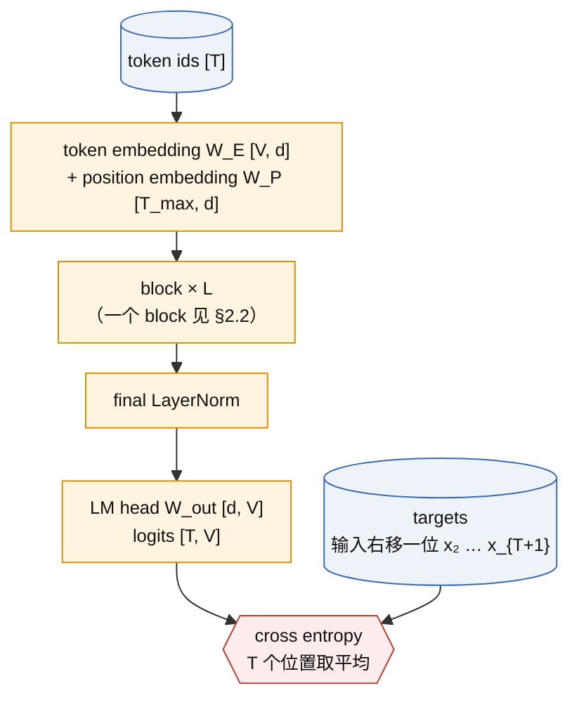
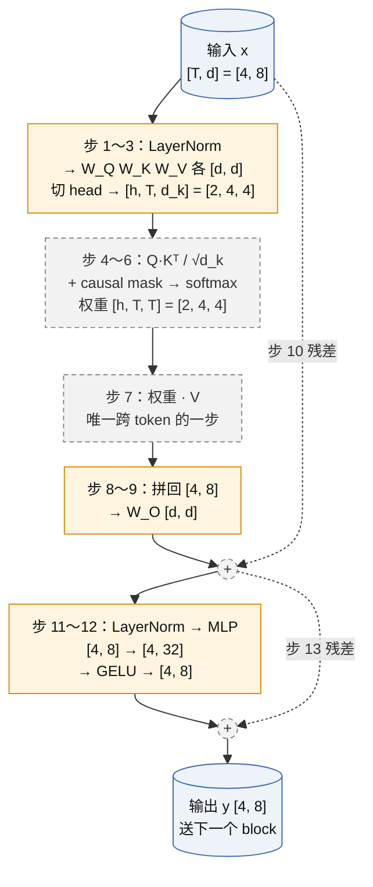
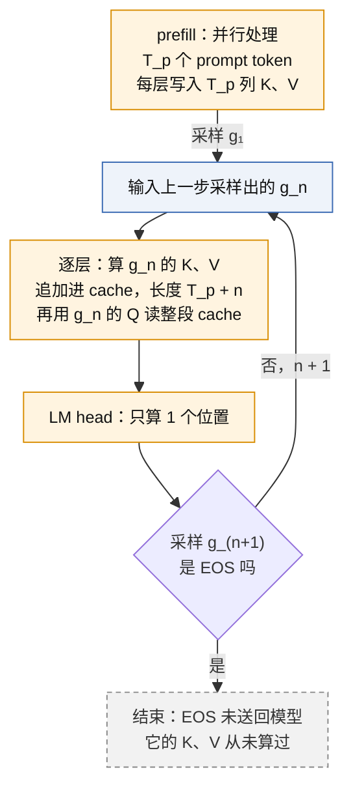
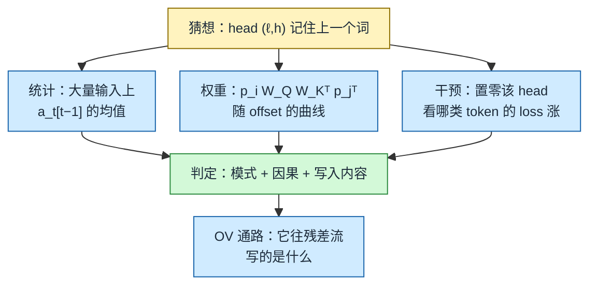
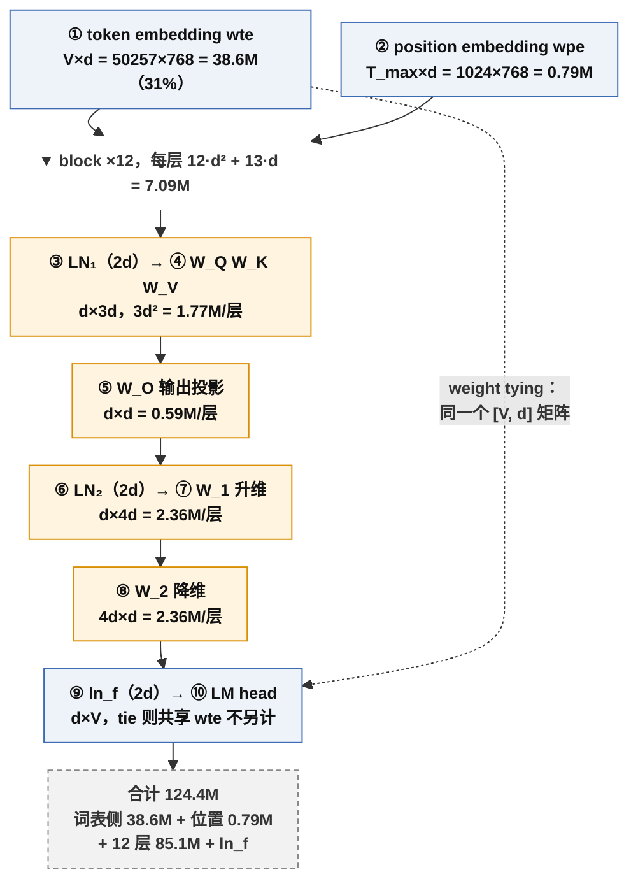
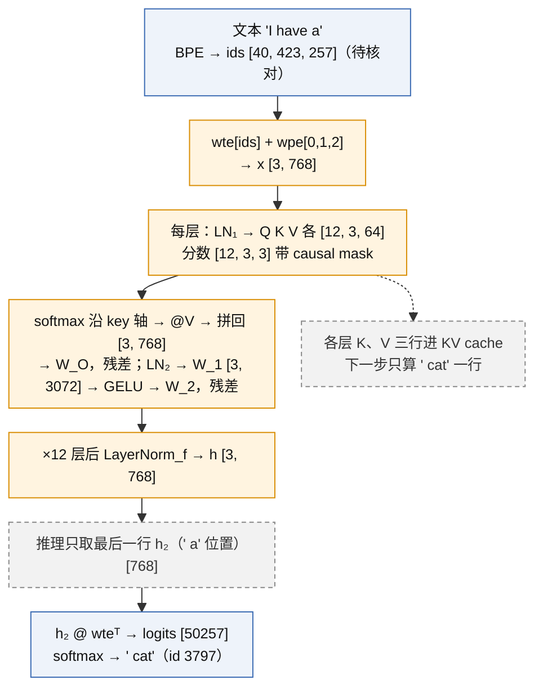

# Transformer decoder 与 next-token objective

一句话定义：把一段 token 序列送进一叠"带 causal mask 的自注意力 + MLP"块，在每个位置预测下一个 token，用交叉熵训练；这是 GPT 全系列共用的底座。

> [!success] Public algorithm
> Transformer 结构（Attention Is All You Need，2017，**非 OpenAI**，前置）与 decoder-only 语言模型的训练目标（GPT-1 论文，2018）都在论文中完整公开，含公式与超参数。

> [!info] Public system behavior
> 无。本卡只涉及论文级算法。

> [!question] Inference
> 参数量近似公式 $N \approx 12 L d^2$ 与 LM head 算力占比是本卡自己的推导，不是论文结论；"MLP 存储事实知识"来自非 OpenAI 的解释性研究，属推断。

> [!danger] Unknown
> GPT-1 的架构、数据集（BooksCorpus）和超参数均已公开。GPT-4 及之后的层数、宽度、是否 weight tying、交叉熵 kernel 实现均未公开，不属于本卡范围。

**本卡结构**：§1～§10 是十个 lens；§11 是学习过程中的追问，前四节按"注意力内部 / MLP / LM head 与词表 / 对照"归档，之后按日期追加；末尾是实验、误解与掌握记录。KV cache 集中在 §5，参数量集中在 §6。

## 1. 承接的瓶颈

上一代是 RNN / LSTM 语言模型（非 OpenAI），它的问题是：

- 序列必须逐个 token 顺序计算，无法在时间维度并行，训练慢；
- 长程依赖靠隐状态一路传递，距离一远信息就衰减；
- 每个 NLP 任务各训一个专用模型，表征无法共享，标注数据稀缺时效果差。

Transformer 用注意力让任意两个位置直接连线，一次前向并行处理整段序列；decoder-only 加 next-token 目标，则让"无标注文本"本身成为训练信号，为 [[A2-sentiment-neuron-gpt-1]] 的 pretrain + fine-tune 铺路。

## 2. 核心思想

自顶向下三层：整个模型 → 一个 block → block 里的两种动作。

### 2.1 整个模型：从 token id 到 loss



入口与出口各有一张"词表 × 宽度"的矩阵，索引同一个词表：

| 记号 | 代码里 | shape | 位置 | 用法 |
|---|---|---|---|---|
| W_E | `self.wte` | [V, d] | 入口 | 查表：第 v 行是 token v 的向量 |
| W_P | `self.wpe` | [T_max, d] | 入口 | 查表：第 t 行是位置 t 的向量，只加一次 |
| W_out | `self.lm_head` | [d, V] | 出口 | 点积：第 v 列是 token v 的打分模板 |

GPT-1、GPT-2 做 weight tying：W_out = W_Eᵀ，同一个张量（`lm_head.weight = wte.weight`），没有额外映射。详见 §11.3。

### 2.2 一个 decoder block（B=1，T=4，d=8，h=2）



橙色是有参数的步骤，灰色虚线是无参数的运算。

注：图中是 GPT-2 之后常用的 pre-LN 写法；原始 Transformer 与 GPT-1 是 post-LN（先残差再 LayerNorm）。子层顺序相同。

**逐步 shape 表**（T=4，d=8，h=2，d_k=4，MLP 中间 32；batch 维省略）

最后一列标 KV cache：<mark style="background:#CFE0F5">蓝底 = 写入 cache</mark>，<mark style="background:#FFE4B3">橙底 = 读取 cache</mark>，空白 = 与 cache 无关。只有 K、V 被缓存，Q 不缓存。

| 步   | 运算                         | shape 变化                           | 参数                | 这一步在做什么                                                                           | KV cache                                                                                  |
| --- | -------------------------- | ---------------------------------- | ----------------- | --------------------------------------------------------------------------------- | ----------------------------------------------------------------------------------------- |
| 0   | 输入 x                       | [4, 8]                             | 无                 | 4 个 token，每个 8 维                                                                  |                                                                                           |
| 1   | LayerNorm                  | [4, 8] → [4, 8]                    | γ, β 各 [8]        | 每行归一化到均值 0、方差 1 再缩放平移；逐 token，不混 token；作用是数值稳定                                    |                                                                                           |
| 2   | Q = xW_Q，K = xW_K，V = xW_V | [4, 8] @ [8, 8] → [4, 8]，三次        | 3 × [8, 8]        | 每个 token 独立生成三个角色：Q "我在找什么"，K "我有什么可被找到"，V "被找到后我给出什么"                            | <mark style="background:#CFE0F5">K、V 在这里算出</mark>；Q 用完即弃                                  |
| 3   | 切 head                     | [4, 8] → [4, 2, 4] → [2, 4, 4]     | 无                 | 沿特征维切成 h 段，每个 head 在自己的 d_k 维子空间找关系                                               | <mark style="background:#CFE0F5">K、V 以 [h, T, d_k] 形状追加进本层 cache</mark>（decode 时每步追加 1 列） |
| 4   | 打分 S = QKᵀ / √d_k          | [2, 4, 4] @ [2, 4, 4]ᵀ → [2, 4, 4] | 无                 | S[h, i, j] = token i 的 query 与 token j 的 key 的点积，"i 有多想看 j"；除以 √d_k 防止 softmax 饱和 | <mark style="background:#FFE4B3">读全部旧 K</mark>：新 token 的 Q 乘 cache 里 T_cur 个 K            |
| 5   | 加 causal mask              | [2, 4, 4] + [4, 4] 广播              | 无                 | j > i 处加 −∞，禁止看未来                                                                 | decode 时新 token 在最后一行，天然只看过去，可省略 mask                                                     |
| 6   | softmax（最后一维）              | [2, 4, 4] → [2, 4, 4]              | 无                 | 每行和为 1，被 mask 的项恰好为 0；第 i 行 = "token i 从每个 j ≤ i 各读多少"                            |                                                                                           |
| 7   | 加权求和 A·V                   | [2, 4, 4] @ [2, 4, 4] → [2, 4, 4]  | 无                 | 第 i 行 = 可见 token 的 value 按权重平均。**唯一跨 token 搬运信息的一步**                              | <mark style="background:#FFE4B3">读全部旧 V</mark>：权重乘 cache 里 T_cur 个 V                      |
| 8   | 合并 head                    | [2, 4, 4] → [4, 2, 4] → [4, 8]     | 无                 | 拼回 d 维                                                                            |                                                                                           |
| 9   | W_O                        | [4, 8] @ [8, 8] → [4, 8]           | [8, 8]            | 让不同 head 的通道互相混合（逐 token）                                                         |                                                                                           |
| 10  | 残差 x + attn                | [4, 8]                             | 无                 | 保留原始信息，梯度直通                                                                       |                                                                                           |
| 11  | LayerNorm                  | [4, 8] → [4, 8]                    | γ, β 各 [8]        | 同步 1                                                                              |                                                                                           |
| 12  | MLP：W_1 → GELU → W_2       | [4, 8] → [4, 32] → [4, 8]          | [8, 32] + [32, 8] | 逐 token 非线性加工，参数占 block 的 2/3                                                     |                                                                                           |
| 13  | 残差                         | [4, 8]                             | 无                 | 输出 y，形状与输入相同，所以可以无限叠                                                              |                                                                                           |

参数核对：注意力 4 × 8² = 256，MLP 8 × 32 + 32 × 8 = 512，合计 768 = 12 d²，即 §6 的 $12 L d^2$（忽略 bias 与 LayerNorm）。

KV cache 存什么、何时读写，见 §5.1～§5.2。

### 2.3 causal mask（T=4）

行 = 当前位置 query，列 = 被看的位置 key。1 表示允许 attend，0 表示置 −∞ 后 softmax 变成 0。

| q \ k | 1 | 2 | 3 | 4 |
|---|---|---|---|---|
| 1 | 1 | 0 | 0 | 0 |
| 2 | 1 | 1 | 0 | 0 |
| 3 | 1 | 1 | 1 | 0 |
| 4 | 1 | 1 | 1 | 1 |

下三角结构保证位置 t 的输出只依赖 $x_{\le t}$，它对 $x_{t+1}$ 的预测在训练时没有偷看答案，一次前向就能同时得到 T 个合法的预测。mask 只需加在步 5，因为其余步骤本来就不跨 token。

### 2.4 两种物理动作

block 的 13 步只有两类：

| 动作 | 步骤 | 参数量 | 算力随什么涨 | 决定什么 |
|---|---|---|---|---|
| **沿 token 维搬运** | 4～7（注意力核心） | 几乎没有 | T² | 看谁、拿多少 |
| **逐 token 加工** | 1、2、3、8、9、10、11、12、13 | 约 12·L·d² 的全部 | T（线性） | 看到之后算什么 |

逐 token 的步骤等价于"对每个 token 跑同一个函数"的 for 循环，token 共用参数；跨 token 的只有步 4 和步 7。残差连接让每个 token 的 d 维向量像一条总线穿过 L 个 block，每层只加增量，不替换。

这个图景在后面反复出现：

- [[A4-scaling-laws]]：参数几乎全在"加工"里，算力却有一部分随 T² 涨，"模型变大"和"上下文变长"是两个成本轴；
- [[D3-codex-agent-loop-compaction]]：搬运要保留全部旧 token 的 K、V（KV cache），这是长上下文吃显存的根源；
- [[D4-gpt-oss-architecture]]：MoE 只把"加工"那一步换成多个专家，"搬运"不动。

## 3. 目标函数与数据

自注意力（Vaswani et al. 2017，非 OpenAI）：

$$
\operatorname{Attention}(Q, K, V) = \operatorname{softmax}\!\left(\frac{QK^\top}{\sqrt{d_k}} + M\right)V,
\qquad
M_{ij} = \begin{cases} 0 & j \le i \\ -\infty & j > i \end{cases}
$$

语言模型目标（GPT-1 论文式 (1)）：

$$
\mathcal{L}_1(\mathcal{U}) = -\sum_{i} \log P(u_i \mid u_{i-k}, \ldots, u_{i-1}; \Theta)
$$

写成每个位置的交叉熵：

$$
\mathcal{L}(\theta) = -\frac{1}{T}\sum_{t=1}^{T} \log \operatorname{softmax}(z_t)_{x_{t+1}},
\qquad z_t = h_t W_{\text{out}} \in \mathbb{R}^{V}
$$

符号说明：

| 记号 | 含义 | 出现在流程的哪一步 |
|---|---|---|
| $u_i$ / $x_t$ | 第 i 个 token | 输入数据 |
| $k$ | 上下文窗口长度（GPT-1 为 512） | 决定 W_P 的行数 |
| $\Theta$ / $\theta$ | 全部可训练参数 | 每步反向传播更新 |
| $Q, K, V$ | query、key、value 矩阵，各 $[T, d_k]$ | block 内线性投影后 |
| $d_k = d / h$ | 每个 head 的维度 | 切 head 时 |
| $M$ | causal mask | softmax 之前 |
| $h_t$ | 位置 t 的最终隐状态，长度 d | final LayerNorm 之后 |
| $z_t$ | 位置 t 的 logits，长度 V | LM head 之后 |
| $V$ | 词表大小 | W_E 与 W_out 的一维 |

数据：GPT-1 用 BooksCorpus（约 7000 本书），无任何标注；训练信号完全来自"下一个 token 是什么"。

## 4. 训练循环

1. 从语料中切一段长度 T+1 的 token；输入取前 T 个，target 取后 T 个（右移一位）；
2. 一次前向：embedding → L 个 block → LM head，得到 [T, V] 的 logits；
3. 对 T 个位置同时算交叉熵取平均（teacher forcing：每个位置的输入都是真实前缀，不是模型自己刚生成的）；
4. 反向传播，AdamW 一步更新；
5. 重复。没有第二阶段，没有人工标签。

## 5. 推理行为

训练是并行的，推理是自回归的：给定前缀前向一次，取最后一个位置的 logits 采样一个 token，拼回前缀再前向。分两个阶段：

| 阶段 | 主干 | LM head |
|---|---|---|
| 训练 | 全部 B·T 位置 | 全部 B·T 位置 |
| prefill（T_p 个 prompt token） | T_p 个位置，建 KV cache | 1 个位置 |
| decode（每生成 1 个 token） | 1 个位置 + 读 KV cache | 1 个位置 |

### 5.1 KV cache 存什么

- **每层一份，存投影并切好 head 的 K、V。** 即 §2.2 步 2～3 的产物，形状 [h, T_cur, d_k]；步 4 读 K，步 7 读 V，其余步骤对新 token 只算一次，不存也不读。Q 只在本步用一次，不缓存。
- **K、V 是前缀的充分统计量。** 注意力是唯一跨 token 的步骤，它从旧 token 那里拿的全部信息就是 K、V；存下它们，旧 token 的其余一切都可以丢。也可以只缓存每层的 x 再临时投影，显存更小但每步多 2·d²·T_cur 的重投影；主流实现选择缓存 K、V。
- **索引是位置，不是 token id。** cache 按序列位置 0 … T_cur−1 排列。同一个 token（比如 "the"）出现在位置 3 和位置 50，K、V 完全不同，因为它们混入了各自的上下文和位置信息。
- **大小。**

```text
每层 cache：K [B, h, T_cur, d_k]，V [B, h, T_cur, d_k]，T_cur = T_p + 已生成数
总大小 ≈ 2 × L × T_cur × d × 每元素字节数（每条序列）
GPT-2 small（L=12, d=768，bf16）：每 token 约 2×12×768×2 B ≈ 37 KB；T_cur = 4k 时约 150 MB
```

这就是长上下文和多并发时显存的主要消耗，也是 [[D3-codex-agent-loop-compaction]] 里 compaction 要压缩的对象。

### 5.2 一步 decode 的时序



cache 在 decode 阶段持续增长，而且在 token 被**吃进去**的那次前向里更新，不是在它被采样出来之后：一个 token 的 K、V 进入 cache 的时刻比它被采样出来晚一步，相位差一。更新发生在同一次前向内部、逐层进行（第 ℓ 层写入后紧接着第 ℓ 层读取），不是前向结束后统一写。

### 5.3 省的是整个前缀的重新前向

一个 token 在一层算 K、V 只要 2·d² 次乘加，确实不大。但第 ℓ 层的 K、V 依赖该 token 在第 ℓ 层的输入 x，而 x 又依赖第 ℓ−1 层对全部 token 的注意力，一路追到底层。没有 cache，要得到旧 token 在每一层的 K、V，就得把旧 token 从 embedding 开始重跑全部 L 层，每个旧 token 代价 12·L·d²。于是第 n 步 decode 要付 n × 12·L·d²，N 步总量 O(N²)；有 cache 后每步只算新 token 那一份，总量 O(N)。

```text
GPT-2 small，前缀 1000 token，生成第 1000 个 token 这一步：
  无 cache：1000 × 85M ≈ 85G 次乘加
  有 cache：     1 × 85M + 读 12 层 × 2 × 1000 × 768 ≈ 85M + 18M
```

### 5.4 训练不需要 KV cache

训练时 T 个位置一次前向同时算完，每个位置的 K、V 在这一步算出并立刻被同一步的注意力用掉，没有"下一步再用"的需求。autograd 把它们作为激活值保留到反向传播，但那是单步内的事，不跨步。例外是 RLHF / 推理 RL 的采样阶段（[[B3-instructgpt-chatgpt]]、[[C2-o1-rl-on-cot]]）：生成 rollout 时用 cache，随后的梯度更新不用。

### 5.5 多轮对话与 prefix caching

对话被序列化成一条长序列：system → user₁ → assistant₁ → user₂ → …。API 是无状态的，每个新请求原则上要把整段历史重新 prefill。但 causal 结构保证位置 i 的 K、V 只依赖 token ≤ i，所以**只要前缀 token 序列逐位相同，它的 K、V 就逐位相同，可以复用**。实现上把 cache 按前缀分块存起来，用前缀 token 序列（的哈希）做 key，新请求命中多长前缀就跳过多长 prefill。任何一处改动（哪怕一个字）会让从那一位开始的全部 cache 失效，所以 system prompt 要放最前、动态内容放最后。

公开边界：OpenAI API 的 prompt caching 是文档化的 Public system behavior（按前缀命中计费折扣；GPT-5.6 提供显式 cache breakpoint，见 [[D2-function-calling-deep-research]]）；服务端如何存储、淘汰和跨机器共享 cache 未公开。

### 5.6 LM head 的代价

按每个生成 token 计是 d·V，与训练一样，没有省。省的是 prefill 阶段前 T_p − 1 个位置不用算（下一个 token 已知），以及避免朴素实现每步对整个前缀重算 logits 的 O(N²) 冗余。与主干的占比见 §6。

## 6. Scaling 维度

可放大的量：层数 L、宽度 d、head 数 h、上下文 T、词表 V。

**主干参数量**（推导，忽略 embedding、bias、LayerNorm）：每个 block 有注意力 $4d^2$（W_Q、W_K、W_V、W_O）+ MLP $8d^2$（两层，中间 4d），所以

$$
N \approx 12 L d^2
$$

| 模型 | L | d | h | T | N（公开值） |
|---|---|---|---|---|---|
| GPT-1（2018） | 12 | 768 | 12 | 512 | 117M |
| tiny GPT（E1） | 4 | 128 | 4 | 128 | 0.80M（train.py 打印 801,664） |

GPT-1 代入公式：12 × 12 × 768² ≈ 85M，加上 40478 × 768 ≈ 31M 的 embedding，约 116M，与公开值一致。E1 的 801,664 比 12·4·128² = 786,432 多出 LayerNorm、bias 与共享的 token embedding，逐项拆账和 Kaplan 的"非 embedding"口径见 [[A4-scaling-laws]] §11.3。

**LM head 算力**（推导）：一个 batch 要算 B·T·V 次长度为 d 的点积，即 B·T·V·d 次乘加；主干每 token 约 12·L·d²。

| 配置 | V | d | LM head / token | 主干 / token | 占比 |
|---|---|---|---|---|---|
| E1（L=4） | 65 | 128 | 8.3k | 786k | ≈ 1% |
| GPT-2 small（L=12） | 50257 | 768 | 38.6M | 85M | ≈ 31% |
| 更大模型 | 固定 | 增大 | 随 d 线性 | 随 L·d² | 持续下降 |

LM head 随 V·d 线性增长，主干随 L·d² 增长，所以词表大小对小模型影响大、对大模型影响小。

## 7. 证据

| 主张 | 证据 | 来源 |
|---|---|---|
| 注意力可替代循环结构并大幅并行 | 机器翻译 BLEU 达到 SOTA 且训练成本更低 | Vaswani et al. 2017（非 OpenAI） |
| decoder-only + next-token 预训练可迁移到 12 个 NLU 任务 | GPT-1 论文 9/12 任务 SOTA | GPT-1 论文 Table 2 |
| 层数越多迁移越好 | GPT-1 论文 Fig. 2 左：转移的层数与下游精度单调关系 | GPT-1 论文 §5 |
| 随机初始化时 loss ≈ ln V | E1 smoke：V=65，loss 4.22 vs ln 65 = 4.17 | [[E1-tiny-gpt]] |

## 8. 局限

- 注意力对 T 是 $O(T^2)$ 的计算与显存，上下文长度受限（GPT-1 为 512）；
- 位置由可学习的 position embedding 编码，无法外推到训练时没见过的长度；
- 目标只是拟合语料分布，不区分"正确"与"常见"，这一点到 [[B3-instructgpt-chatgpt]] 才由 RLHF 处理。

## 9. 后续影响

直接影响 [[A2-sentiment-neuron-gpt-1]]：GPT-1 把这个 decoder 当作预训练底座，再加任务专用的输入变换和 fine-tune。此后 [[A3-gpt-2-zero-shot]]、[[A5-gpt-3-in-context-learning]] 都只改规模和使用方式，不改这个结构与目标。

## 10. 与相关方法的区别

| 维度 | decoder-only（GPT） | encoder-decoder（原始 Transformer） | encoder-only（BERT，非 OpenAI，对照） |
|---|---|---|---|
| mask | causal 下三角 | encoder 无 mask，decoder causal + cross-attn | 无 mask，双向 |
| 训练目标 | next-token | 序列到序列 | masked token 还原 |
| 天然会生成吗 | 是 | 是 | 否 |
| 一次前向的监督信号数 | T 个 | 目标序列长度 | 被 mask 的 15% |

## 11. 追问与澄清

11.1～11.4 是 2026-09-13～17 的追问按主题归档，之后按日期追加。每条先给结论，再给依据。

### 11.1 注意力内部：head 是怎么切、怎么合的

**切 head 沿特征维切 Q、K、V 三者，不沿 token 维切。** V 是 [4, 8]，head 0 拿左 4 列，head 1 拿右 4 列：

```text
V = [ v1_0 v1_1 v1_2 v1_3 | v1_4 v1_5 v1_6 v1_7 ]   ← token 1
    [ v2_0 v2_1 v2_2 v2_3 | v2_4 v2_5 v2_6 v2_7 ]   ← token 2
    [ v3_0 v3_1 v3_2 v3_3 | v3_4 v3_5 v3_6 v3_7 ]   ← token 3
    [ v4_0 v4_1 v4_2 v4_3 | v4_4 v4_5 v4_6 v4_7 ]   ← token 4
           head 0 (4 列)        head 1 (4 列)
```

每个 head 仍看到全部 token，只是每个 token 只给它 d_k 维。两种等价写法：先算 x @ W_V 再 reshape（代码常见）；或把 W_V 视为 h 个 [d, d_k] 拼接，每个 head 各自投影（论文写法）。不能沿 token 切，否则某个 head 看不到部分位置。

**head 之间零交流。** 步 4 是沿 head 维的批量矩阵乘：head 0 的 Q 只乘 head 0 的 K，得到互不相干的 h 张 [T, T] 分数表；步 5～7 也各自在本 head 内完成。多头注意力等价于 h 个独立的小注意力并联。

**W_O 是唯一让 head 相遇的地方。** 步 8 拼接后每个 token 是 [a0 a1 a2 a3 | b0 b1 b2 b3]，W_O 输出的每一维都是这 8 个数的加权和：

```text
out_i[k] = a0·W[0,k] + … + a3·W[3,k] + b0·W[4,k] + … + b3·W[7,k]
```

等价于 `out_i = head0_i @ W_O⁰ + head1_i @ W_O¹`，"对 head 求和"就是混合。没有 W_O 的话，残差流的通道会被绑死在某个 head 上。W_O 仍是逐 token 的，混的是同一 token 内的通道。

### 11.2 MLP：为什么要逐 token 的非线性加工

三层理由，前两条是算法层面，第三条是解释性研究的推断。

1. **没有它，block 几乎是线性的。** 注意力输出 = A·V，V = xW_V，对 x 而言除了 A 里的 softmax 之外全是线性映射；只叠注意力无法对搬来的信息做"计算"（比如判断两个特征是否同时出现）。GELU 提供逐 token 的非线性。
2. **加工不跨 token，是最便宜的加非线性方式。** 成本随 T 线性、可完全并行（§2.4 的"搬运 / 加工"分工）。
3. **容量在这里。** 先升到 4d 再降回 d，参数占 block 的 2/3（§6）。解释性研究（Geva et al. 2021 等，非 OpenAI，推断）把 MLP 看成 key–value 记忆：W_1 的列是模式检测器，GELU 后只有被触发的模式留下，W_2 的对应行把关联内容写回残差流。"事实性知识主要在 MLP"是这类研究的推断，不是 GPT 论文的结论。

可验证：E1 去掉 MLP 只留注意力，同参数量下对比 loss。

### 11.3 LM head 与词表

**注意力分数不是 logits。** 模型里有两处 softmax：

| | 注意力分数（步 4） | logits（LM head 输出） |
|---|---|---|
| shape | [B, h, T, T] | [B, T, V] |
| 含义 | token i 对 token j 的相似度 | 位置 t 对词表每个 token 的打分 |
| softmax 沿哪一维 | key 位置 j，长度 T | 词表，长度 V |
| softmax 后 | 注意力权重，用来加权 V | 下一个 token 的概率分布 |
| loss 直接作用吗 | 否，中间量 | 是，交叉熵算在这里 |
| 出现次数 | 每层每 head 一张 | 整个模型最后一次 |

混淆的后果是以为 loss 直接训练注意力权重；实际上梯度先落在 logits 上，经 W_O、V、softmax 反传才到注意力分数，注意力模式是间接学出来的。E1 填空时把 logits 用 d 而非 V 摊平，就是把这两个轴混了。

**logit 是隐状态与词向量的点积。** `z_t[v] = h_t · W_out[:, v]`，一次 [B·T, d] @ [d, V] 矩阵乘得到全部位置的 logits。tie 时 W_out = W_Eᵀ，logit 就是"当前位置的向量"与"候选词 embedding"的相似度；代价是最后一层的 h_t 必须落到与输入 embedding 同一空间，由最后一个 block 和 final LayerNorm 完成适配。后来许多模型不 tie；OpenAI 闭源模型未知，gpt-oss 配置待 D4 核对。

**分母 Z = Σ exp(z_v) 用精确 softmax，不做近似。** 工程上解决四件事：

| 问题 | 做法 | 公开边界 |
|---|---|---|
| 数值溢出 | log-sum-exp：`log Z = m + log Σ exp(z_v − m)`，损失写成 `log Z − z_target` | 通用数值方法 |
| 算力 | 稠密矩阵乘，占比见 §6，最多三成 | 从公开超参数推算 |
| 显存 | logits、概率、梯度三者都是 [B·T, V]，大词表下比模型激活值还大（16k token × 128k 词表 fp32 ≈ 8 GB/份） | 见下 |
| 多卡 | 词表切到多张 GPU，各算局部 max 与局部和，all-reduce 两个标量 | Megatron-LM（NVIDIA，非 OpenAI） |

显存分四层解决：micro-batch + 梯度累积（全局 batch 从不一次物化）；bf16 存 logits、fp32 累加；反向重算不存概率（前向只留 log Z 与 target logit，反向用 `p_v − 1[v=target]` 重建梯度，梯度需要全部 V 个概率，所以只能重算不能只存一项）；沿 V 和 B·T 双向分块 + 在线 log-sum-exp（`m = max(m₁, m₂)`，`l = l₁·e^{m₁−m} + l₂·e^{m₂−m}`，与 FlashAttention 同一技巧，把 LM head 显存从 O(B·T·V) 降到 O(B·T + chunk)）。融合交叉熵 kernel（Liger、Apple Cut Cross-Entropy）均为非 OpenAI 公开实现；OpenAI 训练栈未公开。

历史上的近似方法（hierarchical / sampled softmax、NCE、adaptive softmax）是 RNN 时代算力不足的产物，现代 LLM 预训练不用。

### 11.4 对照：head 切分与 token mixer（MLP-Mixer、MetaFormer，非 OpenAI）

MetaFormer 把 block 抽象成 token mixer（沿 token 维混合）+ channel mixer（逐 token 加工），与 §2.4 的两种动作一一对应。切 head 在这个框架里是对通道分组：h 组，每组 d_k 通道共用一个 [T, T] 混合矩阵。

| 方法 | 混合矩阵 [T, T] 从哪来 | 通道分组 | 变长 / causal |
|---|---|---|---|
| 多头注意力 | 输入算出 softmax(QKᵀ)，每 head 一个，每样本不同 | h 组 | 能，加 mask 即 causal |
| MLP-Mixer token-mixing | 学出的固定参数，与输入无关 | 全通道共用 | 不能，T 写死在参数形状里 |
| PoolFormer 池化 | 固定平均池化，无参数 | 全通道共用 | 能变长，只有局部邻域 |

结论：head 切分只是分组 token mixer；注意力独特之处是混合矩阵由输入动态生成，这带来任意长度与天然 causal，也带来 O(T²)。只作机制对照，不用于推断 OpenAI 实现。

### 11.5 训练时为什么随机采样窗口，会不会重复（2026-09-18 追问）

E1 的 `get_batch` 每步在语料里随机抽 64 个起点、各截 T=128，起点不对齐、窗口任意重叠。2000 步 × 64 × 128 ≈ 1640 万 token，约等于 16 个 epoch，每个字符平均被看 16 次；起点完全相同的窗口约占 6%，与顺序跑多个 epoch 的重复本质相同。

故意随机的三个理由：相邻文本高度相关，顺序取 batch 等于有效 batch 变小、梯度噪声大；随机起点让每个字符在 0～T−1 每个位置都出现，position embedding 不会绑定"第 t 位常出现什么"；代码最短（nanoGPT 写法）。代价是不保证覆盖、没有 epoch 概念。

对照：数据小时（sft.py 的 100 条标注）改用打乱遍历、耗尽再打乱，避免放回抽样造成的样本曝光不均。大规模训练里重复是真实决策：GPT-3 论文表 2.2 给出 300B token 下各数据源的 epoch 数（Common Crawl 0.44、Wikipedia 3.4、Books1 1.9），也就是高质量的小数据源故意多看几遍，大而杂的数据源看不到一遍，用采样权重而不是数据量决定每个来源的曝光度，见 [[A5-gpt-3-in-context-learning]]。

### 11.6 loss 的单位：nat、bit 与困惑度（2026-09-24 追问两次）

**nat。** 单个位置的交叉熵是正确 token 的"惊讶值" $-\ln p_\theta(u_t\mid u_{<t})$：押满概率为 0，押 $1/e\approx37\%$ 为 1 nat，押 0 为无穷。用自然对数所以单位是 nat（PyTorch `cross_entropy` 默认 ln）。"per token" 指对 batch 内全部 $B\times T$ 个位置取平均。

**bit 与困惑度是同一个数的三种刻度。** $1\ \text{nat} = 1/\ln 2 \approx 1.443\ \text{bit}$，猜一次公平硬币是 1 bit = 0.693 nat。

$$
\text{PPL} = e^{L_\text{nats}} = 2^{L_\text{bits}}
$$

- 困惑度读法：loss 为 $L$ 等价于每步在 $e^{L}$ 个候选里均匀瞎猜；
- bit 读法：平均要问 $L_\text{bits}$ 个"是/否"问题才能确定下一个 token，每问把候选砍半；
- 压缩读法（香农信源编码定理）：用模型概率做算术编码，每个 token 的平均码长就是 $L_\text{bits}$，所以 bits/char 就是"压缩后每字符占几位"。

| E1 读数 | nats | bits | PPL | 读法 |
|---|---:|---:|---:|---|
| 随机初始化 | 4.22 | 6.09 | 68 | ≈ $\ln 65$，65 个字符均匀，约 6 问 |
| 100 步 val | 2.645 | 3.82 | 14 | |
| 目标 | 1.5 | 2.16 | 4.5 | 每字符约 2.16 位 |

推论：不同词表的 loss 不能直接比。字符级 1.5 与 GPT-2 BPE 词表（$\ln 50257\approx10.8$ 起步）量纲相同，但每个 token 承载的文本长度不同，比较要换成 bits/byte，理由正是上面的压缩读法。图解页：https://claude.ai/artifact/Psi2yZUrFa4kVJccehLfhh

**骰子读法（2026-09-28 ELI5 追问）。** 困惑度 = 模型手里骰子的面数：单个词的等效面数是 $1/p$，整句是各词面数的几何平均（惊讶值 $-\ln p$ 取算术平均再取 $e$ 次方），所以一个押 0.01 的词就能把整句拉高；低 PPL 只说明像训练文本，不等于回答好，RLHF 后 PPL 常升高（见 [[B3-instructgpt-chatgpt]]）。ELI5 图板（含可拖动概率的骰子演示与 E1 / GPT-2 词表尺子）：https://claude.ai/artifact/KYwj7isSTGng4vsLbwBdYz
### 11.7 一个 token 的前向计算碰到了模型的每个参数吗（2026-09-28 追问）

分三段看，以 GPT-2 small（$V=50257,\ d=768,\ L=12$）为例：

| 参数块 | 总量 | 单 token 前向碰到 |
|---|---|---|
| token embedding $W_e$ | 38.6M | 进门查表只取 1 行（768）；出门 LM head 与 $W_e$ 绑定，全部 38.6M 参与 logits 乘法 |
| 位置 embedding $W_p$ | 0.8M | 1 行，其余 1,023 行不碰 |
| 12 层 block | 85.0M | 全部：每层 $W_Q,W_K,W_V,W_O$、MLP 两个矩阵、两个 LayerNorm 都乘过它 |

结论：embedding 层是查表不是乘法，单 token 只用一行；进入 block 后每个稠密参数都参与；输出层因权重绑定又把整张 $W_e$ 乘一遍。所以一次前向几乎碰到全部 124M 参数，只有位置表的其他行例外。注意力读前面 token 的 K、V，但那些由同一批权重算出，不引入新参数。训练时的对偶说法：参与运算的参数才有梯度；$W_e$ 进门方向只有 batch 里出现过的行有梯度，出门方向 softmax 对全词表求导，所有行都被更新（错误行被压低）。例外：MoE（如 gpt-oss）每层只激活少数专家，"中间碰全部"不成立，见 [[D4-gpt-oss-architecture]]。ELI5 图板：https://claude.ai/artifact/RvHqmEJq4pzTaAbv55BnJ2 。相关：[[A4-scaling-laws]] §11.3 的参数拆账。

### 11.8 一层注意力里 softmax 做几次：$H \times T$（2026-09-28 追问）

问题：序列长 $T$、$H$ 个 head、每 head $D$ 维，softmax 的次数是不是 $H \times T$？

**是。** 每个 head 的分数表 $QK^\top/\sqrt{D}$ 是 $[T, T]$，softmax 沿最后一维按行做，一行一次，所以每 head $T$ 次，$H$ 个 head 互不共用分数表，一层共 $H \times T$ 次；每次的输入长度是 $T$（该 query 对全部 key 的分数）。三个量分开记账：

| 量 | 值 | 谁影响它 |
|---|---|---|
| softmax 次数（一层） | $H\cdot T$ | 只有 $H$、$T$ |
| 每次 softmax 的长度 | $T$（causal 下第 $i$ 行只有 $i$ 个有效项） | $T$ |
| 打分乘法数 | $H\cdot T^2\cdot D$ | $D$ 只进这里 |

$D$ 决定一格分数（一个 $D$ 维点积）多贵，不改变格数与行数。causal mask 不改变次数，只把第 $i$ 行右侧填 $-\infty$，权重变 0，指数运算总数从 $H T^2$ 降到 $H\,T(T+1)/2$。整模型再乘层数 $L$。推理带 KV cache 时生成第 $t$ 个新 token 只算新增的一行：每层 $H$ 次，每次长 $t$。代码里 `softmax(scores, dim=-1)` 对 `[B, H, T, T]` 只调用一次，内部即 $B\cdot H\cdot T$ 行各做一次。ELI5 图板：https://claude.ai/artifact/99E9zJgrQDsNnMLvgKyoDN 。相关：§11.1 的 head 切分，[[A4-scaling-laws]] 的 FLOPs 记账。

### 11.9 为什么训练用自然对数，写 log 为什么要标底（2026-09-28 追问）

**换底只是乘常数。** $\log_b x = \ln x / \ln b$，所以 $L_{\text{bits}} = L_{\text{nats}}/\ln 2$。梯度同比例缩放、方向不变，最优解不变；对 SGD/Adam 以外的差别只相当于学习率乘 $1/\ln 2 \approx 1.44$（Adam 按梯度尺度归一化，几乎无差别）。选底不改变"学什么"，只改变数值读数。

**选 ln 的理由是和 softmax 的 $e$ 配对。** softmax 用 $e^{z}$，交叉熵用 $\ln$ 时两者抵消，对 logit 的梯度最干净：

$$
L = -\ln \frac{e^{z_y}}{\sum_j e^{z_j}} = -z_y + \ln\sum_j e^{z_j},\qquad
\frac{\partial L}{\partial z_j} = p_j - \mathbb{1}[j=y]
$$

若改用 $\log_2$，梯度变成 $(p_j - \mathbb{1}[j=y])/\ln 2$，多一个无意义的常数。数值实现上 $\ln\sum e^{z_j}$ 就是 logsumexp，框架（PyTorch `cross_entropy`、JAX `log_softmax`）都按 ln 实现，loss 单位因此是 nat。

**为什么必须标底：同一个预测，读数不同。** 本节 CE 例题 $p_0 = 0.665$：$-\ln 0.665 = 0.408$ nat，$-\log_2 0.665 = 0.589$ bit，$-\log_{10} 0.665 = 0.177$。报告里的 loss 若不标单位就无法和别人比：Kaplan 等 [[A4-scaling-laws]] 用 nats/token，压缩类基准（GPT-2 论文的 enwik8、text8）报 bits/byte、bits/char。困惑度 $e^{L_\text{nats}} = 2^{L_\text{bits}}$ 与底无关，可作为换算锚点，见 §11.6。

### 11.10 注意力头是不是就是 Q/K/V 向量（2026-10-11 追问）

**不是。head 是一套参数加一次固定计算，Q/K/V 向量是它作用在输入上的中间产物。** 三样东西分开：

| 东西 | 是什么 | 训练后是否随输入变 |
|---|---|---|
| 一个 head | 投影矩阵 $W_Q^i, W_K^i, W_V^i \in \mathbb{R}^{d \times d_k}$，加 $W_O$ 中对应它的 $d_k$ 行，加"打分→softmax→加权和"的固定计算 | 不变 |
| $Q_i, K_i, V_i$ | $x W_Q^i$ 等，形状 $[T, d_k]$，每 token 一行 | 每次输入都变 |
| 注意力权重 | $\mathrm{softmax}(Q_i K_i^\top/\sqrt{d_k})$，形状 $[T, T]$ | 每次输入都变 |

GPT-2 small（$d=768, h=12, d_k=64$）的实际数据流：

```text
x        : [T, 768]
c_attn   : 768 → 2304        Q、K、V 三个投影合成一个 matmul
split    : → Q, K, V 各 [T, 768]
reshape  : [T, 768] → [12, T, 64]   沿特征维切 12 个 head（见 §11.1）
head i   : softmax(Q_i K_iᵀ/√64) V_i → [T, 64]
concat   : → [T, 768]
c_proj   : W_O 768 → 768     head 间唯一混合点
```

代码里没有 head 对象，只有一次 reshape；head 的边界是人为划定的：$W_Q, W_K, W_V$ 的第 $64i \sim 64i+63$ 列加 $W_O$ 的同一段行。理解上常拆成两条通路：$QK$ 通路决定"看谁"（注意力模式），$OV$ 通路决定"看到后往残差流写什么"（提法来自 Anthropic 的 mechanistic interpretability 工作，非 OpenAI，仅作理解框架，不用于推断 OpenAI 内部实现）。

术语注意："Q/K/V 向量"通常指某个 token 在某个 head 下的三个 $d_k$ 维行向量；$Q_i$ 整体是矩阵。ELI5 图板（问题卡/名牌/背包比喻）：https://claude.ai/artifact/Hf8HWThP6TwHa6dDF9g5nu 。相关：§11.1 切分与 $W_O$ 混合，§11.8 softmax 次数。

### 11.11 解码时"追加一行"追加的是什么：分数、权重与 KV cache（2026-10-11 追问）

问题：推理时每生成一个新 token 就追加一行新的分数，这就是注意力分数（也叫注意力权重）？

**基本对，两处收紧。** 其一，分数与权重是前后两个量：$s_t = q_t K_{1:t}^\top/\sqrt{d_k}$ 是 softmax 前的注意力分数（logits），$a_t = \mathrm{softmax}(s_t)$ 是注意力权重，非负且行和为 1。其二，新行是在新 token 作为输入喂回模型那一步算的，算完即用，**缓存的是 $K$、$V$，不是分数行**。

一步解码（已有 $t-1$ 个 token，刚采样出第 $t$ 个），每层每 head：

```text
1. q_t, k_t, v_t = x_t W_Q, x_t W_K, x_t W_V
2. cache ← append(k_t, v_t)                      cache 长度变 t
3. s_t = q_t · [k_1 … k_t]ᵀ / √d_k               长度 t，含自己
4. a_t = softmax(s_t)
5. o_t = Σ_j a_t[j] v_j
6. W_O → MLP → 下一层 … → LM head → 第 t+1 个 token 的分布
```

**旧行不重算的原因是 causal mask。** 第 $j$ 行只依赖 $k_1\ldots k_j$，新来的 $k_t$ 不改变它，所以旧行的分数、权重、输出全部不变；矩阵只长行不长列，KV cache 因此成立：

```text
step 3           step 4
[ s11 ]          [ s11           ]
[ s21 s22 ]      [ s21 s22       ]
[ s31 s32 s33 ]  [ s31 s32 s33   ]   ← 旧行不动
                 [ s41 s42 s43 s44 ] ← 新增一行
```

数量上每生成一个 token 整模型追加 $L \times H$ 行，每行长 $t$，与 §11.8 的推理记账一致。prompt 阶段是 prefill：一次算完 prompt 全部行并填好 cache，之后逐行追加。分数行含 $s_{tt}$（自己对自己），权重中"看自己"的项一般非零。相关：§11.10 head 与 Q/K/V 的区分，[[A3-gpt-2-zero-shot]] 中 E1 的采样代码。

### 11.12 旧的分数行可以丢弃吗：推理状态只剩 KV cache（2026-10-11 追问）

**可以，标准实现从未存过它们。** 第 $\ell$ 层 token $j$ 的权重行唯一用途是算 $o_j^{\ell}$，它经 $W_O$、MLP 成为 $x_j^{\ell+1}$，再乘出 $k_j^{\ell+1}, v_j^{\ell+1}$ 入缓存。这条链在 token $j$ 首次前向时走完，其作用已沉淀进后续各层的 $K, V$。

| 量 | 推理时保留 | 原因 |
|---|---|---|
| 每层每 token 的 $k, v$ | 保留到序列结束 | 后续 query 要与它打分、从它取值 |
| 分数行、权重行 | 当步丢 | 作用已进 $o_j$ |
| $o_j$、MLP 激活、残差 $x_j$ | 当步丢 | 只用于算下一层 |
| 末层末 token 的 logits | 采样后丢 | 只决定下一个 token |

推理状态因此就是 KV cache：每序列 $2 \cdot L \cdot H \cdot d_k \cdot t$ 个数，GPT-2 small 为 $2 \times 12 \times 768 \times t$，fp16 下约 36 KB/token；长上下文大模型的显存瓶颈主要在此。

两个例外与推理无关：训练时 $[T,T]$ 矩阵需留给反向传播（FlashAttention 不物化、反向重算）；可解释性研究导出权重用于观测（HF `output_attentions`）。

对照：丢旧行零代价且精确；"压缩 KV cache"（滑动窗口、attention sink、按重要性驱逐）丢的是 $K, V$ 本身，是有损近似，后续 token 看不到被丢位置。两者丢的对象不同。相关：§11.11 解码时的逐行追加，[[A4-scaling-laws]] 的推理 FLOPs 记账。

### 11.13 权重随输入变，怎么判定一个 head 的作用（2026-10-11 追问）

问题：注意力权重随输入 token 变化，怎么说"某个头负责记住上一个词"？

**权重是激活的性质，"作用"是参数的性质，要用统计或干预从激活里读出来。** 三种办法，合起来才算判定：

1. **大量输入上给假设打分。** 把猜想写成位置规则，统计该 head 放在该位置的权重均值，得到每层每头一个不随输入变的数，画成 $L \times H$ 热力图：

| 假设 | query 位置 $t$ 应看的位置 | 分数 |
|---|---|---|
| 上一个词头 | $t-1$ | $\overline{a_t[t-1]}$ |
| 看自己头 | $t$ | $\overline{a_t[t]}$ |
| 看开头头（attention sink） | $1$ | $\overline{a_t[1]}$ |
| induction 头 | $j+1$，其中 $x_j = x_t$ 为上次出现 | $\overline{a_t[j+1]}$ |

   这里 $L$ 是层数、$H$ 是每层 head 数，热力图一行一层、一列一个 head，格子是该 head 的分数。GPT-2 四尺寸：small $12\times12$、medium $24\times16$、large $36\times20$、XL $48\times25$，$d_k$ 均为 64（2026-10-11 追问）。真正的上一个词头得分常在 0.9 以上。"0.9 / 0.1"的含义（2026-10-11 追问）：对一句话的权重表，取次对角线（query $t$ 看 key $t-1$）上的数求平均，再对几千句话求平均，每个 head 得一个数：

```text
头 A（上一个词头）              头 B（分散）
      小猫  追   球   它        小猫  追   球   它
小猫 [1                ]      [1                ]
追   [.10 [.90]        ]      [.60 [.40]        ]
球   [.05 [.90] .05    ]      [.50  .10 [.40]   ]
它   [.03  .04 [.90] .03]     [.45  .10  .10 [.35]]
次对角线平均 ≈ 0.9            次对角线平均 ≈ 0.1
```

   判定用阈值而非 argmax（2026-10-11 追问）：$s_{\ell,h}$ 接近 1（常用 $\ge 0.7$ 或 $0.9$）才算上一个词头，可能有多个，也可能一个都没有；最大值仅 0.3 说明该模型无干净的上一个词头。分数只证明"看哪"，是必要不充分条件，还需第 3 条的敲除验证。图板第 7 幕：https://claude.ai/artifact/Hf8HWThP6TwHa6dDF9g5nu 。方法来自 Clark et al. 2019（BERT）、Voita et al. 2019（头分类与剪枝），induction 头定义来自 Olsson et al. 2022（Anthropic）。均为非 OpenAI，社区用其在 GPT-2 small 上定位了具体 head。

2. **直接从权重算。** GPT-2 用可学绝对位置向量 $p_i$，head 的位置偏好为 $\mathrm{score}(i,j) = p_i W_Q W_K^\top p_j^\top / \sqrt{d_k}$，画成 offset $= i-j$ 的函数，上一个词头在 offset $=1$ 处有尖峰。这是纯参数性质，内容项 $x$ 只在其上叠加。RoPE 模型中相对位置显式，更易计算。

3. **敲掉看什么坏。** 把该 head 输出置零或均值替换，看 loss 在哪类 token 上涨。敲掉上一个词头，受损的是依赖前一词的预测和后层的 induction 头（它们依赖前一词身份已写入残差流）。这是因果证据，前两种只是相关。

**模式不等于功能。** 注意力模式只回答"看哪"，OV 通路决定"看到后写什么"；两个都看上一个词的 head，一个抄身份供 induction 用，一个可能抄词性。严格说"上一个词头"是对模式的命名。



提醒：多数 head 无干净描述（Voita 等：少数位置/句法/稀有词头，其余可剪）；head 分工由训练决定，换种子可能换 head 承担；以上均对开源权重（GPT-2）成立，OpenAI 闭源模型的 head 作用属 Unknown，不得从行为反推。可选实验：在 E3 的 GPT-2 四尺寸上加 head 探针，算上一个词分数与 induction 分数热力图，核对 Olsson 等"induction 头出现与 ICL 提升同步"的说法，见 [[A5-gpt-3-in-context-learning]]。


### 11.14 LM head 具体是怎样一个组件（2026-10-21 追问，B1 学习中）

E1 里就一行：`self.lm_head = nn.Linear(cfg.n_embd, cfg.vocab_size, bias=False)`，再加 `self.lm_head.weight = self.wte.weight` 与输入 embedding 共享。它是一个 $d \times V$ 的矩阵，没有非线性，不是 block 意义上的"层"。位置：block 堆叠之后、`ln_f` 之后，$h = \mathrm{ln\_f}(x) \in \mathbb{R}^{B\times T\times d}$，$z = hW \in \mathbb{R}^{B\times T\times V}$。

| 模型 | $d$ | $V$ | LM head 参数量 |
|---|---|---|---|
| E1 tiny GPT | 128 | 65 | 8,320（与 wte 共享，只存一份） |
| GPT-2 small | 768 | 50,257 | 3,860 万，占 1.24 亿的 31% |
| GPT-3 175B | 12,288 | 50,257 | 6.2 亿，不到 0.4% |

算什么：位置 $t$ 对候选 token $v$ 的 logit 是 $z_t[v] = h_t \cdot W[v]$，即隐状态与词向量的点积（§11.3）。手算例子（$d=2$，$V=3$）：$h_t=[1,2]$，$W$ 三行 $[1,0],[0,1],[-1,1]$，则 $z=[1,2,1]$，$p=\mathrm{softmax}(z)=[0.21,0.58,0.21]$，正确答案为第一个 token 时 $\mathcal L=-\log 0.21\approx1.55$。

训练时怎么被改：$\partial\mathcal L/\partial z = p - \mathbf 1[\text{target}] = [-0.79,0.58,0.21]$，外积 $h_t$ 就是 $W$ 的梯度：正确词的那一行向 $h_t$ 方向推，其他行反向推；tie 时输入与输出两侧的梯度叠加在同一行上。

同一个 $h_t$ 后面接什么，决定了它在四条线里的角色（这是 [[B1-ppo-human-preferences-2017]] 里提问的来由）：

| 用法 | 乘什么 | 取什么 | 节点 |
|---|---|---|---|
| 预训练 | $d\times V$ 的 LM head | 全部 logit，与数据 token 算交叉熵 | A1 |
| 打分式读法 | 同一个 LM head | 只比较两三个候选 token 的 logit，不改参数 | [[A3-gpt-2-zero-shot]]、[[A5-gpt-3-in-context-learning]]、E3 |
| reward model | 换成 $d\times 1$ 的标量头 | 末位一个数，作 Bradley–Terry 的 reward | [[B1-ppo-human-preferences-2017]] §3.1；[[A2-sentiment-neuron-gpt-1]] 的 $W_y$（$d\times$ 类别数）是近亲 |
| RLHF 策略 | 还是 LM head | 每步的 $V$ 维分布就是 $\pi(a_t\mid s_t)$，采样一个 token 当动作 | [[B1-ppo-human-preferences-2017]] §11.1 |

"把 LM 当策略"不换任何组件；"把 LM 当 reward model"只把这个矩阵换成一列。

#### 全模型参数分区图（2026-10-21 追问）

独立图解页：[Decoder 参数分区图](https://claude.ai/artifact/GmGabuBSj1Aca5xJhwQgNy)（V-27）：按数据流画，每个组件一个节点只标"组件 + 参数量"，无参数的计算（mask、softmax、GELU、残差）也作节点；下面卡内的版本是合并后的 ≤10 层账本版。

GPT-2 small（$V=50{,}257$，$d=768$，$T_{\max}=1024$，$L=12$）的账本，与 [[A4-scaling-laws]] §11.3 的 E1 版本对照。蓝色为词表与位置相关参数，橙色为每层重复的四个权重矩阵（每层 $12d^2$），灰色为 LayerNorm 与 bias 的 $O(d)$ 小量。Kaplan 的非 embedding 参数 $N$ 只数橙色加 ln_f。



| 块 | 部件 | 形状 | 计算式 | GPT-2 small | E1（$V=65$，$d=128$，$L=4$） |
|---|---|---|---|---|---|
| 词表侧 | ① wte | $V\times d$ | $Vd$ | 38.6M | 8,320 |
| 位置侧 | ② wpe | $T_{\max}\times d$ | $T_{\max}d$ | 0.79M | 16,384 |
| block ×L | ③ LN₁、⑥ LN₂、各 bias | 约 $13d$ | | 10K/层 | 1,664/层 |
| block ×L | ④ $W_Q, W_K, W_V$ | $d\times 3d$ | $3d^2$ | 1.77M/层 | 49,152/层 |
| block ×L | ⑤ $W_O$ | $d\times d$ | $d^2$ | 0.59M/层 | 16,384/层 |
| block ×L | ⑦ $W_1$ | $d\times 4d$ | $4d^2$ | 2.36M/层 | 65,536/层 |
| block ×L | ⑧ $W_2$ | $4d\times d$ | $4d^2$ | 2.36M/层 | 65,536/层 |
| 输出侧 | ⑨ ln_f | $2d$ | | 1.5K | 256 |
| 输出侧 | ⑩ LM head | $d\times V$ | $Vd$，tie 则 0 | 0 | 0 |
| 合计 | | | | 124.4M | 818K（`train.py` 减 wpe 后打印 801,664） |

规律：MLP 占一层的 8/12，注意力 4/12；模型变大时 $d$、$L$ 增长而 $V$ 不变，词表侧占比从 GPT-2 small 的 31% 降到 GPT-3 175B 的 0.4%。无参数的部件：causal mask、softmax、$1/\sqrt{d_k}$、GELU、残差相加、KV cache。

### 11.15 "I have a" → " cat"：一次 next-token 推理的张量轨迹（2026-10-21 追问）

独立图解页：[Next-token 推理一步](https://claude.ai/artifact/7c9XT52iZQhCDfJiuQsVg3)（V-28）：页面版把数据张量（圆柱）与参数（方框）分成两种实体，参数从侧边接入；卡内下图是合并后的简版。以 GPT-2 small（$d=768$，12 头 × 64，$V=50{,}257$）为例，$T=3$：



要点：（1）三个位置都算出 logits，位置 0 在预测 " have"、位置 1 在预测 " a"，训练时三行都与下一个 token 算交叉熵（teacher forcing），推理只读最后一行；（2）注意力分数矩阵每头一张 $3\times 3$，上三角为 $-\infty$，第 3 行（' a'）看到全部三个 token；（3）最后一步是 $h_2$ 与 50,257 个词向量各做一次点积（§11.14）；（4）生成 ' cat' 后下一步只对它算新的一行 Q、K、V，K、V 与 cache 里的 3 行拼成 4 行（§11.11、§11.12）。token id 凭记忆写出，待 tiktoken 核对；具体概率未运行。

**$\gamma_f, \beta_f$ 是什么（2026-10-21 追问）。** 末层归一化 `ln_f`（final LayerNorm）的两个可学习向量，各 $d=768$ 维。LayerNorm 对每个位置的 768 维向量先按该向量自身的均值、方差标准化，再逐维乘 $\gamma$ 加 $\beta$：$y = \gamma \odot \frac{x-\mu}{\sqrt{\sigma^2+\epsilon}} + \beta$。$\gamma$ 是每一维的缩放、$\beta$ 是每一维的偏移，让网络能把标准化后的尺度调回需要的范围。每个 block 里有两个 LayerNorm（$\gamma_1,\beta_1$ 在注意力前，$\gamma_2,\beta_2$ 在 MLP 前），`ln_f` 是 12 层之后、LM head 之前的最后一个，GPT-2 的 pre-LN 结构里它保证送进 LM head 的 $h$ 尺度稳定。参数量 $2d=1{,}536$，相对 12·d² 可忽略，但不能省：去掉它 logits 的尺度会随层数漂移。页面 V-28 第 3 版给每个参数节点加了中文名（词嵌入表、位置嵌入表、层归一化、注意力投影、注意力输出投影、MLP 升维 / 降维、末层归一化）。

**ln_f 只需对最后一行做吗（2026-10-21 追问）。** 推理时是。LayerNorm 逐位置独立，行间不交换信息，ln_f 之后没有注意力，所以只对最后一行做 ln_f 与 LM head，结果与先对全部 T 行做再取最后一行相同，高效实现就这么写。训练时每个位置都有交叉熵，ln_f 对全部 T 行做。block 内的 LN₁、LN₂ 不能只做最后一行，因为后面的注意力要读所有位置的 K、V；prefill 阶段全部位置算一遍并存 K、V，之后每个新 token 只算自己那一行（§11.11）。页面 V-28 第 5 版已改成"取最后一行 → ln_f → LM head"的顺序。

**LM head 的参数是不是就是归一化参数（2026-10-21 追问）。** 不是。`ln_f` 的 $\gamma_f,\beta_f$ 是两个 768 维向量（1,536 个数），只把 $h$ 每一行标准化后逐维缩放、偏移，输入输出都是 768 维，不碰词表；LM head 是 $768\times 50{,}257$ 的矩阵（3,860 万个数），把 $h_2$ 与每个词向量做点积得到 logits，768 维变 50,257 维。GPT-2 把它与 wte 共享，所以不另存一份，但它就是那张嵌入表；不共享时要单独多存 3,860 万参数。两者在图上相邻、都在输出侧，归一化只决定送进 LM head 的向量尺度。V-28 页面已把 LM head 补成明确的参数方框并附对照表（§11.3、§11.14）。

**生成 ' cat' 之后再推下一个：是不是逐层建 12 层的 QKV，最后 LM head 一次大矩阵乘，取最大（2026-10-21 追问）。** 基本对，三处修正：（1）只为新 token 算一行 q、k、v（各 12 × 64），k、v 追加进该层 KV cache（3 行 → 4 行），q 用完即弃，前面 token 的 K、V 不重算；没有 cache 时每步要把全部位置重算，总开销随长度平方增长（§11.11、§11.12）。（2）层间严格串行：第 $l$ 层的 q、k、v 来自第 $l-1$ 层输出，第 $l$ 层输出要等本层注意力读完 cache 里的 4 行再过 MLP；只有同一层的 12 个头并行。（3）12 层后取这一行过 `ln_f`，乘 $768\times 50{,}257$ 的共享矩阵得 50,257 个 logit，这是每步最大的一次矩阵乘；"取最大"只是贪心解码，实际系统多按 softmax 概率采样并用 temperature、top-p 截断，GPT-3 论文生成式任务用 beam search。第二步每层尺寸：分数 $12\times 1\times 4$（一行 query 看 4 个 key），其余与第一步同形但只有一行。第一步（prefill）3 行并行并顺便存 cache，之后每步（decode）只算一行。

## 最小示例或实验

对应实验：[[E1-tiny-gpt]]（`experiments/pretraining/tiny_gpt/`）。model.py 的注释按 §2.2 的 13 步标注 shape；两处填空是 causal mask（§2.3）与交叉熵（§3）。

## 常见误解

- "causal mask 是防止信息泄漏"：更准确地说，它让位置 t 的表示只依赖 $x_{\le t}$，从而训练时的 T 个预测在推理时都可复现；
- "fine-tune 的好处是省算力"：核心是无标注数据学到的表征迁移，省算力是副产品；
- 把 softmax 前的 −∞ 理解为"删掉"：矩阵形状不变，只是权重变 0；
- 把 softmax 当 hardmax：e⁰ = 1 不是 0，所有 logit 都有正概率，这正是梯度的来源；
- 把隐状态维 d 和词表维 V 混用：logits 摊平要用 `logits.size(-1)`；
- "生成时 LM head 更便宜"：每个生成 token 的代价与训练相同（§5.6）。

## 我曾经答错的地方

### 2026-09-13 · decoder 结构与 fine-tune 的差异（诊断）
- 题目：说出 decoder block 的子层顺序与 Q/K/V 的 shape；next-token 目标是什么；fine-tune 与从零训练的核心差异。
- 我的答案（记录为摘要，原话未存）：交叉熵加防泄漏的 mask；block 结构与 shape 说不出；fine-tune 的差别是计算量减少。
- 错在哪：目标没写成条件概率形式；不知道 block 子层；把 fine-tune 的核心说成省算力。
- 正确答案：LN → 注意力 → 残差 → LN → MLP → 残差，Q/K/V 各 [B,T,d]，拆头后 [B,H,T,d/H]；目标是 −Σ log P(u_i ∣ u_{<i}; Θ)（§3）；fine-tune 的核心是无标注预训练的表征迁移到标注稀缺的任务（[[A2-sentiment-neuron-gpt-1]]）。

### 2026-09-16 · target 序列与 softmax / CE（4-token 手推作业）
- 题目：给定 4 个 token 的 input，写出 target 序列；对 logits [2,0,0,2,0] 算 softmax 与正确类的交叉熵。
- 我的答案：target = 4 2 3 0；softmax = [0.5, 0, 0, 0.5, 0]，CE = 0.3466（未写信心）。
- 错在哪：target 当成重排，不是 input 右移一位；softmax 当成只保留最大值的 hardmax，忘了 e⁰ = 1。
- 正确答案：target = [4, 1, 3, 0]；softmax = [0.416, 0.056, 0.056, 0.416, 0.056]，CE = −ln 0.416 = 0.878（§3）。同日重做通过。

### 2026-09-17 · 交叉熵的摊平维度（E1 填空）
- 题目：把 [B,T,V] 的 logits 与 [B,T] 的 targets 摊平后送入 cross_entropy。
- 我的答案：logits 按 d 摊平。
- 错在哪：最后一维应是词表 V，不是隐层 d。
- 正确答案：`logits.reshape(-1, V)` 与 `targets.reshape(-1)`。自行修正。

### 2026-09-28 · block 数据流填空（复测，第二档）
- 题目：B=2、T=8、d=64、h=4、V=65，沿 13 步填操作名与 shape：每头 Q、注意力分数矩阵、第二个子层的名称、target 的 shape 等。
- 我的答案：每头 Q [2,8,64]；分数矩阵 [2,8,8]；第二子层"输出转换"；第 ⑦ 步漏填；target [2,8,65]。其余（token embedding [2,8,64]、MLP 中间层 [2,8,256]、logits [2,8,65]、target = t+1）答对。未写信心。
- 错在哪：把多头当单头，没沿特征维拆头；不知道第二子层是 MLP；把 target 的 shape 写成了 logits 的 shape。
- 正确答案：拆头后 Q 是 [B,H,T,d/H] = [2,4,8,16]；分数 [B,H,T,T] = [2,4,8,8]；第二子层是 MLP（d → 4d → d）；target 是 [B,T] = [2,8] 的整数索引（§2.2）。

### 2026-09-28 · softmax + CE 手算（复测）
- 题目：logits [2,1,0]，正确类 0，算 softmax 各项与交叉熵。
- 我的答案：−log(e²/(e+e²+1))，未算数值，未注明对数底，未写信心。
- 错在哪：式子对但停在式子；没说明用自然对数。
- 正确答案：p = [0.665, 0.245, 0.090]，损失 −ln 0.665 = 0.408（§11.9）。
## 图板与图解页

本卡相关的 Artifact 页面，全表见 [[artifacts]]（私有链接，需登录 claude.ai）。

- [困惑度是几面骰子](https://claude.ai/artifact/KYwj7isSTGng4vsLbwBdYz)（ELI5 图解，2026-09-28）：可拖动概率的骰子演示，E1 / GPT-2 词表尺子。对应 §11.6。
- [一个 nat 有多惊讶](https://claude.ai/artifact/Psi2yZUrFa4kVJccehLfhh)（ELI5 图解，2026-09-24）：nat / bit / 困惑度三种刻度。对应 §11.6、§11.9。
- [一个 token 碰到多少参数](https://claude.ai/artifact/RvHqmEJq4pzTaAbv55BnJ2)（ELI5 图解，2026-09-28）：GPT-2 small 按 wte / wpe / 12 层记账。对应 §11.7。
- [Softmax 数几次](https://claude.ai/artifact/99E9zJgrQDsNnMLvgKyoDN)（ELI5 图解（交互），2026-09-28）：H × T 次；T、H、D 滑块记账。对应 §11.8。
- [注意力头是什么](https://claude.ai/artifact/Hf8HWThP6TwHa6dDF9g5nu)（ELI5 图解，2026-10-11）：head 与 Q/K/V 的关系。对应 §11.10。
- [Decoder 参数分区图](https://claude.ai/artifact/GmGabuBSj1Aca5xJhwQgNy)（追问图板，2026-10-21）：GPT-2 small 数据流，每个组件只标名字与参数量，合计 124.4M。对应 §11.14。
- [Next-token 推理一步](https://claude.ai/artifact/7c9XT52iZQhCDfJiuQsVg3)（追问图板，2026-10-21）："I have a" → " cat" 的张量形状轨迹、因果 mask、KV cache。对应 §11.15。

## 掌握证据

- 2026-09-13 诊断 correctness 2 → mastery 1。
- 2026-09-16 作业 correctness 2、algorithmic_mechanism 2 → mastery 保持 1；causal mask、softmax 权重、"一次前向 T 个预测"已掌握。softmax + CE 重做通过。
- 2026-09-17 E1 第一阶段：自行填 causal mask 与交叉熵，4090 smoke 通过（初始 loss 4.22 ≈ ln 65）。
- 自发总结出 §2.4 的"搬运 / 加工"图景，并追问到 LM head 的代价结构（§11.3），说明数据流层面已能自己推。
- 2026-09-19 E1 第二阶段完成（记录在 [[A2-sentiment-neuron-gpt-1]]）。
- 待完成：block 结构复测（第二档填空，原定 09-23，已逾期）。

## 待验证内容

- gpt-oss 是否 weight tying（D4 时查公开配置）。
- E1 消融：去掉 MLP 只留注意力的 loss 对比（可选）。

← [[A-pretraining-scaling]]
