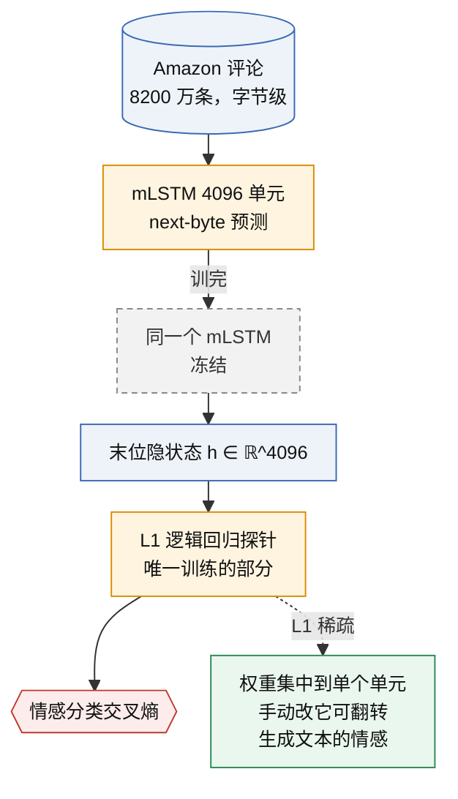
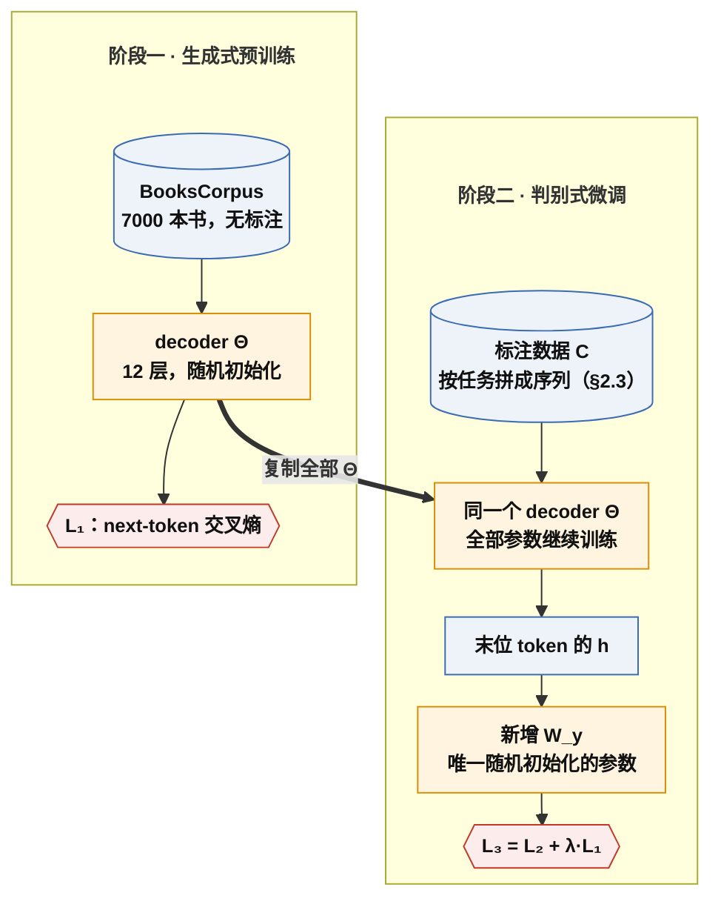

# Sentiment Neuron 与 GPT-1：生成式预训练 + 判别式微调

一句话定义：先用 next-token 目标在无标注文本上训练一个 decoder，再把整个 decoder 复制到下游任务、只新增一个线性层，用少量标注数据微调全部参数。2017 年的 Sentiment Neuron 先证明无监督表征里有可线性读出的语义，2018 年的 GPT-1 把它变成一条通用流水线。

> [!tip] 一句话抓住本节
> **预训练表征里已经含有任务需要的特征，微调只是把它读出来。** Sentiment Neuron 是这句话的证据（冻结模型、线性探针就能读出情感），GPT-1 是这句话的工程化（全参数微调 + 新增 W_y），E1 第二阶段 n=100 的失败是这句话的反例（表征里没有"说话人"，微调就只能记忆）。"少量标注就够"是表征的性质，不是微调的性质。

> [!success] Public algorithm
> 两篇论文完整公开了模型结构、数据来源、超参数、目标函数与消融；GPT-1 的代码和权重开源（finetune-transformer-lm），Sentiment Neuron 的代码和权重也开源。

> [!info] Public system behavior
> 无。当时没有产品。

> [!question] Inference
> Sentiment Neuron 论文只报告了"单个隐单元编码情感"的现象，没有解释为什么会集中到一个单元而不是分布式编码。"可能与 L1 正则的稀疏偏好和情感是评论文本的主导变量有关"是推断，不是论文结论。

> [!danger] Unknown
> BooksCorpus 的具体书目未公开。Amazon 评论数据集是公开的第三方数据。

## 1. 承接的瓶颈

上一代是 [[A1-transformer-decoder-next-token]]，它给了一个能并行训练的 next-token 模型。但 2017 年有两个悬而未决的问题：

1. **无监督学到的表征里有没有语义？** 只预测下一个字符的模型，内部是否编码了"这条评论是正面还是负面"这类高层概念？没有证据前，没人敢把大量算力投在无标注文本上。
2. **有了表征，怎么迁移到有标注的任务？** 当时 NLP 每个任务各设计一套结构，最多共享词向量（word2vec、GloVe，非 OpenAI），深层结构无法复用。

| 论文 | 年份 | 回答的问题 | 结论 |
|---|---|---|---|
| Learning to Generate Reviews and Discovering Sentiment | 2017-04 | 无监督 LM 表征有语义吗 | 有。字节级 mLSTM 隐状态里出现单个"情感神经元" |
| Improving Language Understanding by Generative Pre-Training | 2018-06 | 怎么迁移到所有任务 | 生成式预训练 + 判别式微调，一套结构通吃 |

## 2. 核心思想

### 2.1 Sentiment Neuron：证据先行

- 模型：字节级 multiplicative LSTM，4096 个隐单元，不是 Transformer；
- 数据：Amazon 商品评论，约 8200 万条；
- 训练：next-byte 预测，4 块 GPU 约一个月；
- 探针：冻结模型，取每条评论末尾的隐状态（4096 维），用带 L1 正则的逻辑回归做情感分类。

结果：Stanford Sentiment Treebank 上超过当时最好成绩，且 L1 正则把权重集中到**一个**隐单元。手动改这个单元的值，生成的评论会在正面与负面之间切换。

重点是灰色虚线框：探针阶段模型不动，只训一个线性层。语义如果能被线性读出，说明它本来就在隐状态里，不是探针学出来的。

### 2.2 GPT-1：两阶段，参数共享

- **阶段一 生成式预训练**：12 层 decoder（d=768，12 头，上下文 512，BPE 40k，约 1.17 亿参数）在 BooksCorpus（约 7000 本书）上做 next-token 预测；
- **阶段二 判别式微调**：把整个 decoder 复制过去，只在最后一个 token 的隐状态上加一个新线性层 $W_y$，用标注数据训练**全部**参数。

共享的是整个 decoder（embedding、12 个 block、LayerNorm）。微调阶段唯一从零开始的参数是 $W_y \in \mathbb{R}^{768 \times K}$，K 为类别数，相对 1.17 亿参数可以忽略。

fine-tune 的核心不是"省算力"，而是**用无标注数据学到的参数作初始化，让稀缺的标注数据只需微调**。省算力是结果。与从零训练、词向量迁移、linear probe 的逐项对比见 §10。

### 2.3 Task-aware input transformation：不改结构，改输入

这是 GPT-1 最容易被忽略的创新。把结构化输入序列化成带特殊 token 的一段文本，让同一个 decoder 处理分类、蕴含、相似度、多选：

| 任务 | 输入拼法 | 取哪个位置的 h | 分类头 |
|---|---|---|---|
| 分类 | `<s>` 文本 `<e>` | `<e>` | 一个 $W_y$ |
| 蕴含 | `<s>` 前提 `$` 假设 `<e>` | `<e>` | 一个 $W_y$ |
| 相似度 | `<s>` A `$` B `<e>` 与 `<s>` B `$` A `<e>` 两条 | 两个 `<e>` 的 h 相加 | 一个 $W_y$ |
| 多选 | 每个选项一条 `<s>` 上下文 `$` 选项 `<e>` | 每条的 `<e>` | 各得一个分数再 softmax |

`<s>`、`<e>`、`$` 是词表里新加的 token，embedding 在微调时才学。取 `<e>` 位置是因为 causal mask 下只有最后一个 token 的隐状态看过整段输入；`<s>` 在第 0 位只能看见自己，其隐状态与输入无关，分类头面对常数特征，只能学到类别先验，准确率停在多数类基线。

## 3. 目标函数与数据

$$
\mathcal{L}_1(\mathcal{U}) = \sum_i \log P(u_i \mid u_{i-k}, \ldots, u_{i-1}; \Theta)
$$

$$
\mathcal{L}_2(\mathcal{C}) = \sum_{(x, y)} \log P(y \mid x^1, \ldots, x^m), \qquad P(y \mid x^1 \ldots x^m) = \operatorname{softmax}(h_l^m W_y)
$$

$$
\mathcal{L}_3(\mathcal{C}) = \mathcal{L}_2(\mathcal{C}) + \lambda \cdot \mathcal{L}_1(\mathcal{C})
$$

符号说明：

| 记号 | 含义 | 对应哪一步 |
|---|---|---|
| $\mathcal{U}$ | 无标注 token 序列（BooksCorpus） | 阶段一数据 |
| $k$ | 上下文窗口，512 | A1 的 T |
| $\Theta$ | decoder 全部参数 | 两阶段共享 |
| $\mathcal{C}$ | 标注数据集，每条是 token 序列 $x$ 与标签 $y$ | 阶段二数据 |
| $h_l^m$ | 最后一层 $l$、最后一个 token $m$ 的隐状态，768 维 | 图中"最后一个 token 的 h" |
| $W_y$ | 新增线性层 | 唯一从零训的参数 |
| $\lambda$ | 辅助 LM 损失权重，论文取 0.5 | 微调阶段 |

两点提醒：论文写成最大化 log 似然，E1 实现的是最小化负 log 似然，只差符号；$\mathcal{L}_1(\mathcal{C})$ 是在**标注数据的文本**上继续做 next-token 预测，不在 BooksCorpus 上。

## 4. 训练循环

两阶段的结构见 §2.2 的图，这里只列训练配置：

| 项 | 阶段一 | 阶段二 |
|---|---|---|
| 数据 | BooksCorpus，BPE 40k，窗口 512 | 标注数据，按 §2.3 拼成序列 |
| 初始参数 | 随机 | 阶段一的 Θ，外加随机的 W_y |
| 优化器 | Adam，warmup 2000 步 + cosine 衰减 | 重新初始化的 Adam（§11.1） |
| 学习率 | 峰值 2.5e-4 | 6.25e-5，小 40 倍 |
| batch | 64 条 × 512 token（凭记忆，待核对） | 32 |
| 轮数 | 100 epoch | 3 epoch |
| 损失 | 只有 L₁ | L₃ = L₂ + 0.5 × L₁ |

**为什么微调要降学习率**：学习率不决定梯度流到哪里，反向传播的梯度流经全部层，GPT-1 更新全部参数；学习率只缩放所有参数的步长。$W_y$ 随机初始化，早期经它传回 $\Theta$ 的梯度方向近似噪声，大学习率会用噪声覆盖预训练特征，预训练组退化到接近从零组（==catastrophic forgetting==，论文未用此词）。小学习率、3 epoch、辅助 LM 损失三个超参都在防这件事。只更新末层要靠冻结 $\Theta$，那是另一种方法（linear probe），对比见 §10。

## 5. 推理行为

微调后模型不再生成文本。一次前向，取 `<e>` 位置的 768 维向量，过 $W_y$ 得类别 logits，argmax 即答案。多选是 K 次前向各得一个分数再 softmax。

论文第 5 节"zero-shot behaviors"：不做微调，把任务改写成生成问题（情感分类在文本后接 "very"，比较 "positive" 与 "negative" 的概率），结果随预训练步数稳定上升，虽然远低于微调。这是 [[A3-gpt-2-zero-shot]] 的种子。

## 6. Scaling 维度

论文做了"迁移层数"实验：把预训练的前 k 层搬到下游，其余随机初始化。每多搬一层都有提升，全搬 12 层总计约 9 个百分点，说明深层参数也在做有用的事。GPT-1 没有做模型尺寸 scaling，那是 [[A3-gpt-2-zero-shot]] 与 [[A4-scaling-laws]] 的内容。

## 7. 证据

| 主张 | 证据 | 来源 |
|---|---|---|
| 无监督 LM 表征含语义 | 单个隐单元线性可读出情感，SST 超过当时 SOTA | Sentiment Neuron 论文 + 开源代码 |
| 预训练是提升主因 | 消融：不做预训练，12 项任务平均掉 14.8 个百分点 | GPT-1 论文表 5 |
| 辅助 LM 损失有条件地有用 | 大数据集有帮助，小数据集略有损害 | 同上 |
| Transformer 优于 LSTM | 同设置换成单层 2048 单元 LSTM，平均掉 5.6 个百分点 | 同上 |
| 一套结构通吃 | 12 项任务中 9 项 SOTA | GPT-1 论文表 2～4 |

## 8. 局限

- 每个任务仍要一次微调，产出一个新模型副本，这是 [[A3-gpt-2-zero-shot]] 要解决的瓶颈；
- 输入拼法手工设计，新任务要重新设计；
- 窗口 512，长文档要截断；
- 数据只有 BooksCorpus，领域单一。

## 9. 后续影响

- 直接产出 [[A3-gpt-2-zero-shot]] 的 zero-shot 假说（论文第 5 节）；
- "预训练 + 微调"成为 2018～2020 NLP 默认范式，BERT（非 OpenAI）同年用 encoder 走了同一条路；
- [[B3-instructgpt-chatgpt]] 的 SFT 阶段本质上仍是这个阶段二，只是 $W_y$ 换回 LM head。

## 10. 与相关方法的区别

| 维度 | 从零训练 | 词向量迁移（word2vec/GloVe，非 OpenAI） | Linear probe（Sentiment Neuron） | GPT-1 全参数微调 |
|---|---|---|---|---|
| 迁移的参数 | 无 | 只有 embedding | 整个模型，但冻结 | 整个 decoder |
| 下游更新 | 全部从零 | 下游模型全部从零 | 只有线性层 | 全部参数 + $W_y$ |
| 结构 | 每个任务各一套 | 每个任务各一套 | 共用，换线性层 | 共用，只换输入拼法和 $W_y$ |
| 标注数据需求 | 多，否则过拟合 | 多 | 最少 | 少 |
| 效果 | 差 | 差 | 中 | 最好 |

## 11. 追问与澄清

### 11.1 微调时会不会复用预训练的 Adam 状态（2026-09-18 追问）

不会。checkpoint 只存 `model.state_dict()`（权重 Θ），不存优化器的 m、v、step，也不存 `.grad`。sft.py 新建 AdamW，state 为空，第一次 `step()` 才分配全零的 m、v。这与 GPT-1 一致：微调换了数据、损失和学习率，预训练末期的动量对新任务无意义，论文微调时重新设 Adam 与 warmup。

附带效应：Adam 的 bias correction 使 m、v 从零起步的前几步每个坐标的有效步长接近 lr × sign(grad)，与梯度大小无关。此时 W_y 仍是随机的，传回 Θ 的梯度是噪声，大 lr 的前几步等于对 Θ 做幅度为 lr 的随机扰动。这是"微调必须小学习率"的第二个理由（第一个见 §4）。需要存优化器状态的场景是中断后继续预训练。

### 11.2 E1 第二阶段：n=100 时为什么预训练也救不了过拟合（2026-09-19 解读）

80 万参数的 Θ 拟合 100 条样本，600 步 × batch 32 ≈ 192 个 epoch，训练损失 0.006（对正确标签平均概率 0.994）是纯记忆；测试准确率 0.22～0.27 等于五类瞎猜，低于多数类基线 0.295。记忆发生在 Θ，不在 645 个参数的 W_y：全参数微调把整个模型的容量交给了小数据，GPT-1 用 3 epoch 与小学习率压这个风险。

预训练组没能避免，是因为 GPT-1 "少量标注即可"的前提是 Sentiment Neuron 证明的那件事：预训练表征里已经含有任务特征，微调只是读出来。字符级模型预训练到 loss 1.5 只学到拼写与词形，隐状态里没有"说话人"维度，梯度只能走记忆。n=1000 时预训练组开始领先，是数据足够让 Θ 在微调期间长出这个特征，预训练的词形知识让它长得快。这正是卡首"一句话"的反例一面。数据见 [[E1-tiny-gpt]]。

### 11.3 E1 第二阶段是不是论文的方法（2026-09-19 追问）

机制层面是：两阶段全参数微调、输入拼法、末位取 h 过 W_y、L3 = L2 + λ·L1、"不预训练"和"去辅助 LM"两项消融都照论文第 3 节与表 5。任务、规模、微调日程、标注量与学习率扫描、多种子是 toy 设计，论文没有这些；论文有而 E1 没做的是 LSTM 对照和迁移层数消融。对应表见 [[E1-tiny-gpt]]。

## 最小示例或实验

[[E1-tiny-gpt]] 第二阶段：tinyshakespeare 预训练 2000 步 → 台词片段猜说话人（5 类）SFT，对照从零训练；变量为标注量 100 vs 1000、λ = 0 vs 0.5、微调学习率 6e-5 vs 3e-4，共 16 组。

## 常见误解

- "fine-tune 的好处是省算力"：省算力是结果（§2.2）。
- "小学习率让梯度只更新末层"：学习率只缩放步长，梯度流经全部层；只更新末层要冻结参数。
- "取 `<s>` 位置也行"：`<s>` 在第 0 位看不到输入，隐状态是常数。

## 我曾经答错的地方

### 2026-09-13 · fine-tune 与从零训练的差异（诊断）
- 题目：GPT-1 的 pretrain + fine-tune 和从零训练的核心差别是什么？
- 我的答案（记录为摘要，原话未存）：计算量减少。
- 错在哪：省算力是附带结果，不是机制。
- 正确答案：预训练在无标注文本上学到含任务特征的表征，微调只是用少量标注把它读出来（卡首一句话、§2）。

### 2026-09-17 · 为何取 `<e>` 位置的隐状态（检查题）
- 题目：分类为什么取 `<e>` 位置的隐状态而不是 `<s>`？强行取 `<s>` 会怎样？
- 我的答案："因为 `<e>` 才见过所有序列；取 `<s>` 学不到东西，微调失败"（未写信心）。
- 错在哪：核心对，但"学不到东西"没说机制。
- 正确答案：causal mask 下只有末位 token 见过全序列；`<s>` 前面没有任何 token，它的 h 与输入无关，W_y 只能学到类别先验，准确率等于多数类（§2.3）。

### 2026-09-17 · 微调为何降学习率（检查题）
- 题目：微调学习率不降到 1/40、直接用 2.5e-4 微调 3 epoch，预训练组相对从零组的优势为什么缩小？
- 我的答案："不想对底层参数影响太大，只想把梯度传到末层参数"（信心 50）。
- 错在哪：混淆了"梯度是否流到"与"参数改动多大"。梯度流经全部层，GPT-1 更新全部参数。
- 正确答案：学习率只缩放所有参数的步长；随机初始化的 W_y 早期传回 Θ 的梯度是噪声，大步长会用噪声覆盖预训练特征，预训练组退化到接近从零组；只更新末层是另一种方法 linear probe（§4、§10）。

### 2026-09-19 · n=100 时训练损失趋零、测试低于基线（E1 解读）
- 题目：用参数量 / 样本数 / W_y 形状解释这个现象；预训练组为什么没避免？
- 我的答案："不能解释"。
- 错在哪：没有从"参数量远大于样本数"入手。
- 正确答案：80 万参数拟合 100 条、192 个 epoch，纯记忆，记在 Θ 不在 645 参数的 W_y；测试约等于瞎猜 0.2，低于多数类 0.295；预训练没帮上忙，因为字符级表征不含"说话人"特征，GPT-1 少标注的前提是表征里已有任务特征（§11.2）。

### 2026-09-27 · run_seeds 7 样本均值表（复测，E1 解读）
- 题目：给 init × lr 四组各 7 个种子的均值与标准差：差异是否超过噪声；单种子结论"预训练领先 0.1"是否仍成立；小 lr 是否可行；预训练为何无效；同 seed 两次结果不同是什么原因。
- 我的答案："预训练领先 0.1 仍成立；小 lr 可以；预训练为何无效不清楚；同 seed 两次不同是未收敛"（未写信心）。
- 错在哪：用单次结果下结论，差值已缩到 0.035、在噪声内；"小 lr 可以"与数据相反；没考虑重复同一 seed 不是独立样本；把代码非确定性当成收敛问题。
- 正确答案：差值要与均值差的标准误 σ·√(2/n) 比，低于它不能下结论；预训练无效是表征与任务错配（上一条）。此次 mastery 3 → 2。
## 图板与图解页

本卡相关的 Artifact 页面，全表见 [[artifacts]]（私有链接，需登录 claude.ai）。

- [A2 GPT-1 图板](https://claude.ai/artifact/JA8AYXzSxbitKPRk1qqtXa)（本节图板，2026-09-17）：探针冻结图、两阶段参数共享图、训练循环图。对应 全卡。

## 掌握证据

- 2026-09-17 讲解中检查题 1（为何取 `<e>`）：correctness 3、mechanism 3 → mastery 2；完整度 2（未说清取 `<s>` 时特征为常数）。
- 2026-09-17 检查题 2（为何降学习率）：correctness 2、mechanism 2，自评 50 与实际相符。
- 2026-09-18 E1 第二阶段：sft.py 三处填空全对，16 组对照跑通并推送 → mastery 3（规则：实验完成并有记录）。
- 2026-09-19 解读题（n=100 为何纯记忆）答不出，correctness 0 → 解读能力进 review queue，09-22 复测。
- 待完成（均已逾期）：09-22 用 run_seeds.sh 的多种子结果复测解读；09-24 复测 input transformation 四种拼法与取位、linear probe 与全参数微调的区别。

## 待验证内容

- E1 第二阶段（2026-09-19，单种子）：n=100 两组都是纯记忆，没有复现"小标注量优势最大"；n=1000 大学习率下预训练组仍领先 0.1 以上，推翻了"大学习率缩小优势"的预测。待 run_seeds.sh 多种子确认。
- 阶段一 batch 64 × 512 凭记忆写入 §4，核对论文第 4.1 节。
- 论文表 5 中辅助 LM 损失的具体数字，写卡时凭记忆只记了方向，下次打开 PDF 核对。

← [[A-pretraining-scaling]]
