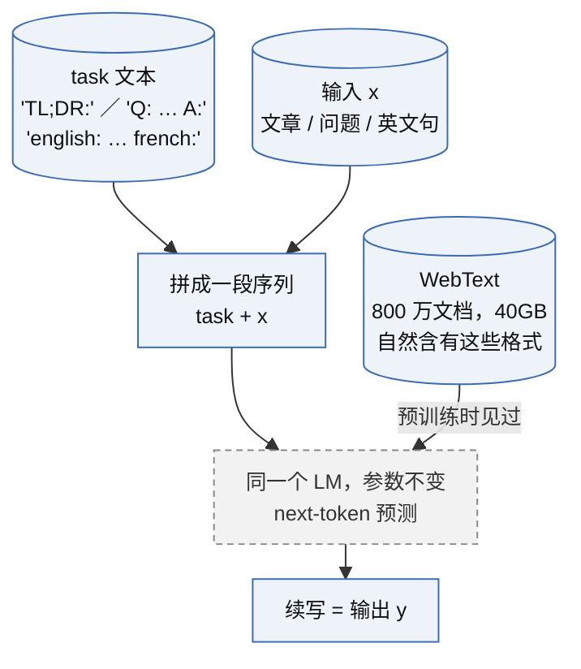
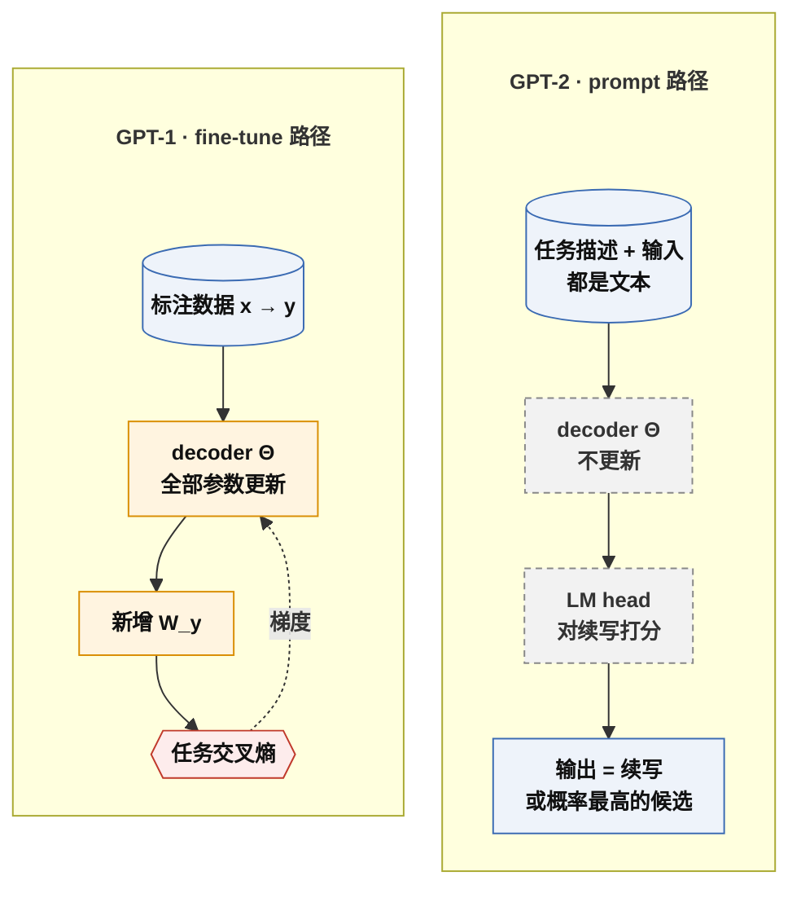
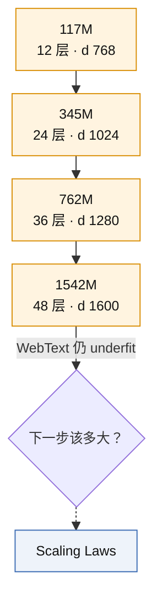

# GPT-2：zero-shot 与 prompt 即任务说明

一句话定义：把任务描述也当作文本放进输入，p(y | x) 变成 p(y | x, task)，于是一个只做 next-token 预测、从不微调的语言模型可以直接执行多种任务；配套是 WebText 数据、放大 10 倍的模型和分阶段发布。

> [!tip] 一句话抓住本节
> **表征里如果已经含有任务，连 W_y 都不需要，用文本把它"点名"就能读出来。** 这是 [[A2-sentiment-neuron-gpt-1]] 那句"预训练表征里已有特征，微调只是读出来"的下一步：读出的手段从梯度换成 prompt。前提也随之加了一条：训练文本里要自然出现过类似的任务格式。

> [!success] Public algorithm
> 论文、代码、四个尺寸（117M / 345M / 762M / 1542M）的权重全部公开；模型结构改动（pre-LN、残差初始化缩放、字节级 BPE、上下文 1024）论文明确说明。

> [!info] Public system behavior
> 分阶段发布：2019-02 放 117M，05 放 345M，08 放 762M，11 放 1.5B。官方理由是评估滥用风险、探索负责任发布规范，有 6 个月跟进报告。

> [!question] Inference
> 完整训练超参（batch、学习率调度、步数）只给了一部分，其余按 GPT-1 类推是推断。

> [!danger] Unknown
> WebText 未公开。社区的 OpenWebText 是非 OpenAI 复现，不能当原始数据。

## 1. 承接的瓶颈

上一代是 [[A2-sentiment-neuron-gpt-1]]，它的问题：每个任务一次微调，产出一份权重和一套手工拼法；小数据微调靠不住（E1 第二阶段 n=100 纯记忆）；更根本的是单数据集单任务系统脆弱，换分布就崩。GPT-2 问：能否一个参数都不改，让 LM 直接做任务？

## 2. 核心思想

### 2.1 任务写进文本

```text
GPT-1 微调：    p(y | x)          任务藏在 W_y 与拼法里，每个任务一套
GPT-2 zero-shot：p(y | x, task)   任务是一段文字，与 x 拼在一起喂给同一个 LM
```

没有 W_y，没有梯度。LM head 自己就是分类器，因为它给每个可能的续写打分。



### 2.2 fine-tune 路径 vs prompt 路径



逐项对比（连同 GPT-3 few-shot）见 §10。

### 2.3 从 LM head 读出分类结果的两种办法

| 读法 | 做法 | 输出空间 | 出处 |
|---|---|---|---|
| 生成式 | 续写，看写出的词 | 开放，需字符串匹配 | GPT-2 的阅读理解、翻译、摘要 |
| 打分式 | 分别算 P(候选 ∣ prompt)，取大 | 封闭 | GPT-1 论文第 5 节（"very" + positive/negative）；GPT-3 多数基准 |

打分式等于把 embedding 矩阵里 K 个候选 token 的行抽出来当 $W_y$，$d \times K$ 形状与 GPT-1 的 $W_y$ 一致，连读出矩阵都是现成的。

### 2.4 数据与模型

WebText：Reddit 上 karma ≥ 3 的外链，去重清洗，约 800 万文档、40GB；karma 是人工质量筛选的代理。论文第 2 节展示了其中自然出现的翻译对、问答对。

| 项 | GPT-1 | GPT-2 最大版 |
|---|---|---|
| 参数 | 1.17 亿 | 15.42 亿 |
| 层数 × d | 12 × 768 | 48 × 1600 |
| 上下文 | 512 | 1024 |
| 词表 | BPE 40k | 字节级 BPE 50257 |
| LayerNorm | post-LN | pre-LN + 末尾 LN |
| 残差初始化 | 标准 | 乘 $1/\sqrt{N}$，N 为残差层数 |

E1 的 `model.py` 用的是 pre-LN，即 GPT-2 写法，见 [[A1-transformer-decoder-next-token]]。

## 3. 目标函数与数据

目标函数与 [[A1-transformer-decoder-next-token]] 完全相同，A 线里唯一一节"目标函数零改动"的创新，创新落在数据、规模与使用方式：

$$
\mathcal{L}(\Theta) = \sum_i \log P(u_i \mid u_{i-k}, \ldots, u_{i-1}; \Theta), \qquad k = 1024
$$

式子是最大化对数似然，与 GPT-1 式 (1) 同形，只是 k 从 512 变成 1024。zero-shot 推理时没有任何 loss。

## 4. 训练循环

与 A1 相同的循环：WebText 上 next-token 交叉熵，Adam，上下文 1024，batch 512。完整超参未全部公开。所有尺寸训完仍 underfit WebText，论文明说。

## 5. 推理行为

输入 prompt，输出续写或候选打分；采样用 top-k 加 temperature；每个任务的 prompt 格式手工试出（"TL;DR:" 借自 Reddit 长帖末尾写总结的习惯，WebText 里大量存在），prompt 工程从此开始。去掉 "TL;DR:" 摘要指标明显下降（§7），说明 prompt 是从数据里读出来的任务开关，不是装饰。延长线：GPT-2 找数据里偶然的开关 → [[A5-gpt-3-in-context-learning]] 用显式描述加例子 → [[B3-instructgpt-chatgpt]] 用人写的指令训练，不再依赖偶然开关。

## 6. Scaling 维度

同一数据、同一目标下第一次系统比较四个尺寸，所有下游任务表现随 log(参数量) 近似线性上升、未饱和，最大模型仍 underfit。它是 [[A4-scaling-laws]] 的雏形但还缺"law"，差在哪见 §11.4。



## 7. 证据

| 主张 | 证据 | 来源 |
|---|---|---|
| zero-shot 能做多种任务 | 8 个语言建模数据集 7 个 SOTA；LAMBADA 63.2%；CoQA F1 55 | 论文表 3、第 3 节 |
| 规模单调有效 | 四个尺寸在所有任务上单调上升 | 论文图 1 |
| 任务格式来自数据 | WebText 中自然存在翻译对、问答对 | 论文第 2 节 |
| 不是背答案 | 训练/测试 8-gram 重叠率低 | 论文第 4 节 |
| prompt 是控制变量 | 摘要任务去掉 "TL;DR:" 提示，指标掉约 6 分 | 论文第 3.6 节（数字凭记忆，待核对） |

## 8. 局限

- 下游离监督 SOTA 远：法→英 BLEU 11.5，摘要只比随机抽三句略好；
- prompt 手工试，写法敏感；
- 只能做能写成续写的任务；
- 最大模型仍 underfit，算力是瓶颈。

## 9. 后续影响

- [[A4-scaling-laws]]：把图 1 的四个点变成几十个点、换成 loss 坐标、拟合成幂律，回答"下一个该多大"（见 §11.4）；
- [[A5-gpt-3-in-context-learning]]：规模再放大 100 倍，加 few-shot，把 prompt 路径推到可用；
- [[B3-instructgpt-chatgpt]]：prompt 路径的反面，zero-shot 时模型不听指令，才需要对齐；
- 分阶段发布是 OpenAI 发布策略线的起点，延续到今天的 system card。

## 10. 与相关方法的区别

| 维度 | GPT-1 fine-tune | GPT-2 zero-shot | GPT-3 few-shot |
|---|---|---|---|
| 参数更新 | Θ 全部更新，新增 W_y | 无 | 无 |
| 任务信息从哪进 | 几千条标注的梯度 | 一句描述，在输入文本里 | 描述 + 几个例子，在上下文里 |
| 每任务产物 | 一份新权重 | 一段 prompt（§11.3） | 一段 prompt |
| 输出怎么得到 | 末位 h 过 W_y | 续写，或比较候选续写的概率（§2.3） | 同 GPT-2 |
| 依赖 | 表征含任务特征 + 标注数据 | 表征含任务特征 + 训练文本里见过类似格式 | 同 GPT-2，外加模型能从例子里读出格式 |

## 11. 追问与澄清

### 11.1 zero-shot 是 GPT-2 引入的概念吗（2026-09-19 追问）

不是。词来自视觉领域（非 OpenAI）：2008～2009 的 zero-data / zero-shot learning 指识别训练时没见过的类别，靠属性描述连接新旧类；2017 Google 多语言翻译用 zero-shot translation。OpenAI 内部，GPT-1 论文第 5 节已有 zero-shot behaviors。GPT-2 把对象从"类别"换成"任务"，把桥梁从"属性"换成自然语言 prompt，并第一次系统地在多任务上评测。GPT-3 再补 one-shot、few-shot，"shot"数的是上下文里的示例数。

### 11.2 "只靠 prompt 迁移到新任务"是什么意思（2026-09-19 追问）

模型只学过续写，把任务伪装成需要续写的文本，续写出来的就是答案。迁移的是任务不是数据；prompt 起作用是因为它改变条件概率（"french:" 把分布推向法语）；能成立全靠预训练文本见过类似格式。zero-shot 描述条件（该任务零样本、零梯度），prompt 是手段，二者不是同一个东西。

### 11.3 "每任务产物是 prompt"是什么意思（2026-09-19 追问）

指为了让模型能做某个任务而额外制造并保存的东西。GPT-1 每个任务要微调出一份完整权重（12 个任务 12 份）；GPT-2 每个任务只需一个 prompt 模板（"english: {x} french:"），对该任务所有输入复用，填入 x 后直接喂同一个模型读续写，中间没有别的步骤。差别不只是省存储：12 份权重是 12 个互不相通的模型，12 个模板背后是同一个模型，任务可以串联组合，这是"一个模型做所有事"的起点，也是 [[D3-codex-agent-loop-compaction]] 一类 agent 能成立的前提之一。

### 11.4 GPT-2 是不是 scaling law 的雏形（2026-09-19 追问）

是雏形，缺"law"。GPT-2 有：同一数据与目标下四个尺寸横向比较（实验设计）、图 1 下游表现随 log N 近似线性且未饱和（定性趋势）、明说最大模型仍 underfit WebText（算力未到头）。[[A4-scaling-laws]] 补上：自变量从 N 扩到 N、D、C；因变量换成测试 loss；关系写成可外推的幂律；给出算力固定时 N 与 D 的分配；用途从"说明方向"变成"决定下一次训练多大"。非 OpenAI 前史：Hestness 等 2017（百度）已在翻译、语音上报告幂律学习曲线，Kaplan 论文引用了它；OpenAI 的贡献是在 Transformer LM 上把幂律做成决策工具。

### 11.5 GPT 和 Claude 的分词器是怎样的（2026-09-23 追问）

**Public algorithm**：GPT-2 论文写明用字节级 BPE：基础符号是 256 个 UTF-8 字节，任何文本都能编码，没有 OOV；在字节上跑 BPE（算法见 §11.6）到 50257 个词表项；编码前先用正则按空格、标点、数字预切，空格附在词前，且禁止跨类别合并。OpenAI 开源的 `tiktoken` 公开了后续词表：r50k_base（GPT-2/3，约 50K）、cl100k_base（GPT-3.5/4，约 100K）、o200k_base（GPT-4o、o 系列，gpt-oss 用它的 harmony 变体，约 200K）。词表越大，常见中文字词被合成单个 token 的越多，同样中文用的 token 越少；汉字 UTF-8 占 3 字节，生僻字没被合并时会拆成 2～3 个 token。**Unknown**（非 OpenAI）：Claude 早期分词器曾公开，当前模型的词表与规则未公开，只能用官方 token 计数接口；"同属 BPE 一类"只是 Inference。所以同一段文本在两家模型上的 token 数不能直接比较。与 GPT-1 的对比见 [[A2-sentiment-neuron-gpt-1]]（GPT-1 用 40k 次合并的 BPE，先经 ftfy 清洗、spaCy 预切，不是字节级）。

### 11.6 BPE 属于什么算法（2026-09-23 追问）

一种基于频率的贪心、自底向上合并的统计算法，没有神经网络，不用梯度，结果是确定的。出身是数据压缩（非 OpenAI）：Gage 1994 把最常见的字节对替换成一个没用过的字节，反复做到压不动为止；Sennrich 等 2016 把它搬到机器翻译，用来切子词，解决未登录词问题。训练时每轮统计所有相邻对，合并频率最高的那一对，并把这条合并规则按顺序记进 merges 表，做到目标词表大小为止。编码时不再数频率，而是在当前序列里找 merges 表中排名最靠前的相邻对，先合并它，直到没有可合并的对。分词器在模型训练前单独训练好并冻结，与模型参数无关。同类对照（非 OpenAI）：WordPiece（BERT）同样自底向上合并，但按"合并后似然提升"选对，而不是只看频率；Unigram LM（SentencePiece 可选）反过来，从大词表出发逐步删掉对似然贡献最小的 token。图解页：https://claude.ai/artifact/2ouTn5rzu1mgUTJdXA7tz6

### 11.7 BPE 是不是教材里的 Huffman 编码（2026-09-23 追问）

不是，但两者是近亲，都是"按频率反复合并两个东西"的贪心压缩法。Huffman（CLRS 贪心算法一章的标准例题）每步从优先队列取出频率**最低**的两个符号，不要求它们相邻，合并成树的内部节点，最后产出变长比特码；频率一开始就定了，不重新统计；能证明得到最优前缀码。BPE 每步合并序列里**相邻**且频率**最高**的一对，产出的是新符号（词表项），不是比特码；每次合并后要重新统计；只是启发式，不保证最优压缩。压缩领域里跟 BPE 最像的是 Re-Pair（Larsson & Moffat，非 OpenAI），它反复替换最常见的相邻对，属于基于文法的压缩；LZW 也会边读边建字典，但按前缀匹配，不按对频率。两者设计目标的差异见 §11.8。

### 11.8 BPE 与 Huffman 的设计目标差异，LLM 为何用 BPE（2026-09-25 追问）

目标函数不同。Huffman：字母表固定、分布已知，求平均码长（比特）最短的前缀码，产物是给存储和传输用的比特流，每个码字只是比特串。BPE（LLM 用法）：在给定词表大小 V 下选一组切分单元，把文本变成尽量短的整数 ID 序列，每个 ID 对应一个可学习的 embedding；压缩只是副作用。

LLM 不用 Huffman 的原因：

1. **序列长度**：Huffman 不减少符号个数，只把每个符号换成几个比特，交给模型逐比特预测时序列反而变长几倍，注意力成本按长度平方增长，上下文窗口能装下的文本也变少。BPE 把英文压到约 4 个字符一个 token。
2. **单元要有意义**：Huffman 码字的比特没有独立语义，边界取决于树形；BPE 的 token 是反复出现的子词（如 ` the`、`ing`），embedding 能学到语义和形态。
3. **分工**：频率建模本来就是语言模型自己的工作，而且它用上下文条件分布，比 Huffman 的静态单符号频率强得多；语言模型加算术编码本身就是压缩器（[[A1-transformer-decoder-next-token]] §11.6；非 OpenAI：DeepMind 2023《Language Modeling Is Compression》）。分词器不必再做熵编码，只负责切分，两边如何分摊总比特见 §11.9。
4. **旋钮可控**：BPE 可以直接选 V，在 embedding/softmax 大小与序列长度之间折中（r50k → cl100k → o200k 就是在调这个旋钮）；Huffman 的字母表是给定的。

**Public algorithm**：GPT-2 论文把 BPE 定位为字符级与词级之间的实用折中：词级有未登录词、词表巨大；当时的字节级 LM 在大规模数据集上打不过词级 LM；字节级 BPE 兼得全覆盖与较短序列。选 BPE 而不选 WordPiece、Unigram 更多是简单、快、有先例的工程取舍，公开资料里没有 OpenAI 的对比实验，"BPE 最优"不能当结论。代价：数字和拼写被切得不规则，影响算术与逐字母任务；不同语言 token 成本不公平；训练中极少出现的 token 会产生异常行为（社区称 glitch token，非官方发现）。

### 11.9 统一视角：Huffman 最小化总比特，BPE 最小化序列长度？（2026-09-26 追问）

基本对，差别在哪个量是变量、成本按什么计。设符号 $s$ 在语料中出现 $c(s)$ 次：

$$
\text{Huffman: } \min_{\ell} \sum_s c(s)\,\ell(s) \quad \text{s.t. 前缀码},\ \text{符号数 } N \text{ 固定}
$$

$$
\text{BPE: } \min_{\mathcal{V}} N_{\text{tok}}(\text{corpus}; \mathcal{V}) \quad \text{s.t. } |\mathcal{V}| = V
$$

| 记号 | 含义 | 对应步骤 |
|---|---|---|
| $c(s)$ | 符号 $s$ 的出现次数 | Huffman 统计频率 |
| $\ell(s)$ | 符号 $s$ 的码长（比特） | Huffman 建树 |
| $\mathcal{V}$, $V$ | 词表及其大小上限 | BPE 训练的终止条件 |
| $N_{\text{tok}}$ | 语料切分后的 token 数 | BPE 编码结果 |

Huffman 里 $N$ 不变，只压每个元素的比特数；BPE 里每个元素的成本固定（一个 ID），只压元素个数。原因是成本模型不同：存储和传输按比特计费，Transformer 按位置计费，每个位置一次前向，注意力按位置数平方增长，与这个位置携带多少信息无关。

三点修正：(1) 必须有 $V$ 约束，否则整份语料合成一个 token 就最短；每次合并多用一个词表位置、少掉约 $c(a,b)$ 个 token，所以 BPE 是"每个词表位置换最大 token 节省"的逐步贪心，不是全局最优（有非 OpenAI 论文证明求最优词表是 NP 难，待核对出处）；GPT-2 编码时按合并顺序执行，给定词表下也不一定得到最少 token。(2) 两边合起来看：文本总比特 = $N_{\text{tok}} \times$ 每 token 平均 $-\log_2 P$，即模型的总交叉熵。分词器降 $N_{\text{tok}}$，模型降每 token 比特；信息总量大致不变，序列变短只是每个 token 承载更多信息、预测更难。(3) Huffman 的每元素比特是静态码表给的；LLM 的每 token 比特随上下文变化，由模型给出。

### 11.10 zero-shot 与 few-shot 分别是哪一代 GPT 提出的（2026-09-28 追问）

三代各有一个"主角"，区分标准是"提问前给几个例子"和"参数动不动"：

| 代 | 年份 | 论文主角 | 例子数 | 参数 |
|---|---|---|---|---|
| GPT-1 | 2018 | fine-tuning（每任务上一次课） | 几千条训练样本 | 改 |
| GPT-2 | 2019 | zero-shot task transfer | 0，只写任务描述 | 不改 |
| GPT-3 | 2020 | few-shot in-context learning | 上下文里放 k 个示例 | 不改 |

GPT-1 论文第 5 节只把 zero-shot behaviors 当分析材料；GPT-2 把它抬成论文标题级的主张；GPT-3 定义 zero / one / few-shot 三档并起名 in-context learning。两个词本身都不是 OpenAI 发明（见 11.1），OpenAI 做的是换含义：类别→任务，少量样本→写进上下文、不更新参数。ELI5 图板：https://claude.ai/artifact/57G8vt5QYDAqwCTxvkRB6B 。相关：[[A5-gpt-3-in-context-learning]]、[[A2-sentiment-neuron-gpt-1]]。

### 11.11 few-shot 的例子为什么"下一次问别的就不留痕迹"（2026-09-28 追问）

few-shot 示例只是当前 prompt 里的输入 token，模型在这一次前向计算里通过 attention 读取它们，权重不发生任何更新。每次调用都是独立的前向计算，模型能看见的只有当前上下文，所以新 prompt 里没有那几行示例时，模型不是"忘了"，而是从未记住过。对照 fine-tuning：梯度更新改的是权重，改动永久保留，之后不给提示也会做。这正是 GPT-3 把它命名为 in-context learning 的原因：学习发生在 context 里，不发生在参数里。要让示例持续生效只能每次重新贴入，system prompt 与 few-shot 模板由此而来；聊天产品"记得上一轮"也是客户端把历史对话拼回上下文，不是模型自身记忆。相关：[[A5-gpt-3-in-context-learning]]、[[A1-transformer-decoder-next-token]]。

## 最小示例或实验

E3（A5 时）用 E1 的模型或 GPT-2 small 做 zero/few-shot 探针；A3 本节无实验。可用 E1 模型试打分式分类：比较末位 logits 里两个候选 token 的值。

## 常见误解

- "zero-shot 是 GPT-2 发明的"：见 §11.1。
- "few-shot 是从 LM head 读出分类的一种办法"：few-shot 是给不给例子的条件，读法只有生成式和打分式两种，与是否给例子正交。
- "GPT-2 改了目标函数"：没有，只改数据、规模、使用方式。

## 我曾经答错的地方

### 2026-09-19 · 从 LM head 读出分类的两种办法（检查题）
- 题目：不用 W_y，从 LM head 读出分类结果的两种办法是什么，哪种在 GPT-1 §5 出现过？
- 我的答案："一种是 few-shot，另一个不知道"（未写信心）。
- 错在哪：few-shot 是上下文的条件，不是读法；输入端与输出端混在一起。
- 正确答案：生成式续写、看写出的词；打分式比较候选 token 的概率取大。GPT-1 §5 用的是打分式（"very" + positive / negative）（§2.3）。

### 2026-09-27 · 读法、embedding 行与 few-shot（复测）
- 题目：两种读法各是什么；打分式用到 embedding 矩阵的哪几行、与 W_y 的关系；few-shot 为什么不是第三种读法。
- 我的答案：打分式比较标签词 logit、生成式让模型续写；"两个标签词那两行"；"few-shot 本质也是输出对应词的 logits"（未写信心）。
- 错在哪：前两问对，但第二问没说明 weight tying；第三问第二次把 few-shot 当读法。
- 正确答案：weight tying 下 LM head = Eᵀ，两个标签词的行就构成 2×d 的 W_y；few-shot 改的是上下文（条件），与读法正交、可任意组合（§2.3、§11.10）。

### 2026-10-11 · 条件 × 读法二维表归格（A5 检查题 3，第三次）
- 题目：把 E3 的三个设置放进条件 × 读法二维表并补第四格。
- 我的答案："不懂"。
- 错在哪：两个维度仍未分开。
- 正确答案：见 [[A5-gpt-3-in-context-learning]] 同名段落。
## 图板与图解页

本卡相关的 Artifact 页面，全表见 [[artifacts]]（私有链接，需登录 claude.ai）。

- [A3 GPT-2 图板](https://claude.ai/artifact/GzWJbEhPea5v3HpWm5oLSS)（本节图板，2026-09-19）：fine-tune vs prompt、任务写进文本、四尺寸 scaling。对应 全卡。
- [字节级 BPE 分词器](https://claude.ai/artifact/2ouTn5rzu1mgUTJdXA7tz6)（ELI5 图解，2026-09-23）：BPE 合并过程与 Huffman 对照。对应 §11.5～11.9。
- [Zero-shot 与 Few-shot](https://claude.ai/artifact/57G8vt5QYDAqwCTxvkRB6B)（ELI5 图解，2026-09-28）：GPT-1 培训班 / GPT-2 zero-shot / GPT-3 few-shot 三种教法。对应 §11.10～11.11（A5 §11.1 对照）。

## 掌握证据

- 2026-09-19 讲解完成；检查题 correctness 1，mastery 保持 0，待复测识别题。

## 待验证内容

- 表 3 与第 3 节的数字（LAMBADA 63.2、CoQA 55、法→英 11.5、NQ 4.1%、去掉 TL;DR 掉约 6 分）凭记忆写入，打开 PDF 核对。
- 训练 batch 512 与 Adam 的出处，核对是否论文明写。

← [[A-pretraining-scaling]]
