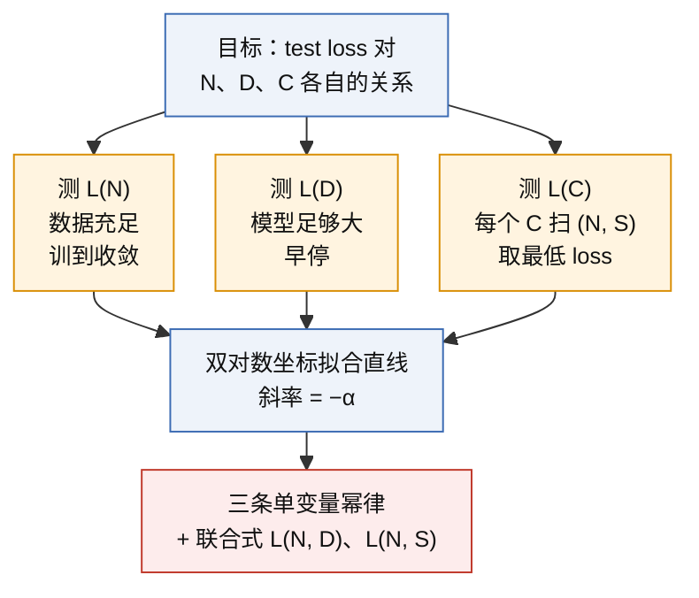
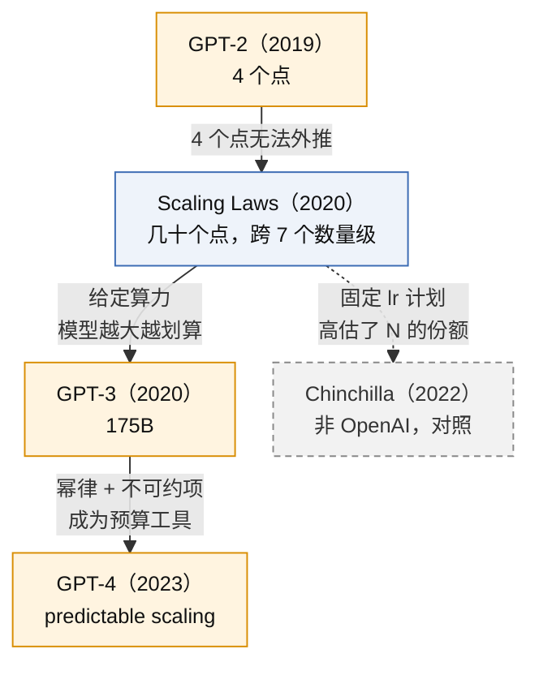
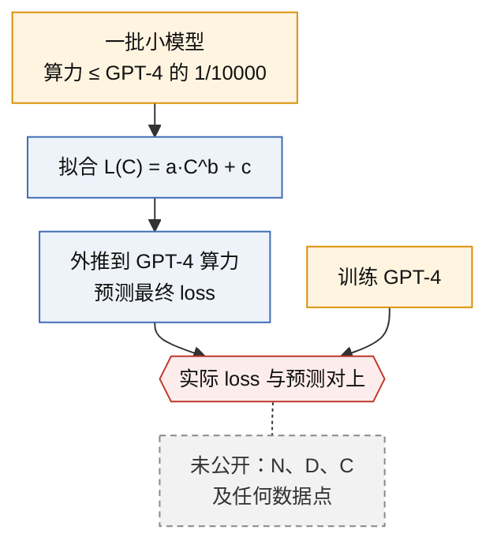
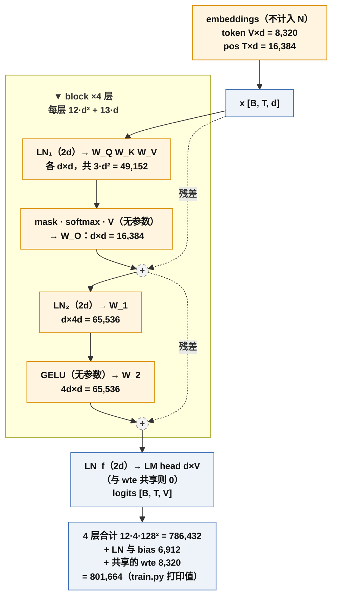
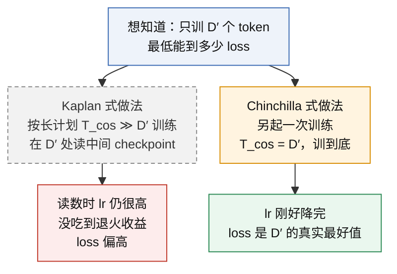

# Scaling Laws 与其修正

语言模型的 test loss 对参数量 N、数据量 D、算力 C 各呈幂律，可以用小模型的实验外推大模型的 loss，==并回答"给定算力，参数和数据怎么分"。==

> [!success] Public algorithm
> Kaplan 等人 2020（OpenAI）：三条单变量幂律 L(N)、L(D)、L(C)，两条联合式 L(N, D)、L(N, S)，临界 batch size，算力最优分配 N ∝ C^0.73。公式、拟合常数、实验设置全部公开。

> [!info] Public system behavior
> GPT-4 技术报告（2023）：用不到 GPT-4 万分之一算力的小模型拟合 L(C) = a·C^b + c，提前预测了 GPT-4 在内部代码集上的最终 loss；用千分之一算力的模型预测了 HumanEval 通过率。方法与结论公开，数据点、GPT-4 的 N、D、C 均未公开。

> [!question] Inference
> GPT-3 175B 只训 3000 亿 token，是按 Kaplan 分配（大模型、少数据）做的决定。依据：GPT-3 论文引用 Kaplan 并按其趋势选尺寸；按 Chinchilla 标准 GPT-3 训练不足。

> [!danger] Unknown
> GPT-4 及之后模型的参数量、数据量、算力、拟合曲线的任何数据点；OpenAI 内部当前采用的分配规则是否已按 Chinchilla 修正。

## 1. 承接的瓶颈

上一代是 [[A3-gpt-2-zero-shot]]。GPT-2 论文图 1 只有四个尺寸（117M → 1.5B），能看出"越大越好"，但四个点外推不了，也回答不了"算力有限时钱该花在参数上还是数据上"。要决定下一个模型的尺寸，需要一条跨多个数量级、可外推的曲线。

## 2. 核心思想

关键设计是**一次只让一个量成瓶颈**：

N 排除 embedding 参数后幂律才干净（§11.2）；L(C) 不是第三个独立轴，而是约束下的最优曲线（§11.1）。

### 主线因果位置

## 3. 目标函数与数据

目标函数不变，仍是 [[A1-transformer-decoder-next-token]] 的 next-token 交叉熵，单位 nats/token。数据 WebText2（约 230 亿 token），上下文 1024。论文的经验公式：

$$
L(N) = \left(\frac{N_c}{N}\right)^{\alpha_N},\qquad
L(D) = \left(\frac{D_c}{D}\right)^{\alpha_D},\qquad
L(C_{\min}) = \left(\frac{C_c}{C_{\min}}\right)^{\alpha_C}
$$

$$
L(N, D) = \left[\left(\frac{N_c}{N}\right)^{\alpha_N/\alpha_D} + \frac{D_c}{D}\right]^{\alpha_D},\qquad
L(N, S) = \left(\frac{N_c}{N}\right)^{\alpha_N} + \left(\frac{S_c}{S_{\min}}\right)^{\alpha_S}
$$

$$
C \approx 6\,N\,D \quad \text{FLOPs}
$$

符号说明：

| 记号              | 含义                               | 论文拟合值                  |
| --------------- | -------------------------------- | ---------------------- |
| $N$             | 非 embedding 参数量                  | 768 ～ 1.5B             |
| $D$             | 训练 token 数                       | 2.2×10^7 ～ 2.3×10^10   |
| $C$             | 训练算力，$C_{\min}$ 指临界 batch 下的算力   | PF-days                |
| $S$             | 参数更新步数，$S_{\min}$ 指临界 batch 下的步数 |                        |
| $\alpha_N, N_c$ | L(N) 的指数与尺度常数                    | 0.076，8.8×10^13        |
| $\alpha_D, D_c$ | L(D) 的指数与尺度常数                    | 0.095，5.4×10^13        |
| $\alpha_C, C_c$ | L(C) 的指数与尺度常数                    | 0.050，3.1×10^8 PF-days |
| $\alpha_S, S_c$ | L(N, S) 的步数项                     | 0.76，2.1×10^3          |

$C \approx 6ND$：==每 token 前向 2N、反向 4N FLOPs==，推导与忽略项见 §11.14。GPT-4 报告的拟合式多一个不可约项 $L(C) = a\,C^{b} + c$，Kaplan 原式没有它，讨论见 §11.13。

## 4. 训练循环

与 GPT-2 相同的 decoder，Adam，各尺寸共用一套学习率计划，固定 batch。论文引入临界 batch size $B_{\mathrm{crit}}$：低于它加 batch 等价于加步数，高于它是浪费，公式与常数见 §11.6。"各尺寸共用学习率计划"后来被 Chinchilla 指为系统偏差来源，见 §11.19。

## 5. 推理行为

无新推理机制。附带发现：按位置看，上下文里越靠后的 token loss 越低，也是幂律。这是"条件越充分预测越准"的量化版，[[A5-gpt-3-in-context-learning]] 建立在它上面。

## 6. Scaling 维度

三条推论：

1. 给定 N，形状（深宽比、头数）影响在几个百分点内；
2. 大模型样本效率更高：达到同一 loss 需要的 token 和步数更少；
3. 因此算力增加时大部分应花在 N 上：$N \propto C_{\min}^{0.73}$，$D \propto C_{\min}^{0.27}$，训练远未收敛就停最划算。0.73 的来源见 §11.5。

"花"是按倍数分，不是按金额分：$C \approx 6ND$ 是乘积，算力增加 $k$ 倍只能拆成 N 增加 $k^{a}$ 倍、D 增加 $k^{1-a}$ 倍。

| 算力 × | N ×（$C^{0.73}$） | D ×（$C^{0.27}$） | 对照：Chinchilla N × / D × |
|---:|---:|---:|---:|
| 2 | 1.66 | 1.21 | 1.41 / 1.41 |
| 10 | 5.4 | 1.9 | 3.2 / 3.2 |
| 100 | 29 | 3.5 | 10 / 10 |

Kaplan 进一步把 D 拆成 batch × 步数：$B \propto C^{0.24}$，$S \propto C^{0.03}$，算力涨了步数几乎不变，多出的数据靠临界 batch 变大吃掉（§11.6）。这是 Kaplan 2020 当时的结论，不是当前共识（§10）。

不过拟合条件：$D \gtrsim N^{0.74}$（模型放大 10 倍，数据至少放大约 5.5 倍）。

L(N, D) 的形状（论文常数画出，只看形状，绝对值不迁移）：

| N | D → ∞ | D = 10^11 | D = 10^9 | D = 10^7 |
|---:|---:|---:|---:|---:|
| 10^6 | 4.01 | 4.04 | 4.19 | 5.06 |
| 10^8 | 2.83 | 2.86 | 3.07 | 4.25 |
| 10^10 | 2.00 | 2.06 | 2.44 | 3.96 |
| 10^12 | 1.41 | 1.55 | 2.21 | 3.90 |

数据无限时双对数下是直线；数据固定时 N 超过某点后走平。

## 7. 证据

| 主张               | 证据                                            | 来源                         |
| ---------------- | --------------------------------------------- | -------------------------- |
| 三条幂律跨七个数量级成立     | 几十次训练在双对数下排成直线，最大 1.5B                        | Kaplan 2020 图 1            |
| 大模型样本效率更高        | 同一 loss 下大模型所需 token 更少                       | Kaplan 2020 图 2、图 4        |
| L(C) 趋势延续到 175B  | 8 个尺寸的 loss–compute 曲线平滑                      | GPT-3 论文图 3.1              |
| 小模型可预测大模型最终 loss | 万分之一算力的模型拟合 L(C)，预测与 GPT-4 实际对上               | GPT-4 报告 §2                |
| N 与 D 应同速增长      | 400 多次训练，三种方法一致；Chinchilla 70B 反超 Gopher 280B | Hoffmann 2022（非 OpenAI，对照） |

## 8. 局限

- 经验拟合，没有理论解释指数为什么是这些值；
- 单数据集、单架构、≤1.5B 上验证，常数不跨数据集迁移；
- loss 平滑不等于能力平滑：GPT-4 报告指出 hindsight neglect 任务小模型越大越差、到 GPT-4 反转，单看 loss 预测不到；
- 各尺寸共用学习率计划，Chinchilla 认为这高估了 N 的份额（机制见 §11.19）。

## 9. 后续影响

- [[A5-gpt-3-in-context-learning]]：175B 的尺寸按这条曲线外推选定；
- GPT-4 的 predictable scaling 把幂律变成训练前的预算工具（[[gpt-4]]）；
- Chinchilla 修正分配比例后，业界转向"小模型多数据"；
- OpenAI 后续把幂律扩展到图像、视频、数学（Henighan 2020）和迁移学习（Hernandez 2021），两篇凭记忆写入，待核对；
- 推理时算力的第二条 scaling 曲线是 [[C2-o1-rl-on-cot]] 的主题，那时"scaling"一词的对象从训练算力变成推理算力。

### GPT-4 predictable scaling 流程

## 10. 与相关方法的区别

| 维度    | Kaplan 2020（OpenAI） | Chinchilla 2022（DeepMind，非 OpenAI，对照）         |
| ----- | ------------------- | --------------------------------------------- |
| N 随 C | C^0.73              | C^0.5                                         |
| D 随 C | C^0.27              | C^0.5，约每参数 20 token                           |
| 训练策略  | 训很大的模型，远未收敛就停       | 训完与 token 数匹配的 cosine 计划                      |
| 模型范围  | ≤ 1.5B              | 70M ～ 16B，400 多次训练                            |
| 学习率计划 | 各尺寸同一套              | cosine 长度按 token 数调                           |
| 拟合形式  | 幂律，无不可约项            | E + A/N^α + B/D^β（E ≈ 1.69，α ≈ 0.34，β ≈ 0.28） |

Chinchilla 把分歧主要归因于 Kaplan 的学习率计划没按 token 数调（§11.19），另有模型尺寸偏小、embedding 计数口径不同（§11.2）。同一种方法、不同实验细节、结论相反：幂律常数是实验设置的函数，不是自然常数。

## 11. 追问与澄清

### 11.1 N 和 D 固定时 C 不是确定的吗（2026-09-19 追问）

是。$C \approx 6ND$ 意味着 C 不是第三个自由变量，而是 N 与 D 的函数。论文里三条"定律"的自变量地位不同：L(N) 与 L(D) 各是把另一个量推到充足后的单变量关系；L(C) 不是又一个独立轴，而是一条**约束下的最优值曲线**：固定 C，所有满足 $6ND = C$ 的 (N, D) 组合各有一个 loss，取其中最低的那个记为 L(C)。所以 L(C) 本质上是 $\min_{N \cdot D = C/6} L(N, D)$。正因为 C 由 N、D 决定，"算力最优分配"才是一个有意义的问题：预算定了，只剩一个自由度，要选的是 N 与 D 的比例。Kaplan 和 Chinchilla 争的就是这个比例（§10）。补充：论文实际用 $C = 6NBS$（$D = BS$），$C_{\min}$ 指按临界 batch 训练时的算力（§11.6）。

### 11.2 为什么特意指出是"非 embedding"参数量（2026-09-19 追问）

两个原因，都是论文自己的发现。

1. **embedding 参数的占比随模型尺寸剧烈变化，会污染拟合。** token embedding 是 $V \times d$，位置 embedding 是 $T \times d$，都只随 $d$ 线性增长；而 block 里的参数按 $12 L d^2$ 增长。小模型里 embedding 能占总参数的一半以上，大模型里只占几个百分点。把它们算进 N，等于给横轴加了一个随尺寸变化的偏移，小模型的点被系统性地"推向右边"。例如 GPT-2 small：总参数 124M，其中 embedding 约 38.6M（50257 × 768），非 embedding 约 85M；而 E2 最小模型 d=32、L=2：非 embedding 约 2.5 万，embedding 约 6 千（65 × 32 + 128 × 32），占总量两成。

2. **排除之后，形状的影响消失，幂律才干净。** 论文图 6：按总参数画，不同层数的模型各成一条线，看起来"深度重要"；改按非 embedding 参数画，各种深度的点收敛到同一条线。也就是说"形状影响很小"这条推论（§6）本身依赖于这个计数约定。

背后的机制是 embedding 层不做与参数量成比例的计算：输入 embedding 是查表，每个 token 只取 $V \times d$ 矩阵的一行，不是矩阵乘法；所以它对"每 token 算力"的贡献不是 2N，$C \approx 6ND$ 里的 N 也用非 embedding 参数。输出 unembedding 确实要做 $d \times V$ 的矩阵乘（[[A1-transformer-decoder-next-token]] §11.3 讨论过大词表 LM head 的代价），论文把它一并排除，这在小模型加大词表时会低估算力，论文承认了这一点。

对照：Chinchilla 计入了 embedding 参数，这是两篇常数不可直接比较的原因之一（§10）。E2 用字符级 65 词表，embedding 占比小，两种计法差别不大，但记录时按 train.py 打印的 non-embedding 数为准，与论文一致。

### 11.3 block 里具体哪部分让参数量与 d² 成正比（2026-09-19 追问）

block 里所有的权重矩阵都是 $d \times d$ 或 $d \times 4d$，每个矩阵的元素数与 $d^2$ 成正比；LayerNorm 和 bias 只有 $d$ 个数，随 $d$ 线性长，可忽略。一层的账（对应 [[A1-transformer-decoder-next-token]] 的 13 步）：

| 子层 | 矩阵 | 形状 | 参数量 |
|---|---|---|---|
| 注意力 | $W_Q, W_K, W_V$ | 各 $d \times d$ | $3d^2$ |
| 注意力 | $W_O$（多头拼接后的输出投影） | $d \times d$ | $d^2$ |
| MLP | $W_1$ | $d \times 4d$ | $4d^2$ |
| MLP | $W_2$ | $4d \times d$ | $4d^2$ |
| 合计 | | | $12d^2$ |
| LayerNorm ×2、bias | | | 约 $13d$，忽略 |

L 层就是 $12Ld^2$。多头不改变这个数：h 个头各 $d \times d/h$，拼起来还是 $d \times d$。E1 打印的 801,664 与 $12 \cdot 4 \cdot 128^2 = 786,432$ 之差 15,232 由两部分组成：4 层的 LayerNorm 与 bias 加最后一个 LN，共 6,912；以及与 lm_head 共享的 token embedding 8,320。E1 的 `num_params()` 只减了位置 embedding，共享矩阵被算进了"非 embedding"，与 Kaplan 口径不同。E2 的 `scaling.py` 改为两者都减（2026-09-19 写 E2 骨架时发现）。MLP 占 8/12，注意力占 4/12，所以"参数在哪"的答案是三分之二在 MLP。

参数分布图（E1 配置 d=128，L=4，V=65，T=128；橙色是权重矩阵，灰色虚线无参数）：

### 11.4 幂律是否意味着算力领先者的优势"难以提速"（2026-09-20 追问）

> [!question] Inference
> 这一节是从公开幂律出发的推断，不是任何 OpenAI 来源的结论；涉及国家间比较的部分超出本课程的证据范围，只谈机制。

幂律能支持的部分：$L(C) = (C_c/C)^{\alpha_C}$，$\alpha_C \approx 0.05$，所以 loss 差距只取决于算力的**比值**，且随比值增长得很慢：算力 10 倍，loss 只降到 0.89 倍；100 倍降到 0.79 倍；1000 倍降到 0.71 倍。换算成"领先时间"：若双方算力都按每年约 4 倍增长，10 倍的算力比值等于约 1.7 年的领先，100 倍等于约 3.3 年。要把领先时间拉长一倍，算力比值必须平方，也就是投入要指数级扩大。这就是"很难提速"的机制内容：**领先幅度由比值决定，而比值的每一次扩大都要指数级投入。**

幂律不支持的部分，也是这个推断最容易出错的地方：

1. **loss 不等于能力。** GPT-4 报告自己给出 loss 平滑但能力反转的例子（§8）。若某项能力有阈值，很小的 loss 差可能对应"能做 / 不能做"的差别，也可能相反。幂律只约束 loss。
2. **幂律的常数随方法移动。** Chinchilla 用同样算力得到更低 loss（§10）；MoE、数据配比、蒸馏都在改 $C_c$ 而不是 $\alpha_C$。历史上算法效率的提升速度不低于硬件，所以追赶方可以靠改常数而不是靠追算力。一个非 OpenAI 的公开例子：DeepSeek-V3 技术报告（2024-12，非 OpenAI）给出的训练开销约 2.8M H800 GPU 小时，说明系统与算法效率能把训到同一档 loss 所需的 C 压低一个量级。
3. **蒸馏不在幂律里。** 追赶方可以用领先方模型的输出做训练数据，此时它付的 C 与领先方无关，幂律描述的是从头训练。
4. **算力还买实验次数。** $L(C)$ 只算最后那次训练的算力。OpenAI 2026-09 的 research acceleration 文章（Public system behavior，见 `sources/source-status.md`）说明算力同时决定研究迭代速度，这部分优势是乘法关系，不受 $\alpha_C$ 约束。
5. **推理时算力是第二条曲线。** [[C2-o1-rl-on-cot]] 之后，同一模型的表现还随推理算力按另一条幂律变化，算力优势在部署侧再算一次。
6. **数据是同样的瓶颈。** Chinchilla 说明 D 与 N 同等重要，图 3 的 L(N, D) 说明数据不够时算力再多也走平。

结论：幂律支持"仅靠算力比值得到的 loss 领先很小、且扩大领先需要指数级投入"，不支持"算力优势不重要"。真正的差距更可能出现在幂律之外的四个地方：能力阈值、常数（算法效率）、实验次数、数据。

### 11.5 C 固定时，是否因为 L(D) 更陡就该多给 D（2026-09-20 追问）

不能这样推。$\alpha_D \approx 0.095 > \alpha_N \approx 0.076$ 是两条**单变量**曲线的斜率，各自在"另一个量无限充足"的条件下测得；C 固定时两个量都不充足，问题变成在约束 $6ND = C$ 上最小化联合式 $L(N, D)$，答案由联合式的形状决定，不由两个单变量指数的大小决定。

**推导**（非论文内容）：把联合式写成两项之和 $L = A N^{-\alpha} + B D^{-\beta}$（Chinchilla 的形式；Kaplan 的形式括号里也是两项，指数分别为 $\alpha_N/\alpha_D \approx 0.8$ 与 1），在 $ND = K$ 下用拉格朗日乘子：

$$
\alpha A N^{-\alpha} = \beta B D^{-\beta}
\quad\Rightarrow\quad
N_{\mathrm{opt}} \propto C^{\beta/(\alpha+\beta)},\qquad
D_{\mathrm{opt}} \propto C^{\alpha/(\alpha+\beta)}
$$

注意分子分母交叉：**N 的份额由 D 的指数决定，D 的份额由 N 的指数决定**。曲线越陡，边际收益衰减得越快，少量投入就吃到大部分收益，最优解反而给它更少。所以"L(D) 更陡，就该多给 D"方向恰好反了。

三组数字对照：

| 来源 | 指数 | 最优分配 |
|---|---|---|
| Chinchilla 拟合（非 OpenAI） | α = 0.34（N），β = 0.28（D） | N ∝ C^0.46，D ∝ C^0.54（论文 approach 3 的 a = 0.46、b = 0.54，与推导一致） |
| Kaplan 的 L(N, D) 按同法推导 | 括号内指数 0.8（N）与 1（D） | N ∝ C^0.56，D ∝ C^0.44 |
| Kaplan 论文正文的 0.73 | 来自 L(N, S) 与临界 batch 的分析，不是 L(N, D) | N ∝ C^0.73，D ∝ C^0.27 |

第三行说明 Kaplan 的"大模型少数据"主要来自另一条曲线：$\alpha_S \approx 0.76$ 很大，训练早期 loss 随步数下降极快，大模型只训很少的步数就能达到小模型收敛时的 loss，所以按"步数效率"算大模型划算。这条分析也以临界 batch 为前提（§11.6）；Chinchilla 认为它被固定学习率计划扭曲了（§11.19）。Chinchilla 的"每参数 20 token"是第一行近似 1:1 分配的经验值（§11.9），同样不是从 $\alpha_D > \alpha_N$ 推出来的。

### 11.6 什么是临界 batch size（2026-09-20 追问）

来源是 OpenAI 2018 年的 McCandlish 等《An Empirical Model of Large-Batch Training》（Public algorithm），Kaplan 直接沿用。

**机制。** 一步更新用的梯度是 B 个样本的平均，是真实梯度的带噪估计。B 小时噪声大，一步走不远；把 B 翻倍，噪声方差减半，一步能走得更远，达到同一 loss 所需的**步数**几乎减半，总**样本数** $E = B \cdot S$ 不变，这叫完美缩放区。==B 大到梯度已经足够准以后，再加样本不能让一步走得更远，步数不再减少==，多出的样本是浪费。两个区之间的转折点就是临界 batch $B_{\mathrm{crit}}$。论文用一条双曲线描述整个权衡：

$$
\left(\frac{S}{S_{\min}} - 1\right)\left(\frac{E}{E_{\min}} - 1\right) = 1,
\qquad B_{\mathrm{crit}} = \frac{E_{\min}}{S_{\min}}
$$

$S_{\min}$ 是 batch 无限大时的最少步数，$E_{\min}$ 是 batch 极小时的最少样本数。B 取 $B_{\mathrm{crit}}$ 时，步数与样本数各比各自的下限多一倍，是两者的折中点。

| B 相对 B_crit | 所需步数 S  | 所需样本 E  | 处境                 |
| ----------- | ------- | ------- | ------------------ |
| ≪ 1         | 很多      | ≈ E_min | 时间换样本：==慢但省数据和算力== |
| = 1         | 2·S_min | 2·E_min | 折中，算力最划算的附近        |
| ≫ 1         | ≈ S_min | 很多      | 样本换时间：快但浪费算力       |

**Kaplan 的补充。** $B_{\mathrm{crit}}$ 只依赖当前 loss，不依赖模型大小：$B_{\mathrm{crit}}(L) \approx B_*/L^{1/\alpha_B}$，$B_* \approx 2\times10^8$ tokens，$\alpha_B \approx 0.21$。loss 越低，临界 batch 越大，因为模型越好，梯度里信号越弱、噪声占比越高，需要更多样本才能平均掉。这也是为什么训练后期通常要增大 batch。

**它在本卡里的位置。** §3 的 $C_{\min}$ 和 $S_{\min}$ 都以它为基准：$C_{\min}$ 是按 $B \approx B_{\mathrm{crit}}$ 训练时的算力，$S_{\min}$ 是 $B \gg B_{\mathrm{crit}}$ 时的步数，因而它是 0.73 的前提之一（§11.5）。

**对 E1、E2 的含义。** 我们每步 64 × 128 = 8,192 个 token，远小于任何合理的临界值（Kaplan 常数下 loss ≈ 1.5 时约 $3\times10^7$ tokens，常数不可迁移，只看量级）。所以 E2 处在完美缩放区：batch 翻倍，步数大约减半，总 token 不变，wall-clock 更短。这意味着 E2 的 best_step 不能直接和论文的 $S$ 比，但 tokens_at_best 可以和 $E$ 对应。

**直观版（2026-09-23 复问）。** 把 B 想成"下山每步前问几个路人"：人少则方向噪声大、只敢小步；人数翻倍，方向噪声减半、步长翻倍（完美缩放区）；方向已足够准后，再多问也迈不了更远（浪费区）。由双曲线可直接解出 $S/S_{\min} = 1 + B_{\mathrm{crit}}/B$，$E/E_{\min} = 1 + B/B_{\mathrm{crit}}$，例如 B 从临界值再翻倍：步数只从 $2S_{\min}$ 降到 $1.5S_{\min}$，样本却从 $2E_{\min}$ 涨到 $3E_{\min}$。图解页：https://claude.ai/artifact/2oP8DVbtx17BFt83nyYbE8

### 11.7 C 固定时，scaling law 是否能估出 N、D 各取多少 loss 最低（2026-09-20 追问）

是，这正是"compute-optimal"分配的含义，也是这条线从研究结论变成工程工具的原因。给定预算 C，scaling law 给两样东西：

1. **能达到的最低 loss** $L(C)$：训练开始前就知道这次能到哪里（GPT-4 的 predictable scaling 就是这一条，§7）；
2. **怎么分**：$N_{\mathrm{opt}}(C)$ 与 $D_{\mathrm{opt}}(C)$，Kaplan 给 $C^{0.73}$ / $C^{0.27}$，Chinchilla 给约 $C^{0.5}$ / $C^{0.5}$（每参数约 20 token）。

四个限定：

- **指数可借，常数要自己测。** 分配比例的趋势是公开结论，但绝对值（多少 token、多少参数）依赖数据集、tokenizer、学习率计划。实际做法是在自己的方法上先跑一批小模型，拟合自己的常数，再外推（§9 的 GPT-4 流程图）。
- **"最优"只指预训练 loss。** 不是下游任务最优，也不是能力最优（§8）。
- **不含推理成本**：要大量部署时常故意 over-train，见 §11.9。
- **约束形式是 $C \approx 6ND$**，即一遍过数据；数据重复多轮时（E2 的情形）D 的含义变了，见 §11.11。

[A4 图板](https://claude.ai/artifact/E4C59fa4YoEvaWBgcTohCJ) 图 4 的滑块就是在做这件事：拖 C，读出两套分配下的 N 与 D。

### 11.8 "给预算算 loss 和分配"是不是 scaling law 最主要的作用（2026-09-20 追问）

是它的**工程作用**，但不是它**历史上最大的作用**。三层分开看：

1. **预算工具**（§11.7）：给 C，得 L(C) 与 (N, D) 分配。这是论文被日常使用的方式，GPT-4 的 predictable scaling 是它的成熟形态。
2. **战略判断**（历史影响最大）：论文证明 loss 是规模的平滑、可预测函数，跨七个数量级不断，而且形状、超参等架构细节的影响很小。这把"继续放大是否还有收益"从信念变成了有数据的判断，直接支撑了 GPT-3 把规模放大 100 倍的决定（§9、[[A5-gpt-3-in-context-learning]]）。之后"scaling law"这个词在业界常被当作"规模假设"的代名词，指的就是这一层。
3. **分析语言**：过拟合边界 $D \propto N^{0.74}$、大模型样本效率更高、临界 batch、训练早期 loss 随步数快速下降。这些给了讨论"为什么这次训练不如预期"的一套词汇，E1、E2 的解读用的就是它们。

排序：论文发表时最重要的是第 2 层，今天日常最常用的是第 1 层，第 3 层贯穿始终。本课程考的因果链是第 2 层：它解决了 GPT-2 留下的"下一次该训多大"的问题，并把 GPT-3 变成一次可计算的下注。

### 11.9 Chinchilla 的"每参数约 20 个 token"是什么意思（2026-09-20 追问）

指 compute-optimal 点上训练 token 数与参数量的比值：$D/N \approx 20$，即模型每有 1 个参数，训练时就应该让它看过约 20 个不重复的 token。它不是从理论推出的，而是 Chinchilla 三种拟合方法得到的最优 (N, D) 表里读出的经验比值，在他们的算力范围内大致恒定（严格说随 C 缓慢漂移，approach 3 里 D 比 N 长得略快，§11.5）。

| 模型（非 OpenAI 部分为对照） | N | D | D/N |
|---|---:|---:|---:|
| GPT-3（2020） | 175B | 300B | 1.7 |
| Gopher（2021，DeepMind） | 280B | 300B | 1.1 |
| Chinchilla（2022，DeepMind） | 70B | 1.4T | 20 |
| Chinchilla 表中的最优点（示例） | 10B | 约 200B | 20 |

同样的算力，Gopher 把钱花在参数上，Chinchilla 把钱平分给参数和数据，后者在多数基准上更好，这就是"GPT-3 一代训练不足"的依据。

和 $C \approx 6ND$ 联立就能把预算换成尺寸：$D = 20N \Rightarrow C = 120N^2 \Rightarrow N = \sqrt{C/120}$，$D = 20N$。[A4 图板](https://claude.ai/artifact/E4C59fa4YoEvaWBgcTohCJ) 图 4 的 Chinchilla 侧就是这两行。

三个限定：

- 20 这个数依赖 Chinchilla 的数据、tokenizer 与学习率计划，换数据集要重测，可借的是"N 与 D 大致同速"这个结论；
- 它只对"数据不重复、一遍过"成立，E2 那样反复过同一份数据不适用（§11.11）；
- 它只最小化训练算力，不管推理成本（§11.7 的限定同此）。部署时推理成本随 N 线性增加，所以后来的开源模型常故意远超 20（Llama 3 的 8B 模型训了约 15T token，每参数近 2000 个），用多花训练算力换更小、更便宜的部署模型，这叫 over-training，是公开的工程做法，不是论文结论。

### 11.10 "大模型样本效率更高"如何理解（2026-09-20 追问）

定义：达到同一个 loss，大模型需要看的 token 更少（步数也更少）。Kaplan 图 2 与图 4 画的是各尺寸的学习曲线（loss 对已处理 token 数），大模型的曲线在每一个横坐标上都更低。

用本卡的公式看就是 $L(N, D)$ 对 N 单调递减：D 固定时 N 越大 loss 越低，等价地说，达到同一 loss 所需的 D 随 N 增大而减少。这是同一件事的两种读法。

机制层面的理解（论文只给现象，下面是通行的解释，标为 Inference）：

> [!question] Inference
> 参数多意味着每个样本的梯度能同时更新更多可用的特征方向，一个 token 里的信息被更充分地吸收；小模型容量不够，同样的 token 只能改一小部分表示，其余信息被浪费。过参数化配合早停在实践中泛化更好，是这一现象在深度学习里的一般形式。

三个必须区分的点：

1. **样本效率高不等于算力效率高。** 大模型每个 token 的算力是 6N，多得多。Kaplan 的结论是在他们的范围内，token 数的节省超过了每 token 成本的增加，所以算力最优解是大模型少数据（§6）；Chinchilla 认为这个优势被高估了（§10）。两篇都不否认样本效率本身。
2. **样本效率高不等于小数据就够。** 它说的是"同一 loss 用更少 token"，不是"少量数据能训好大模型"。数据固定且很少时，大模型只是更快地记住训练集（E1 第二阶段 n=100 的结果，[[A2-sentiment-neuron-gpt-1]]），图 3 的走平也是这一条。
3. **这是从头预训练的现象。** 微调阶段"大模型更省标注"是 GPT-1 论文的另一个观察，机制不同（预训练表征已含特征），不要混用。

对 E2 的预期：s4（470 万参数）的 best_step 应早于 s3，epochs_at_best 更小，这是样本效率在 toy 尺度上的体现；但它的 best_val 未必更低，因为数据先成了瓶颈。

### 11.11 测 L(D) 时的"早停防过拟合"是什么意思，数据是不是过了多轮（2026-09-22 追问）

是多轮。L(D) 要回答的是"只有 D 个**不重复**的 token 时，最好能到多低的 loss"。做法：取 WebText2 的一个小子集（最小约 2200 万 token），用一个对这份数据来说明显偏大的模型反复训练，训练集会被过很多遍。模型大、数据少，训练 loss 会一直降，而 test loss 先降后升，也就是过拟合。"早停"指记录 test loss 的最低点作为这份数据的 L(D)，而不是训练结束时的值。所以 L(D) 与 L(N, D) 里的 D 是**数据集的去重 token 数**，不是训练中处理过的 token 总数，两者在多轮训练时相差一个 epoch 数。

这与 E2 的协议完全相同：数据固定为 0.9M token，训到 val 连续不降就停，记最低 val。E2 的 epochs_at_best 从 98 降到 17，就是"数据少于模型需要时会过很多轮"的直接体现。

和"一轮"训练的关系：

| 场景 | 数据过几轮 | 为什么 |
|---|---|---|
| Kaplan 的 L(D) 实验 | 多轮，直到 test loss 回升 | 目的是测数据量的极限，故意让数据成为瓶颈 |
| Kaplan 的主实验（L(N)、L(C)） | 按步数×batch 算约 5～6 轮（凭记忆，需核对） | 大模型远未收敛，未见明显过拟合 |
| Chinchilla 及之后的预训练 | 约 1 轮 | $C = 6ND$ 假设每个 token 只看一次；数据充足时重复没有必要 |
| CTR 类推荐模型 | 1 轮 | 稀疏 ID embedding 第二轮就严重过拟合，业界称"one-epoch 现象" |

所以"数据过一轮"是数据充足时的常态，"多轮加早停"是数据不足时测极限的工具。两者不矛盾：前者是在 $D \gtrsim N^{0.74}$ 的区域，后者是在数据先成为瓶颈的区域。后续的非 OpenAI 工作（Muennighoff 等 2023，data-constrained scaling，凭记忆）进一步测了重复的代价：重复到大约 4 轮以内损失不大，之后每多一轮收益快速递减。

### 11.12 scaling law 图为什么用对数尺度（2026-09-23 追问）

对数轴每一格代表 ×10 而不是 +1，所以"乘几倍"变成"走几格"。用它有两个原因：

1. **跨度太大**：N 从 $10^6$ 到 $10^{11}$ 差五个数量级，线性轴上前五个模型会挤在原点附近，只剩最大的一个点可见；对数轴上它们等距排开。
2. **幂律变直线**：对 $L = (N/N_c)^{-\alpha_N}$ 两边取对数得 $\log L = -\alpha_N \log N + \alpha_N \log N_c$，双对数图上是一条直线，**斜率就是指数** $-\alpha_N$。"N 每 ×10，L 每次都 ×$10^{-0.076}\approx 0.84$"，是等高的台阶。所以拟合幂律等价于在双对数坐标上做线性回归，外推等于把直线延长。

读图的三个坑：直线不代表进步快，一格就是 10 倍成本；loss 有不可约下限（Chinchilla 式里的 $E$），靠近下限时直线会变平，纯幂律的 Kaplan 式画不出这段弯曲；对数轴画不出 0 和负数。E2 的 `experiments/scaling-laws/fit.py` 正是这样做的：`np.polyfit(log N, log L, 1)`，斜率取负即 $\alpha_N$。

图解页：https://claude.ai/artifact/D1D9TsrBmwka6mbDXHS85k

### 11.13 关于不可约项的讨论主要是什么（2026-09-23 追问）

核心是把 loss 拆成两块：

$$L = \underbrace{H(P)}_{\text{不可约：文本自身的熵}} + \underbrace{D_{\mathrm{KL}}(P\,\|\,Q_\theta)}_{\text{可约：随规模按幂律下降}}$$

交叉熵恒等于真实分布的熵加 KL，放大 N、D、C 只能压缩 KL，熵是数据决定的下限。讨论围绕四点：

| 工作 | 形式 | 对不可约项的处理 |
|---|---|---|
| Kaplan 2020（OpenAI） | $L=(N_c/N)^{\alpha_N}$ | 公式里没有；§6.3 指出 $L(C_{\min})$ 与 $L(D)$ 外推会在约 $10^{12}$ 参数、loss 约 1.7 nats/token 处矛盾，推测这附近幂律会失效，可能接近语言的熵（数字凭记忆，需核对） |
| Henighan 2020（OpenAI） | $L=L_\infty+(x_0/x)^{\alpha}$ | 显式加入 $L_\infty$，在图像、视频、数学、多模态上统一拟合；$L_\infty$ 读作熵，幂律项读作 KL（凭记忆，需核对） |
| Chinchilla 2022（非 OpenAI，对照） | $E + A/N^\alpha + B/D^\beta$ | $E\approx1.69$；有了 $E$，可约部分才能在 N 与 D 之间分配 |
| GPT-4 报告 2023（OpenAI） | $L(C)=aC^b+c$ | 带不可约项拟合小模型，预测最终 loss（见 §3） |

为什么重要：

1. **外推**：远离下限时 $L$ 在双对数图上近似直线，靠近下限时会弯平；不带 $E$ 的直线外推会穿到下限以下。正确做法是对 $L-E$ 取对数再看直线。
2. **衡量进步**：真正可被 scaling 压缩的只有 $L-E$，比较两个模型时"离地板还有多远"比绝对 loss 更有意义。
3. **不是常数**：$E$ 取决于数据集与分词器（nats/token 的单位随 token 定义变），Kaplan 的 1.7 与 Chinchilla 的 1.69 不可直接比较。
4. **难估**：$E$ 与指数同时拟合时相关性强，小算力范围估出的 $E$ 不稳定。
5. **靠近下限不等于能力饱和**：loss 的小幅下降可能对应明显的能力差异，loss 与下游能力不是线性关系。

与 [[A1-transformer-decoder-next-token]] 的联系：不可约项就是 next-token 交叉熵目标在"模型完全等于真实分布"时的取值。

图解页：https://claude.ai/artifact/YEqy5DigiFqQ2VdCw5SyHG

### 11.14 为什么每 token 训练算力是 6N：正向 2N，反向 4N（2026-09-24 追问）

**单个权重。** 正向 $y \mathrel{+}= w\,x$：一次乘、一次加，2 FLOPs。反向要做两件事，各一次乘加：把误差传给前一层 $\partial x \mathrel{+}= w\,\partial y$（2 FLOPs），算这个权重自己的梯度 $\partial w \mathrel{+}= x\,\partial y$（2 FLOPs）。合计 $2+2+2=6$。N 个权重、D 个 token 即 $6ND$。

**矩阵形式。** 一个线性层 $Y = XW$，$X\in\mathbb{R}^{T\times d_{\text{in}}}$，$W\in\mathbb{R}^{d_{\text{in}}\times d_{\text{out}}}$：

$$
\underbrace{Y = XW}_{\text{正向}},\qquad
\underbrace{\partial X = \partial Y\,W^{\top}}_{\text{反向①}},\qquad
\underbrace{\partial W = X^{\top}\partial Y}_{\text{反向②}}
$$

三次矩阵乘的 FLOPs 都是 $2\,T\,d_{\text{in}}\,d_{\text{out}}$，即每 token $2\times$（该层参数数），所以正向:反向 = 1:2。

| 记号 | 含义 | 对应步骤 |
|---|---|---|
| $T$ | 这一批的 token 数 | 三次都有 |
| $\partial Y$ | 上一层传回的误差 | 反向①② |
| $\partial X$ | 传给前一层的误差 | 反向① |
| $\partial W$ | 权重梯度，优化器用它更新 | 反向② |

**核对。** GPT-3：$6 \times 1.75\times10^{11} \times 3\times10^{11} \approx 3.15\times10^{23}$，论文报 $3.14\times10^{23}$。E1：$N\approx 12\cdot4\cdot128^2 \approx 7.9\times10^5$，每步 8,192 token，约 $3.9\times10^{10}$ FLOPs/步。

**没算进去的。** 注意力的 $QK^\top$ 与乘 $V$ 不含参数，Kaplan 记为每 token 正向 $2\,n_{\text{layer}}\,n_{\text{ctx}}\,d$，与 $2N \approx 24\,n_{\text{layer}}\,d^2$ 之比为 $n_{\text{ctx}}/(12d)$：GPT-3 约 1.4%，E1（$n_{\text{ctx}}=d=128$）约 8%。embedding 是查表不是乘法（§11.2）。LayerNorm、GELU、softmax 是逐元素的零头。第一层不需要把误差传给输入，省下的可忽略。工程上用激活重算省显存时会多跑一遍正向，实际约 $8ND$，这是实现开销，不改 $6ND$ 的定义。

图解页：https://claude.ai/artifact/AtC9n7P2nMaBuEgm2a6NwL

### 11.15 为什么正向按 $y \mathrel{+}= wx$ 核算（2026-09-24 追问）

线性层的每个输出是一个求和：

$$
y_j = \sum_{i=1}^{d_{\text{in}}} W_{ij}\,x_i
$$

程序（和硬件）算这个和的方式是累加：$y_j \leftarrow 0$，然后对每个 $i$ 做一次 $y_j \mathrel{+}= W_{ij} x_i$。所以"$y \mathrel{+}= wx$"不是另设的模型，而是矩阵乘法拆到单个权重后的样子，每一项恰好一次乘、一次加，业界称为乘加（MAC，硬件上常是一条 FMA 指令，按惯例记 2 FLOPs）。严格说 $d_{\text{in}}$ 项求和只要 $d_{\text{in}}-1$ 次加，加上 bias 正好补齐，差一次也可忽略。

按单个权重核算之所以成立，关键在于：**在 Transformer 里，每个 token 经过时，每个权重恰好被用一次**。$W_{ij}$ 只连接 $x_i$ 与 $y_j$，一个 token 的正向里只参与一项乘加。所以每 token 正向 FLOPs = 2 × 被用到的权重数 = $2N$。这个性质不是普遍的：

| 情形 | 每个权重每样本被用几次 | 正向 FLOPs |
|---|---|---|
| Transformer 的线性层（按 token 计） | 1 | $2N$ |
| 卷积网络（按图片计） | 输出特征图的位置数，成百上千 | 远大于 $2N$ |
| 注意力的 $QK^\top$、乘 $V$ | 不涉及权重 | 不在 $2N$ 里，单独计（§11.14） |
| MoE（非本卡主题） | 只有被路由到的专家的权重被用 | $2N_{\text{active}}$，不是 $2N_{\text{total}}$ |

也就是说，Transformer 把"跨位置共享权重"放在了 token 维度上：卷积按图片计时一个权重在许多位置重复用，Transformer 按 token 计时恰好用一次，这才让"算力 ∝ 参数量 × token 数"这么干净。反向同理：$\partial x_i = \sum_j W_{ij}\,\partial y_j$ 与 $\partial W_{ij} = \sum_{t} x_{t,i}\,\partial y_{t,j}$（对 batch 里的 token 累加）也都是每权重每 token 一次乘加。

### 11.16 $\partial W_{ij} = x_i\,\partial y_j$ 如何推导（2026-09-24 追问）

记号：$\partial y_j := \partial L/\partial y_j$，由后面的层传回（最顶层 softmax + 交叉熵处为 $p - \text{onehot}$，见 [[A1-transformer-decoder-next-token]]）。

**单个 token。** 正向 $y_k = \sum_i W_{ik} x_i + b_k$。$W_{ij}$ 只出现在 $y_j$ 的那一项里，所以

$$
\frac{\partial y_k}{\partial W_{ij}} =
\begin{cases} x_i & k = j \\ 0 & k \neq j \end{cases}
$$

链式法则对所有输出求和，只剩 $k=j$ 一项：

$$
\frac{\partial L}{\partial W_{ij}} = \sum_k \frac{\partial L}{\partial y_k}\,\frac{\partial y_k}{\partial W_{ij}} = \partial y_j \cdot x_i
$$

直觉：$W_{ij}$ 改动 $\varepsilon$，$y_j$ 改动 $x_i\varepsilon$，loss 改动 $\partial y_j \cdot x_i \varepsilon$。输入越大、该输出的误差越大，这根线的"责任"越大。

**一批 token。** 同一个 $W$ 被 batch 里 $T$ 个 token 共用，$L$ 是各 token loss 之和（或均值），各 token 的贡献相加：

$$
\partial W_{ij} = \sum_{t=1}^{T} x_{t,i}\,\partial y_{t,j}
\quad\Longleftrightarrow\quad
\partial W = X^{\top}\,\partial Y
$$

| 记号 | 形状 | 含义 |
|---|---|---|
| $X$ | $T \times d_{\text{in}}$ | 这一层的输入，正向时存下来 |
| $\partial Y$ | $T \times d_{\text{out}}$ | 上面传回的误差 |
| $\partial W$ | $d_{\text{in}} \times d_{\text{out}}$ | 与 $W$ 同形，每 token 每权重一次乘加，共 $2Td_{\text{in}}d_{\text{out}}$ FLOPs |

单 token 时 $\partial W = x\,\partial y^{\top}$ 是外积。数值例：$x=(1,2,3)$，$\partial y=(0.5,-1)$，$\partial W = [[0.5,-1],[1,-2],[1.5,-3]]$。有限差分核对 $W_{21}$：加 $\varepsilon$ → $y_1$ 变 $2\varepsilon$ → $L$ 变 $0.5\cdot2\varepsilon=\varepsilon$，梯度 1，与表中一致。

同法可得传回前一层的误差：$x_i$ 出现在所有 $y_k$ 里，$\partial x_i = \sum_k W_{ik}\,\partial y_k$，即 $\partial X = \partial Y\,W^{\top}$。两者一起说明反向 = 两次与正向同尺寸的矩阵乘（§11.14）。也因为 $\partial W$ 要用到 $X$，正向必须把每层输入存下来，这是训练显存大于推理显存的主要原因；激活重算用算力换这块显存（§11.14）。

### 11.17 $\partial W$、$\partial x$、$\partial y$ 都是梯度吗（2026-09-24 追问）

是。三者都是**同一个标量 loss $L$** 对某个量的偏导，形状与该量相同：$\partial W = \partial L/\partial W$，$\partial x = \partial L/\partial x$，$\partial y = \partial L/\partial y$。"d"只是简写，不是微积分里的微分 $dy$。区别在于对谁求导、拿来做什么：

| 记号 | 对谁求导 | 用途 | batch 里 |
|---|---|---|---|
| $\partial W$ | 参数 | 交给优化器更新 $W$，是唯一被"用掉"的梯度 | 对 token 求和，只有一份 |
| $\partial y$ | 本层输出（激活） | 输入给本层反向，算 $\partial W$ 与 $\partial x$ | 每个 token 一份 |
| $\partial x$ | 本层输入（激活） | 就是前一层的 $\partial y$，继续往回传 | 每个 token 一份 |

激活的梯度不更新任何东西，只是中间量，算完即丢；参数梯度才是训练要的结果。经典反向传播文献把 $\partial y$ 叫误差信号 $\delta$；PyTorch 里 $\partial y$、$\partial x$ 对应 autograd 的 `grad_output`、`grad_input`，$\partial W$ 存在 `W.grad`。

### 11.18 §6 "算力增加时大部分应花在 N 上"怎么理解（2026-09-25 追问）

答案已并入 §6：按倍数分配的对照表，以及 $B \propto C^{0.24}$、$S \propto C^{0.03}$ 的拆分。三个要点：

1. "花"是对数尺度上的份额：算力每 ×10，约 73% 的数量级给 N，27% 给 D；
2. 结论来自大模型样本效率更高（§11.10），具体的 0.73 来自 $L(N, S_{\min})$ 与临界 batch（§11.5、§11.6）；
3. Chinchilla 改为各约 $C^{0.5}$（§10、§11.19），所以这句话要读成"Kaplan 2020 当时的结论"。

### 11.19 "cosine 长度按 token 数调"是什么意思（2026-09-25 追问）

**余弦学习率计划。** warmup 之后，学习率沿半个余弦从峰值降到接近 0：

$$
\eta(t) = \eta_{\min} + \tfrac12(\eta_{\max}-\eta_{\min})\left(1+\cos\frac{\pi t}{T_{\text{cos}}}\right),\quad 0 \le t \le T_{\text{cos}}
$$

$T_{\text{cos}}$ 就是"cosine 长度"：计划在第几步（换算成 token 即第多少 token）降到底。学习率降下来的那一段，loss 通常会额外下降（退火收益），高学习率下参数在谷底附近来回跳，降低学习率才能落进去。"通常"而非"一定"，依据与边界见 §11.20。

**"按 token 数调"** = 让 $T_{\text{cos}}$ 等于这次实际要训的 token 数 $D$，训练结束时学习率正好降到底。

**为什么影响 scaling 结论。** Kaplan 所有尺寸用同一套固定长度的计划（凭记忆：约 $2.5\times10^5$ 步，余弦降到 0），短训练的 loss 取自长计划的中间 checkpoint。Chinchilla 指出这些中间点高估了"按 $D'$ 配计划训练"时能达到的 loss，从而低估了较少 token 训练的效果，并最终促成"模型应比数据增长更快"的结论（凭记忆转述 Hoffmann 2022 §2，需核对原文措辞）。Chinchilla 自己的实验：cosine 长度超过实际训练长度约 25% 以上，最终 loss 就明显变差；所以他们每个 (N, D) 点都单独训练、计划长度匹配 D。这就是 Chinchilla 训练次数多（400 多次）的原因之一。

**对 E2 的含义。** `experiments/scaling-laws/scaling.py` 用恒定学习率 3e-4（AdamW，无 warmup、无衰减）加早停。所有尺寸都没有退火，彼此之间是公平的，但每个点的 best_val 都比"配好余弦计划"时偏高，拟合出的常数不能和论文比；若退火收益随尺寸不同，指数也会有偏。可选后续：给每个尺寸加一个长度匹配 best_step 的余弦计划重跑，对比指数变化。

### 11.20 退火为什么有收益，这个认知从哪来（2026-09-25 追问）

准确的说法是：**在同样的训练预算下，结尾把学习率降下来，通常比一直保持高学习率的终点 loss 低**。依据分四层，可信度递减：

| 层级 | 内容 | 性质 |
|---|---|---|
| 理论（凸/二次情形） | 恒定步长 $\eta$ 的 SGD 不收敛到最优点，而是停在一个大小约 $\propto \eta\,\sigma^2$ 的噪声球里（$\sigma^2$ 为梯度噪声方差）；期望 loss 比最优高出约 $\propto \eta$ 的一项。要收敛需 $\sum_t \eta_t = \infty$ 且 $\sum_t \eta_t^2 < \infty$（Robbins–Monro 条件），即步长必须趋于 0 | 教科书结论，但只在凸或局部二次近似下严格成立，深度网络不满足前提 |
| OpenAI 文献 | Kaplan 2020 附录：学习率计划的具体形状影响不大，前提是总学习率足够、含 warmup、**并在结尾衰减到接近 0**（凭记忆，需核对附录原文）；GPT-1、GPT-3 论文都用 warmup + 余弦衰减 | Kaplan 是实证观察；GPT 系列只说明"这么做了"，不证明收益 |
| 非 OpenAI 实证 | Chinchilla 附录：余弦长度超过训练长度约 25% 以上 loss 明显变差；2024 年起的 WSD（warmup–stable–decay）计划，loss 在恒定段平缓下降，进入衰减段后出现一段明显的陡降（凭记忆，需核对） | 实证，非 OpenAI，只用于解释通用机制 |
| 直觉解释 | "河谷"图景：loss 地形像一条狭长河谷，高学习率让参数在两侧谷壁间来回弹，同时沿谷底向前走；降低学习率消掉来回弹的那部分，参数落到谷底，loss 立刻下降，但沿谷底前进也变慢 | 推断性质的解释，不是定理 |

**什么时候没有收益或有害。**

1. **太早退火**：学习率降低后沿谷底前进变慢，若还远没走到位，提前衰减等于提前刹车，最终更差。这正是"cosine 长度要匹配训练长度"的另一半理由：过长则没来得及降（§11.19），过短则过早刹车。
2. **学习率本来就很小**：噪声球已经很小，衰减可挖的余量也小。
3. **过拟合区**：数据重复多轮、val 已回升时，把 train loss 压得更低不改善 val。
4. **退火收益是终点指标**：它说的是"同预算下终点更低"，不是"每一步都更低"；中途读数（Kaplan 式）恰恰没吃到这部分。

**可以自己验证**（E2 上的 toy 版本，未做）：取某个尺寸在恒定 lr 下的 best checkpoint，分两支再训同样步数（例如 best_step 的 20%）：一支保持 3e-4，一支线性降到 0，比较 val。预期后者低；若数据已过多轮而 val 不降，说明处在第 3 种情形。结论只代表 toy 尺度。

## 最小示例或实验

E2（2026-09-20 完成两轮，见 `experiments/scaling-laws/E2-scaling-fit.md`）：用 E1 的代码训 4 个尺寸，数据固定为 tinyshakespeare（0.9M 训练 token）。第二轮结果：

| N（Kaplan 口径） | best val | best_step | 两两斜率 |
|---:|---:|---:|---:|
| 25,472 | 1.973 | 12000（上限，未收敛） | |
| 150,080 | 1.657 | 11500（未收敛） | 0.098 |
| 793,344 | 1.529 | 5700 | 0.048 |
| 4,739,072 | 1.520 | 2100 | 0.003 |

看到的形状：单调下降但逐级走平；用前三点外推第四点，实际比预测高 0.20，就是 §6 表里 D 固定时的走平。best_step 随 N 递减，对应大模型样本效率更高（§11.10）。最大模型训练 loss 1.14 对 val 1.52，差距随 N 增大，是记忆训练集。两个警告：小模型在步数上限处未收敛，前三点的弯曲一部分是假象（所有尺寸共用 lr 与步数上限，即 Kaplan 被 Chinchilla 批评的做法）；单种子。按 $D \propto N^{0.74}$ 估算，要让 470 万参数不走平，数据至少要 $(4.7/0.79)^{0.74} \approx 3.8$ 倍于 79 万参数饱和时的用量。

## 常见误解

- "N 就是总参数量"：Kaplan 的 N 排除 embedding，Chinchilla 计入，比较常数前先看计数约定（§11.2）；
- "C 是第三个独立变量"：不是，C ≈ 6ND，L(C) 是约束下的最优曲线（§11.1）；
- "幂律常数是普适的"：不是，常数依赖数据集、tokenizer、学习率计划；
- "GPT-4 预测准了说明知道它多大"：报告未公开任何数据点的横坐标，推不出 N 或 C；
- "loss 可预测所以能力可预测"：报告自己给了反例。

## 我曾经答错的地方

- 2026-09-20 预测题：以为数据固定时四个尺寸的 best val 仍在一条直线上，漏掉 §6 的走平；把 L(N, D) 说成非单调。正解：L(N, D) 对 N 单调递减，数据不够时只走平不上翘；val 反而升高要先查训练配方与噪声。
- 2026-09-20 推导题：公式对，没代数值。C = 6×10^21 时 N ≈ 7.1×10^9，D ≈ 1.4×10^11。
- 2026-09-20 追问 11.5：以为 L(D) 更陡就该多给 D，方向反了。

## 掌握证据

- 2026-09-13 诊断：说出 N/D/C 与幂律，Chinchilla 方向对但无依据 → mastery 1；
- 2026-09-19 讲解完成，追问 11.1 显示已意识到 C 与 N、D 的约束关系。
- 2026-09-20 检查题：推导题 correctness 3（有提示，未算数值），预测题 correctness 1。
- 2026-09-20 E2 第二轮结果解读复测：correctness 3 / mechanism 3，三条机制（L(N,D) 数据瓶颈、样本效率、记忆训练集）答对 → mastery 2。第 4 问（欠训练假象与固定 lr 计划的联系）待 09-23 补答。

## 待验证内容

- Kaplan 附录里 $N_{\mathrm{opt}} \approx 1.3\times10^9 \cdot C_{\min}^{0.73}$（C 以 PF-days 计）的绝对常数凭记忆写入，需打开 PDF 核对；
- Henighan 2020、Hernandez 2021 的标题与结论凭记忆；
- Kaplan 固定计划的步数（约 2.5×10^5）与 Chinchilla 对"中间点高估 loss"的原文措辞凭记忆写入 §11.19，需核对；
- Kaplan 附录"计划形状不重要，但须含 warmup 并衰减到接近 0"与 WSD 衰减段 loss 陡降，均凭记忆写入 §11.20，需核对；
- Kaplan §6.3 的矛盾点（约 10^12 参数、约 1.7 nats/token）与 Henighan 的 L∞=熵、幂律项=KL 读法凭记忆写入 §11.13，需打开 PDF 核对；
- GPT-4 报告中 HumanEval 预测所用算力比例（记为千分之一）需核对。

← [[A-pretraining-scaling]]
