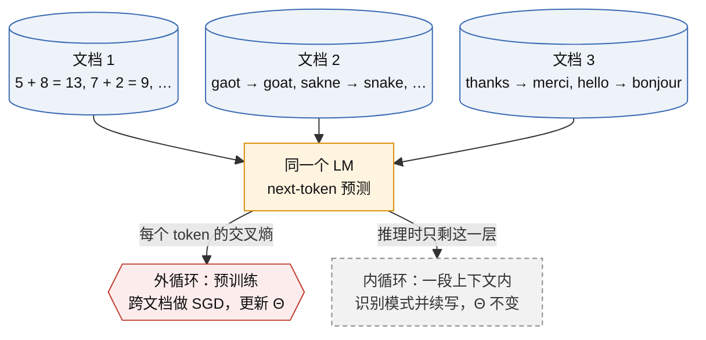
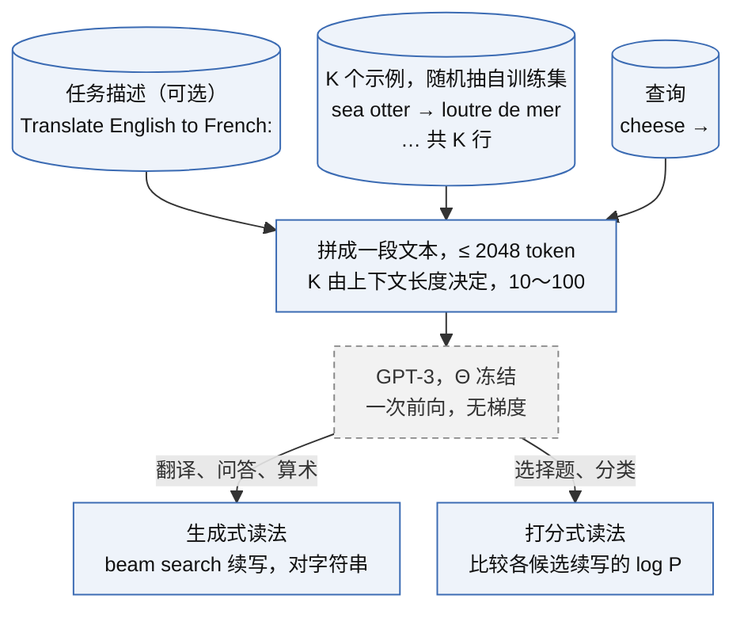
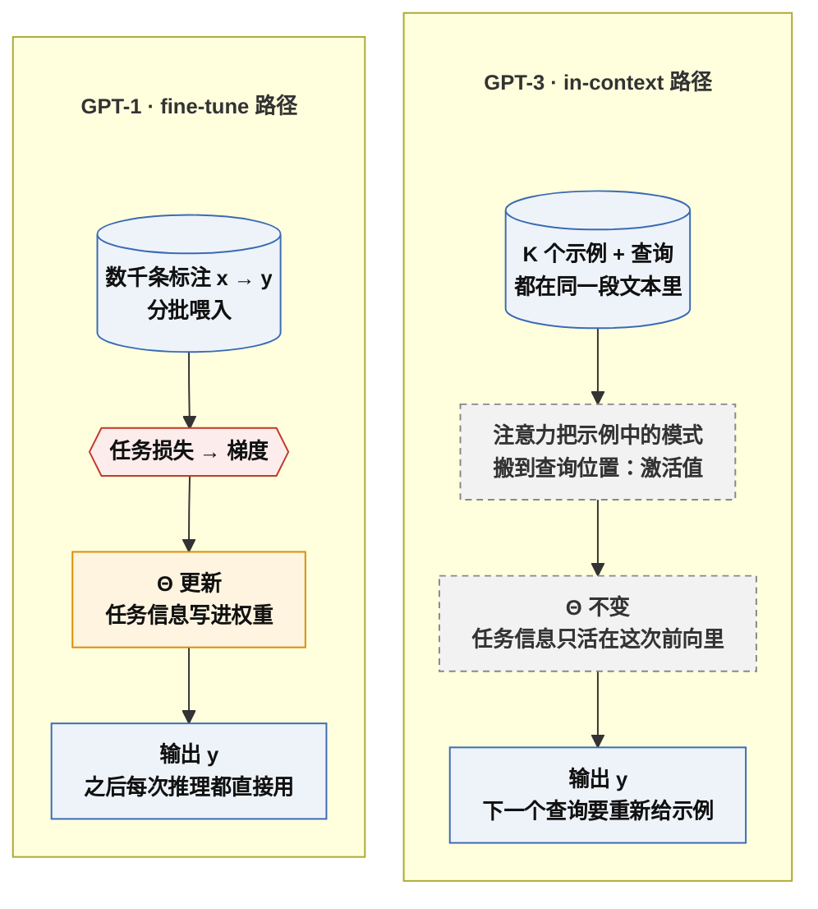
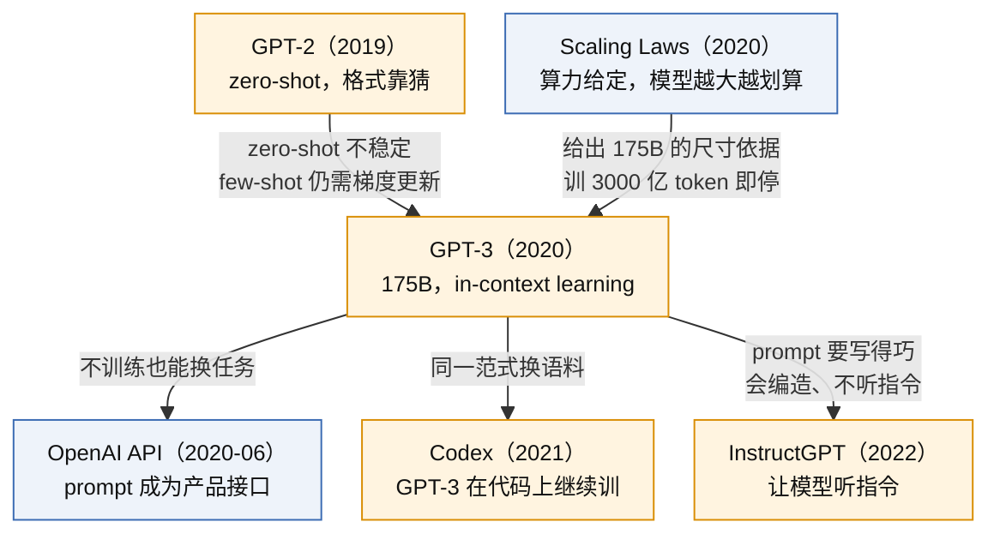
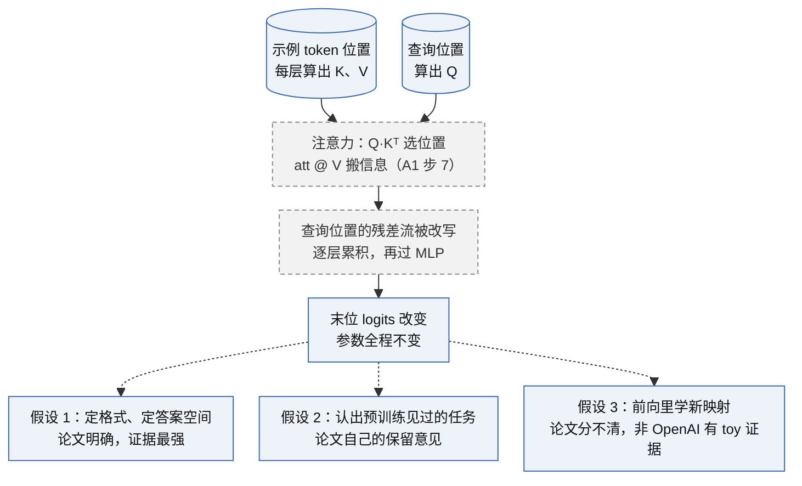
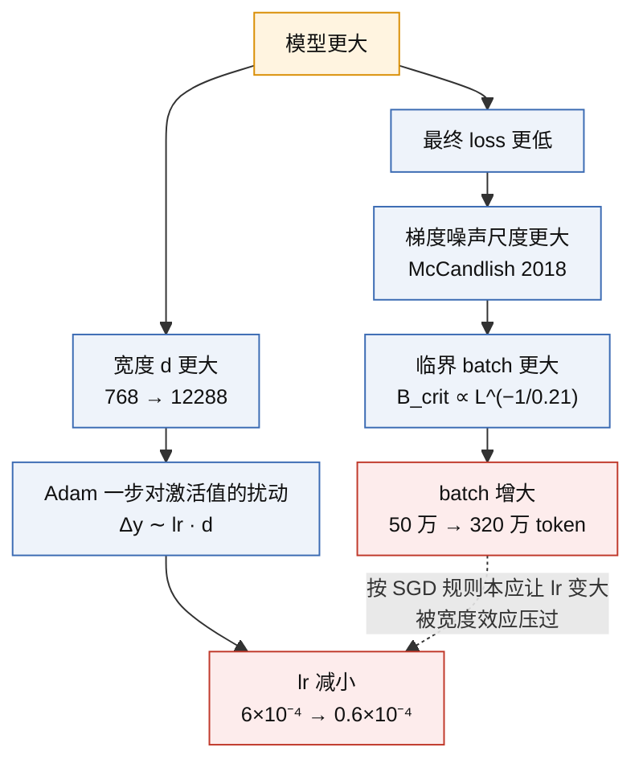
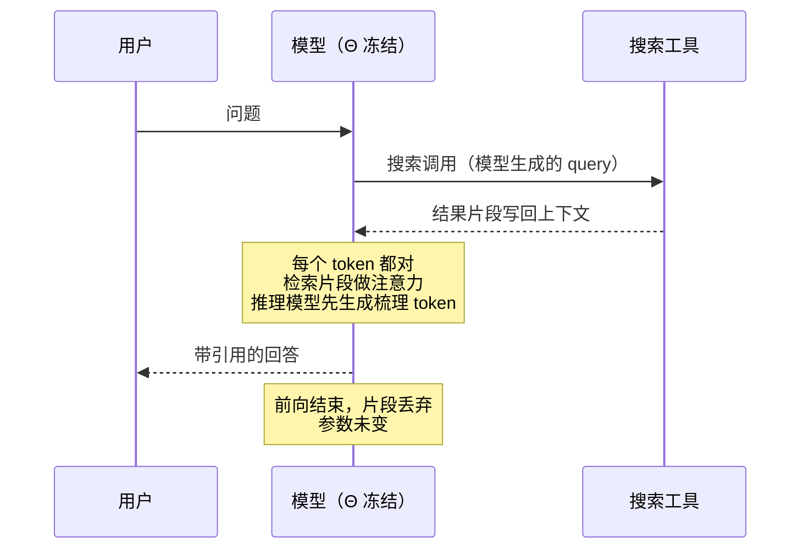
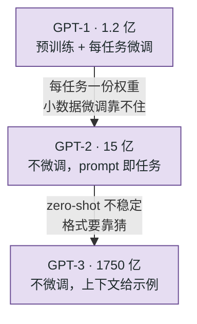
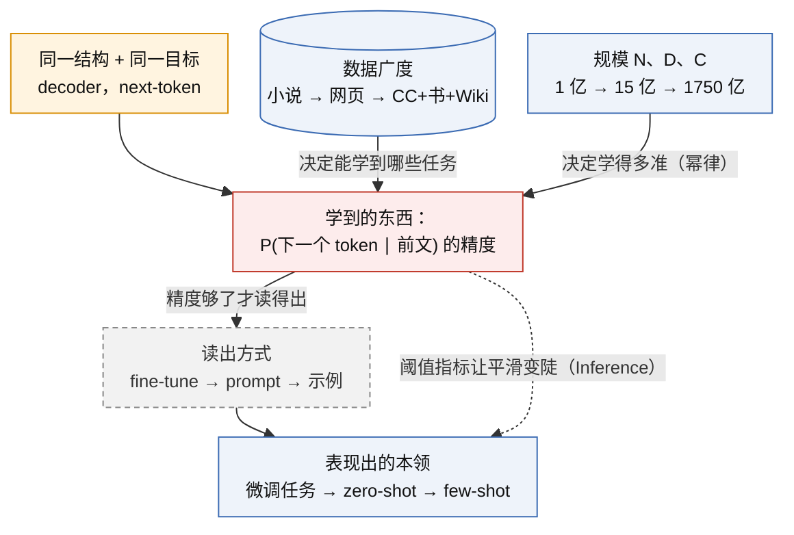
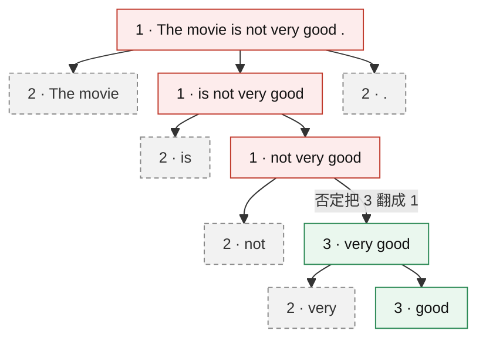

# GPT-3 与 In-context Learning

把任务示例直接写进输入文本，让一个足够大的预训练语言模型在不更新任何参数的情况下完成新任务；这种能力随模型规模增强，是 175B 参数的 GPT-3 论文（Brown 等，2020）的核心发现。

> [!success] Public algorithm
> 论文公开：8 个尺寸（125M → 175B）的层数、宽度、头数、batch、学习率；5 个数据源的 token 数、采样权重、训练中过几遍；总训练量 3000 亿 token；架构沿用 [[A3-gpt-2-zero-shot]] 并把注意力改为 dense 与 locally banded sparse 交替；zero / one / few-shot 的评测协议（K 的取法、示例分隔、打分归一化、beam search 参数）；42 个基准的全部分数；数据污染分析。

> [!info] Public system behavior
> 模型只通过 API 提供（2020-06 起），未放出权重。OpenAI 官方 GitHub 的 gpt-3 仓库只有论文附录里的数据污染统计和示例，没有训练或推理代码。

> [!question] Inference
> （1）175B 的尺寸与"只训 3000 亿 token"是按 [[A4-scaling-laws]] 的 Kaplan 分配做的决定：论文引用 Kaplan 并说沿其趋势选尺寸，按 6·N·D 验算 3.14×10²³ FLOPs 也对得上；（2）few-shot 到底是推理时"学会"新任务还是"认出"预训练里见过的任务，论文自己说区分不了（§5），任何一边都不能写成结论。

> [!danger] Unknown
> 权重；训练代码与并行方案（只说用了 V100 集群与模型并行）；Common Crawl 过滤分类器与去重的具体实现；Books2 的来源；每个尺寸的训练 loss 曲线数值。

## 1. 承接的瓶颈

上一代是 [[A3-gpt-2-zero-shot]]：任务写进文本、不改参数就能做任务，但 zero-shot 的结果不稳定，任务格式要靠 prompt 去猜，多数基准远不及 fine-tune。要让结果稳定，当时的办法仍是 [[A2-sentiment-neuron-gpt-1]] 式的 fine-tune，每个任务数千条标注、一份权重，并且 fine-tune 后的模型在分布外表现差，基准分数夸大了真实能力。

同时 [[A4-scaling-laws]] 给出了"算力给定时应把大部分预算花在参数上"的依据，也留下一个待验证的问题：loss 平滑下降，下游能力会跟着平滑上升吗？

GPT-3 论文把这两条线接在一起：把 GPT-2 放大 100 倍，并把"给几个示例"这件事从梯度更新改成写进上下文。

## 2. 核心思想

### 2.1 meta-learning 框架：外循环学参数，内循环在上下文里换任务

论文图 1.1 的意思：预训练语料里天然夹着"同一模式反复出现"的片段。梯度下降跨文档更新 Θ 是外循环；每一段文本内部，模型要靠前文识别当前是什么模式并续写，是内循环。in-context learning 就是内循环能力，它是预训练的副产物，不是单独训出来的。"meta-learning"是类比，不是说用了 MAML 一类算法，训练目标从头到尾只有 next-token 交叉熵。



### 2.2 few-shot 的一次前向

三段材料拼成一段文本：可选的任务描述、K 个从训练集随机抽的示例、要回答的查询。参数冻结，做一次前向。答案的读法沿用 [[A3-gpt-2-zero-shot]] §2.3 的两种：生成式与打分式。



三种条件只差 K：zero-shot 只有任务描述（K = 0）；one-shot K = 1；few-shot K 取 10～100，以塞满 2048 token 为限。三者都不更新参数。论文明确说没有对 GPT-3 做任何 fine-tune，留作未来工作。

### 2.3 对照：fine-tune 路径 vs in-context 路径

看两件事：参数是否变化、任务信息从哪条路进入模型。fine-tune 把任务写进权重，永久生效；ICL 把任务留在这一次前向的激活值里，前向结束就消失。



逐项对比见 §10。

### 主线因果位置



## 3. 目标函数与数据

训练目标不变，仍是 [[A1-transformer-decoder-next-token]] 的 next-token 交叉熵。论文没有为 ICL 引入任何新损失。新的是推理时的条件分布：

$$
\hat{y} \;=\; \arg\max_{y \in \mathcal{Y}}\; \log P_{\Theta}\bigl(y \,\big|\, d,\; x_1, y_1, \ldots, x_K, y_K,\; x\bigr)
$$

打分式读法的两种归一化（论文 §2.4）：候选长度不同时比较每 token 平均值 $\frac{1}{\lvert y \rvert}\log P_\Theta(y \mid c)$；ARC、OpenBookQA、RACE 改用

$$
\frac{P_\Theta(y \mid c)}{P_\Theta(y \mid a)},\qquad a = \text{``Answer: ''}
$$

符号说明：

| 记号            | 含义                             | 对应步骤          |
| ------------- | ------------------------------ | ------------- |
| $\Theta$      | 预训练参数，推理时冻结                    | 图 2.2 的 LM 节点 |
| $d$           | 自然语言任务描述，可为空                   | zero-shot 只有它 |
| $(x_i, y_i)$  | 第 $i$ 个示例，随机抽自该任务的训练集          | few-shot 的上下文 |
| $K$           | 示例数，0 / 1 / 10～100             | 三种条件的唯一差别     |
| $c$           | 整段上下文 $d, x_1, y_1, \ldots, x$ | 一次前向的输入       |
| $\mathcal{Y}$ | 候选答案集合                         | 打分式读法的输出空间    |
| $a$           | 无内容的"答案上下文"，用来去掉候选自身的先验        | 归一化           |

生成式读法用 beam search，束宽 4，长度惩罚 0.6。

数据（论文表 2.2）：

| 数据源 | token 数 | 采样权重 | 训练中过几遍 |
|---|---:|---:|---:|
| Common Crawl（过滤后） | 4100 亿 | 60% | 0.44 |
| WebText2 | 190 亿 | 22% | 2.9 |
| Books1 | 120 亿 | 8% | 1.9 |
| Books2 | 550 亿 | 8% | 0.43 |
| Wikipedia | 30 亿 | 3% | 3.4 |

按质量加权采样：高质量的小语料被看多遍，Common Crawl 不到一遍。过滤办法是训一个分类器区分 WebText 风格与原始 Common Crawl，只保留高分文档；再做文档级模糊去重。

## 4. 训练循环

与 GPT-2 相同的 decoder（pre-LN、修改过的初始化、可逆分词），注意力改为 dense 与 locally banded sparse 交替（来自 Sparse Transformer，OpenAI 2019）。8 个尺寸全部训 3000 亿 token，Adam，梯度裁剪 1.0，cosine 学习率衰减到 10%，前 3.75 亿 token 线性升 batch。

| 模型 | 层数 | d_model | 头数 | batch（token） | 学习率 |
|---|---:|---:|---:|---:|---:|
| 125M | 12 | 768 | 12 | 50 万 | 6.0×10⁻⁴ |
| 350M | 24 | 1024 | 16 | 50 万 | 3.0×10⁻⁴ |
| 760M | 24 | 1536 | 16 | 50 万 | 2.5×10⁻⁴ |
| 1.3B | 24 | 2048 | 24 | 100 万 | 2.0×10⁻⁴ |
| 2.7B | 32 | 2560 | 32 | 100 万 | 1.6×10⁻⁴ |
| 6.7B | 32 | 4096 | 32 | 200 万 | 1.2×10⁻⁴ |
| 13B | 40 | 5140 | 40 | 200 万 | 1.0×10⁻⁴ |
| 175B | 96 | 12288 | 96 | 320 万 | 0.6×10⁻⁴ |

上下文 2048。175B 算力约 3.14×10²³ FLOPs（3640 PF-days）。学习率随尺寸递减、batch 随尺寸递增，与 [[A4-scaling-laws]] 的临界 batch 结论一致。学习率与 batch 两列凭记忆，待核对。两列为何反向变化见 §11.4。

## 5. 推理行为

- 同一份权重，换 prompt 就换任务；任务知识不保留到下一次查询，每次都要重新给示例；
- K 越大一般越好，但收益递减，且受 2048 token 上限约束；
- 对示例的选择和顺序敏感，论文用随机抽样并报告单次结果，没有报告方差；
- 生成质量：175B 生成的约 200 词新闻，人类判别准确率约 52%，接近随机（125M 对照组约 76%，凭记忆待核对）；
- 论文把 LAMBADA 的提升归于 few-shot 修正了格式：示例告诉模型"只填一个词"，zero-shot 时模型不知道该停在哪。

## 6. Scaling 维度

论文图 1.2：42 个基准平均准确率对参数量作图，zero / one / few-shot 三条曲线都随 N 上升，few-shot 升得最快，差距在 175B 处最大。这意味着"从上下文里学"这件事本身随规模增强。图 3.1 把 [[A4-scaling-laws]] 的 L(C) 曲线再延长两个数量级，175B 略偏离趋势线。

| 基准（175B） | zero-shot | one-shot | few-shot | 对照 |
|---|---:|---:|---:|---|
| LAMBADA acc | 76.2 | 72.5 | 86.4 | 此前 SOTA 68.0 |
| TriviaQA | 64.3 | 68.0 | 71.2 | 超过当时 fine-tune 的开放域 SOTA |
| SuperGLUE 平均 | — | — | 71.8 | fine-tune BERT-Large 69.0，fine-tune SOTA 89.0 |
| 两位数加法 | — | — | 100 | 三位数 80.4，四位数 25.5，五位数 9.3 |
| WiC | — | — | 49.4 | 低于随机 50 |

算术任务是最清楚的"规模阈值"例子：13B 以下几乎不会两位数加法，175B 全对。这是论文自己的数据，可以说"该能力在这个尺寸区间出现"；不能推断它是怎么在内部实现的。数值凭记忆，待核对。

## 7. 证据

| 主张 | 证据 | 来源 |
|---|---|---|
| 不更新参数就能做多种任务 | 42 个基准，zero / one / few-shot 均有分数 | 论文 §3 |
| ICL 能力随规模增强 | 8 个尺寸同一评测，few-shot 与 zero-shot 差距随 N 变宽 | 论文图 1.2、图 3.10（算术） |
| 部分任务达到或超过 fine-tune SOTA | LAMBADA、TriviaQA、PIQA、COPA 等 | 论文 §3.1～3.3 |
| L(C) 幂律延续到 175B | loss 对算力曲线平滑 | 论文图 3.1 |
| 分数不是靠背测试集 | 去污染后分数变化很小 | 论文 §4、图 4.2 |
| 生成文本人类难辨 | 判别准确率约 52% | 论文 §3.9.4 |

## 8. 局限

论文 §5 自列：

- 若干任务明显弱：ANLI、部分阅读理解（RACE、QuAC）、WiC 低于随机；
- 单向模型，不擅长需要回看和比较的任务，作者认为双向或去噪目标可能更好；
- 预训练目标对每个 token 一视同仁，不区分重要与否，也没有"目标导向"的信号，这一条直接指向 [[B3-instructgpt-chatgpt]]；
- 预训练样本效率极低，看过的文本远多于人一生所见；
- 分不清 few-shot 是"学"还是"认"；
- 175B 推理昂贵；不可解释；示例选择与顺序敏感；
- 偏见（性别、种族、宗教）与滥用风险，论文 §6 单独讨论。

E3 层面的局限：GPT-2 尺寸上 ICL 信号弱，示例顺序噪声可能与 K 的效应同量级。

## 9. 后续影响

- 直接影响 [[B3-instructgpt-chatgpt]]：GPT-3 需要精心设计的 prompt、会编造、不听指令，InstructGPT 用人类反馈对齐它；
- [[D1-codex-2021-webgpt]]：Codex 是 GPT-3 在代码上继续训练的结果，同一范式换语料；
- prompt 成为产品接口：OpenAI API（2020-06）第一次把"不训练、只写 prompt"卖给开发者；
- ICL 随规模增强的曲线后来被概括为"emergent abilities"讨论的起点（非 OpenAI 的后续综述，只作背景）；
- 推理阶段"多给上下文就更强"的思路，在 [[C2-o1-rl-on-cot]] 那里变成"多给推理 token 就更强"，对象从示例换成模型自己生成的思考。

## 10. 与相关方法的区别

| 维度 | GPT-1 fine-tune | GPT-2 zero-shot | GPT-3 few-shot |
|---|---|---|---|
| 参数是否变化 | 全部更新，另加 W_y | 不变 | 不变 |
| 任务信息进入路径 | 梯度 → 权重 | 任务描述文本 → 激活值 | 描述 + 示例文本 → 激活值 |
| 需要多少标注 | 数千～数万 | 0 | 10～100，只在推理时用 |
| 换任务的成本 | 重新训练、存一份权重 | 改一句 prompt | 改 prompt，多占上下文 |
| 任务知识保留到下次 | 是 | 否 | 否 |
| 主要弱点 | 过拟合窄分布、每任务一模型 | 格式靠猜、不稳定 | 上下文上限、示例敏感、不及 fine-tune SOTA |

与 [[A3-gpt-2-zero-shot]] §2.3 的"条件 × 读法"二维表的关系：zero / one / few-shot 是**条件**这一维上的三个取值，生成式 / 打分式是**读法**这一维；GPT-3 论文两维都用到了，且任意组合。

## 11. 追问与澄清

### 11.1 zero / one / few-shot 都不更新参数吗（2026-09-29 追问）

是。三种设置都只改输入文本，Θ 冻结，唯一变量是示例数 K（0 / 1 / 10～100）。论文明确把 few-shot 定义为"推理时只给示例、不做梯度更新"，并说明没有对 GPT-3 做过任何 fine-tune。

两个边界：

1. **词义变化。** GPT-3 之前，meta-learning 文献里的 few-shot / one-shot learning 一般指用少量样本做参数更新（MAML 一类）。GPT-3 论文重新定义了这个词，读其他论文时先确认指的是"少量样本 fine-tune"还是"上下文示例"。
2. **参数不变，激活值变。** 示例信息进入的是每一层注意力的 K、V；查询位置通过注意力读到示例里的模式，输出因此改变。前向结束这些激活值就丢弃，下一个查询要重新给示例。这是 §2.3 图里"任务信息只活在这次前向里"的含义，也是与 [[A2-sentiment-neuron-gpt-1]] 的 fine-tune（写进权重、永久生效）的本质区别。

一句话：三种条件改的是输入，fine-tune 改的是权重。

### 11.2 n-shot 是靠注意力"激活输出范式"吗（2026-10-01 追问）

**通道层：是架构事实。** 示例与查询在同一段文本里，模型中唯一跨位置搬信息的操作是注意力加权求和（[[A1-transformer-decoder-next-token]] 步 7）。示例 token 在每层算出 K、V，查询位置用 Q 去选去读，结果写进查询位置的残差流，逐层累积后改变末位 logits。参数不变，MLP 逐 token，没有别的路径。

**内容层：示例激活了什么，三个候选，证据强弱不同。**

| 假设 | 内容 | 证据 | 级别 |
|---|---|---|---|
| 1 定格式、定答案空间 | 该输出哪类 token、在哪停 | LAMBADA zero 76.2 → few 86.4，论文归因于示例修正"只填一个词" | 论文明确说明 |
| 2 认出预训练里见过的任务 | 示例是"任务名"，从预训练学到的子分布里挑一个 | 论文 §5 承认区分不了"学"与"认" | Inference |
| 3 前向里学新映射 | 真正拟合 x → y | 合成任务有分数但可能在预训练见过；非 OpenAI 工作在 toy 线性回归上证明 transformer 能在上下文里做类似梯度下降的事 | 非 OpenAI，toy |

"激活合规的输出范式"对应假设 1 加一点假设 2，是证据最强的部分；但论文立场是"分不清"，不能写成"ICL 的机制就是这个"。

非 OpenAI 补充（只作参考，不推到 GPT-3 内部）：Anthropic 2022 的 induction heads，在小模型里找到"找当前 token 上次出现的位置、抄它后面的东西"的注意力头，是"示例交叉"最具体的电路实现，出现时刻与 ICL 能力上升重合；Min 等 2022 把示例标签随机打乱，few-shot 准确率掉得很少，支持"示例主要提供格式、标签空间与输入分布"。



E3 可测：加"示例标签随机打乱"的 K = 8 对照。准确率与正常示例接近 → GPT-2 尺寸上示例主要激活格式（假设 1）；掉到 zero-shot 水平 → 标签映射被用到（假设 3）。

### 11.3 ICL 是什么（2026-10-11 追问）

定义：把任务的几条"输入 → 输出"示例写进 prompt，让预训练好的 LM 靠续写完成新输入，全程不更新参数。术语由 GPT-3 论文提出。三个要素：

- **in-context**：任务信息放在输入文本里，不在权重里；
- **learning**：模型在一次前向里识别前文的模式并续写（如 `sea otter → loutre de mer ⏎ cheese →` 续写 fromage），没有为该任务做过梯度更新；
- **不更新参数**：与 [[A2-sentiment-neuron-gpt-1]] 的 fine-tune 的本质区别，任务只存在于这次前向的注意力激活值里（§11.1、§11.2）。

zero / one / few-shot 是 ICL 按示例数分的三档条件。重要性：把"换任务"从"重新训练"变成"换一段 prompt"，是 OpenAI API 与 prompt 工程的起点；示例带来的提升随规模变大（§6）是论文的核心证据。

### 11.4 学习率为何随尺寸递减、batch 为何随尺寸递增（2026-10-11 追问）

论文只给数值并说沿用 Kaplan 2020，未解释原因。以下解释来自 OpenAI 另两篇公开论文（batch）与一般优化理论（学习率），不是 GPT-3 论文的披露。

| 模型 | $d_{\text{model}}$ | batch（token） | 峰值 lr | 步数 ≈ 3000 亿 ÷ batch |
|---|---:|---:|---:|---:|
| 125M | 768 | 50 万 | 6.0×10⁻⁴ | 60 万 |
| 1.3B | 2048 | 100 万 | 2.0×10⁻⁴ | 30 万 |
| 13B | 5140 | 200 万 | 1.0×10⁻⁴ | 15 万 |
| 175B | 12288 | 320 万 | 0.6×10⁻⁴ | 9.4 万 |

**batch 递增：模型大 → loss 低 → 梯度噪声尺度大 → 临界 batch 大。** McCandlish 等 2018（OpenAI）：梯度噪声尺度衡量把梯度估准所需的样本数；batch 低于它时翻倍 batch ≈ 步数减半，高于它则多出的 token 白算。Kaplan 2020 拟成只依赖 loss 的函数（[[A4-scaling-laws]] §11.6）：

$$
B_{\text{crit}}(L) = \frac{B^*}{L^{1/\alpha_B}},\qquad B^* \approx 2\times10^{8}\ \text{tokens},\ \alpha_B \approx 0.21
$$

loss 从 3 降到 2 nats，$B_{\text{crit}}$ 从约 100 万涨到约 700 万 token。batch 跟的是"该模型最终能到的 loss"，不是参数量本身。同一逻辑用于训练内部：所有尺寸的 batch 从 3.2 万 token 线性升到满值（前 40～120 亿 token），因为早期 loss 高、$B_{\text{crit}}$ 小。系统层面大 batch 才能喂饱几百张 V100，但"喂饱"不等于"不浪费"，是临界 batch 保证两者一致。

**lr 递减：宽度效应压过了 batch 效应。** 按 SGD 线性缩放规则，batch 大、噪声小，lr 应变大；GPT-3 的 lr 却变小，说明宽度效应更强。机制：Adam 每个参数每步约移动 lr，与梯度大小无关；线性层 $y = Wx$ 的 $\Delta y_i = \sum_{j=1}^{d} \Delta W_{ij} x_j$，同一行的 $\Delta W_{ij}$ 符号由 $g_i x_j$ 决定、彼此相关，所以 $\Delta y_i \sim \text{lr}\cdot d$。保持每步对激活值的扰动不变需 $\text{lr} \propto 1/d$。GPT-3：$d$ 增 16 倍，lr 降 10 倍，介于 $1/d$ 与 $1/\sqrt d$ 之间。Kaplan 附录的经验拟合 $\text{lr}(N) \approx 0.003239 - 0.0001395\ln N$（凭记忆待核对）在 1.25 亿处给 6.7×10⁻⁴，与 GPT-3 一致，但代到 1750 亿为负，说明大尺寸的 lr 不是这个式子外推的。"$1/d$"的系统化是 2022 年 µP（Yang 等，微软与 OpenAI 合作，在 GPT-3 6.7B 验证）：换参数化后最优 lr 不随宽度变。GPT-3 训练时没有它。



合起来：大模型每步看的 token 多 6.4 倍、步长小 10 倍、总步数少 6.4 倍，靠"每步更准、步数更少"而非"每步更大"达到低 loss，是 §6 样本效率的另一面。对应 E2：四个尺寸共用 lr 3×10⁻⁴、batch 64 把两条规律都忽略了；可选第三轮给 s1、s2 换 lr 1×10⁻³ 测的正是"小模型能吃更大步长"。

公开边界：数值与"沿用 Kaplan"是 Public；临界 batch 是 OpenAI 另两篇论文的 Public algorithm；lr 与宽度的关系是一般理论加 µP 的事后解释，Inference；每个尺寸是否扫过 lr、175B 的值怎么定，Unknown。

### 11.5 induction heads 是什么（2026-10-11 追问，ELI5）

非 OpenAI 参考（Anthropic：Elhage 等 2021 *A Mathematical Framework for Transformer Circuits*；Olsson 等 2022 *In-context Learning and Induction Heads*），只用来解释通用机制，不推到 GPT-3 内部。

机制是两个注意力头跨层配合，完成规则 `[A][B] … [A] → 预测 [B]`：

- **previous-token head**（前层）：让每个位置的残差流带上"我前一个 token 是谁"；
- **induction head**（后层）：当前 token 为 A 时，query 去匹配"前一个 token 是 A"的位置，即找到上一次 A 后面的 B，再把 B 的身份抄到输出（copy）。

因为第二个头要用第一个头写进残差流的信息（K-composition），一层 attention-only 模型学不出来，两层可以。Olsson 等 2022 的核心证据：小模型训练中这对头在一个很窄的窗口内"相变"式出现，loss 曲线在该处有一个台阶，同一时刻"上下文越长、后段 token 预测越准"的 in-context learning 指标跳升；在大模型里只是相关证据，属于 Inference。与本卡的关系：它是 §11.2"示例交叉"最具体的电路实现，也是 [[E3-icl-probe|E3]] 打乱标签对照想分离的东西（抄标签分布 vs 学映射）。ELI5 图画书见 2026-10-11 session 的 Artifact。

**"相变"具体指什么（2026-10-11 追问）。** 不是 loss 平滑下降中的某一点，而是一个可测量的开关：

- 测法：给模型一串随机 token 重复两遍，第二遍只能靠抄第一遍。对每个头算 prefix-matching score（第二遍某 token 的注意力是否落在第一遍同 token 的下一个位置）和 copying score（OV 回路是否把被注意 token 的身份写到输出）。
- 现象：两项分数在训练早期一个很窄的窗口内从接近 0 跳到接近 1，同一窗口 loss 曲线出现一个小台阶（bump），loss 对位置的梯度结构也在此重排。窗口之前模型只有 unigram/bigram 与局部头，之后"找上次、抄后面"能力稳定存在。

**论文在论证什么。** 主张：in-context learning 的大部分（小模型里）或相当一部分（大模型里，假设）由 induction heads 实现。论文把 ICL 量化为一把尺子：第 500 个 token 的 loss 减去第 50 个 token 的 loss（越负表示越能靠上下文变准）。证据分三类：

1. 同时发生：不同尺寸模型里，ICL score 的突变与 induction heads 的出现落在同一窗口；
2. 拿掉就掉：在小模型里 ablate 这些头，ICL score 随之下降；
3. 帮它出现就提前：一层 attention-only 模型本来长不出该电路，改一处结构（smeared key，让单层也能拿到前一 token 信息）后一层模型也长出 induction heads，ICL 突变随之出现。

作者给出的把握：小 attention-only 模型里机制可完整拆解，证据强；大模型里只有共现与"行为相似"（大模型的同类头还做模糊匹配 A′ B′ … A → B，如翻译、照格式续写），属相关证据，作者自述为假设。对本课程：这是 ICL 机制的最具体候选解释，但不能据此说 GPT-3 内部"就是"这样。

**这两个头是怎么训练出来的（2026-10-11 追问）。** 没有专门训练：模型只用标准自回归 next-token loss 在普通文本上训练，梯度同时更新所有头的 $W_Q, W_K, W_V, W_O$。"previous-token head""induction head"是研究者训练完成后用重复乱码测试逐头打分、再按功能起的名，训练时不存在这两个角色。它们会长出来，是因为自然文本里重复（名字、短语、格式）很多，"找上次出现、抄后面"直接降低 loss，梯度自然朝这个方向走。两个头在电路里的分工：

- previous-token head（前层）：QK 回路靠位置信息让第 $i$ 格注意第 $i-1$ 格，OV 回路把第 $i-1$ 格的 token 身份写进第 $i$ 格的残差流；
- induction head（后层）：query 来自当前 token A 的身份，key 读前层写入残差流的"前一 token 身份"（K-composition），因此注意力落在"前一个是 A"的位置，OV 回路把该位置的 token B 抄到 logits。

为什么是相变而不是渐进（直觉解释，论文未给完整理论）：两个头只有同时存在才能降低 loss，单独一个几乎无用，所以早期两者的梯度都很小；一旦都略有雏形，每一方变准都放大另一方的梯度，形成正反馈，分数曲线先平、后陡、再饱和。论文的 smeared key 对照与此一致：把前一 token 的 key 直接混进当前 key，单层模型无需等待另一个头，也能长出 induction heads。本段全部是非 OpenAI 的 Anthropic 公开分析与据此的推断，GPT-3 内部对应情况 Unknown。

**影响力定位（2026-10-11 追问）。** Semantic Scholar 2026-10-11 引用数：Olsson 2022 约 1,075，在 Anthropic 的 LLM 论文里排第 8～9 位（前面是 HH-RLHF、Constitutional AI、LMs (Mostly) Know What They Know、Sycophancy、General Language Assistant、Mathematical Framework、Model-Written Evaluations、Toy Models of Superposition）。按主题看，它是 mechanistic interpretability 与 ICL 机制研究的奠基文献，"induction head"已成通用术语，后续 ICL 机制论文几乎都以它为起点。来源表见 `sources/official-sources.md` R-6、R-7。

**"按梯度拧权重"发生在哪个阶段（2026-10-11 追问）。** 混淆点：把"训练程序的规则"听成了"对模型下的指令"。澄清：

- 权重在训练开始前就存在，是随机初始化的张量（E1 的 `model.py` 里 `nn.init.normal_(std=0.02)`），不是推理时凭空出现的；
- 训练（预训练）循环由工程师写的程序执行，模型本身不"接收"任何指令：取一段训练文本 → 前向算出下一 token 分布 → 与文本里真实的下一 token 算交叉熵 → 反向传播得梯度 → 优化器更新全部权重（E1 `train.py` 的 `zero_grad / loss.backward / optimizer.step`）。重复数十亿步后把权重存盘；
- 推理只有前向这一步，权重冻结，无 loss、无梯度、无更新（E1 `generate` 在 `@torch.no_grad()` 下）。前向计算两边完全相同，差别只在后面有没有"对答案并更新"；
- induction heads 在预训练阶段长出来，推理时只是在跑。本卡的 ICL（§11.1）全部发生在推理阶段：权重不变，这对头靠注意力在当前上下文里"找上次、抄后面"。prompt 里的"指令"只改变前向的输入，不改变任何权重。

**三个"随机"不是一回事（2026-10-11 追问）。** 误读："LLM 学的是随机数字"。澄清：权重初始值是随机数（起点，之后被改）；训练数据是真实文本（学的内容）；"随机 token 重复两遍"是研究者的诊断探针，对训练过程中保存的各个 checkpoint 逐个施测，把 prefix-matching / copying 分数连成曲线才看到相变，探针本身不进训练。"突然学到技能"要限定为：只有"找上次出现、抄后面"这一项电路是窄窗口一次成型，模型其他能力与整体 loss 仍是渐进的；观测对象是 Anthropic 自训的 attention-only 小模型与至 13B 的全尺寸模型，推广到其他 LLM 属 Inference。

**"随机 token 重复两遍"探针的具体构造（2026-10-11 追问）。** 从词表均匀抽 $N$ 个 token $t_1 \dots t_N$，原样拼接成 $t_1 \dots t_N\, t_1 \dots t_N$。第一遍无任何可预测结构，loss 接近 $\log V$；第二遍每一格唯一可行的预测路径是"回到第一遍同 token 的位置、抄其后继"，因此第二遍成绩只反映该电路，排除了语言知识。在此序列上量三个量：(1) 整体：第二遍 loss 相对第一遍的下降；(2) prefix-matching score：第二遍位置 $N+k$（token $t_k$）时某头落在位置 $k+1$ 的注意力权重；(3) copying score：该头的 OV 回路是否提高被注意 token 自身的 logit。对每个 checkpoint 重复计算即得相变曲线。只重复两遍是为了让每格恰有一个先例，分数无歧义。

**为什么叫 previous-token head（2026-10-11 追问）。** 命名轴不同：next-token prediction 是整个模型的训练目标；previous-token head 是某个注意力头事后观察到的注意力模式，第 $i$ 格的注意力集中在第 $i-1$ 格（注意力矩阵的黑块在对角线左移一格）。同类命名（induction head、attend-to-first-token head）都按"注意力落在哪里"起名，与训练方式无关。它在普通 next-token 训练中出现的原因：第 $i$ 格预测 $t_{i+1}$ 时，$t_{i-1}$ 是仅次于 $t_i$ 的廉价信息，把它写进残差流相当于 bigram 升为 trigram 统计，直接降 loss，因此早于 induction head 形成，之后被后者的 K 回路复用。

**两个头如何配合、形状与能力的关系（2026-10-11 追问）。** 模型不"关注"形状：两种注意力模式分别属于不同层的两个头（GPT-2 small 共 144 个头），同一次前向里逐层执行，唯一的耦合是后者的 K 回路读前者写进残差流的"前一 token 身份"。"形状出现"与"通过重复乱码探针"不是先后因果，而是同一电路的两种量法（逐头注意力打分 vs 整体第二遍 loss），两条曲线在同一窗口跳变正说明量的是同一对象；研究者的"发现"不影响模型。时序细节：previous-token head 因单独可降 loss 而更早形成，窄窗口内突变的是 induction head，探针分数随后者跳。

**ICL score 与探针是两把尺子（2026-10-11 追问）。** 误读：ICL 分数也是靠复述乱码打的。澄清：ICL score 在普通文本上量，定义为第 500 个 token 的 loss 减第 50 个 token 的 loss，针对整个模型，不涉及机制；随机重复探针在乱码上量，针对单个头，检测机制。论文的共现证据正要求两者材料不同、独立测量却同窗口跳变，否则论证循环。

**induction head 的注意力形状（2026-10-11 追问）。** 在 `k 7 q m z | k 7 q m z` 上，行为当前位置、列为被注意位置：

```text
              1   2   3   4   5   6   7   8   9  10
             (k) (7) (q) (m) (z) (k) (7) (q) (m) (z)
第 6 格 (k)   ·   ■   ·   ·   ·   ·
第 7 格 (7)   ·   ·   ■   ·   ·   ·   ·
第 8 格 (q)   ·   ·   ·   ■   ·   ·   ·   ·
第 9 格 (m)   ·   ·   ·   ·   ■   ·   ·   ·   ·
第 10 格 (z)  ·   ·   ·   ·   ·   ■   ·   ·   ·   ·
```

第二遍每行的黑块落在"上次出现位置 + 1"，第一遍无先例时注意力分散（常堆在首 token）。与 previous-token head 对比：两者都是平行于对角线的斜线，但 previous-token head 固定左移 1 格、由位置决定；induction head 左移 $N-1$ 格（$N$ 为重复周期）、由 token 身份匹配决定。辨认方法：改变重复周期，前者形状不变，后者斜线整体平移。

**探针怎么实施、"两遍"在什么阶段（2026-10-11 追问）。** "第一遍 / 第二遍"是同一条长 $2N$ 输入的前后两半，一次前向即完成，后半段"回看"前半段由因果注意力在前向内部完成，不分两次喂。实施：训练中定期存 checkpoint；对每个 checkpoint 在推理模式（冻结、`no_grad`）下喂入一个 batch 的随机重复序列，钩出各头注意力矩阵，从这一次前向取出后半段 loss 减前半段 loss、各头 prefix-matching 均值、copying score；按训练步数连成曲线。ICL score 对同一批 checkpoint 用普通文本另算，两条曲线共用训练步数轴。可在 E1 tiny GPT 上复现，步骤记在 E3 记录的可选扩展。

**2N 序列验的是机制不是知识（2026-10-11 追问）。** 该序列不含任何可学内容，模型对它唯一可行的策略是回看并复制，因此它只回答"复制电路是否已形成"与"长在哪个头"两个问题，并为后续在自然文本上观察、ablation 这些头提供定位。模型学到的内容来自训练文本，由 ICL score 与常规评测度量。

**从 2N 序列上取的三个量各答什么（2026-10-11 追问）。** 后半段 loss 减前半段 loss：模型整体是否会回看复制（能力在不在）；prefix-matching score：某头是否注意到"上次出现 + 1"（找对位置）；copying score：该头 OV 回路是否抬高被注意 token 的 logit（真的抄）。判定一个头为 induction head 须后两项同时高。此处 loss 是推理模式下对该序列算的普通 next-token 交叉熵，不反传。

**两类头在 $L \times H$ 网格里的位置关系（2026-10-11 追问）。** 层方向有硬约束：induction head 的 K 回路读 previous-token head 写入残差流的信息，故后者层号必须严格小于前者（一层模型不可能有）。头编号方向无意义：同层各头置换对称，位置随训练种子变化，编号只是指认用。多层全尺寸模型中的经验分布（Olsson 2022）：previous-token head 偏早层；induction head 不止一个、散在多层、集中在前半到中段，首层不会有；一个 P 可喂多个 I，模型越大 I 越多且出现模糊匹配型。记忆例子（Wang 等 2022 对 GPT-2 small 的分析，非 OpenAI/非 Anthropic，凭记忆待核）：P 在 L2H2、L4H11，I 在 L5H5、L5H8、L5H9、L6H9，符合"I 的层号 > P 的层号、头号无规律"。

**探针 token 的采样方式（2026-10-11 追问）。** 从整个词表均匀采样（论文设定，知识确认，未重开原文核对）。理由：按频率采样会让高频 token 在前半段内多次重复，先例不唯一；且 unigram 先验会压低前半段 loss，使"后半段减前半段"不再只反映复制。均匀采样下词表约 5 万、序列约百个 token，撞车概率极低，每格恰一个先例。副作用是抽中大量罕见 token，但探针只测复制不测识别，反而堵死了"靠认识猜"的路径。

### 11.6 µP 是哪篇论文（2026-10-11 追问）

"Tensor Programs V: Tuning Large Neural Networks via Zero-Shot Hyperparameter Transfer"，Yang、Hu 等，微软研究院主导、OpenAI 多位研究员合著（作者名单凭记忆待核对），NeurIPS 2021，arXiv 2203.03466，代码 github.com/microsoft/mup。µP（Maximal Update Parametrization）本身先在 "Tensor Programs IV"（Yang 与 Hu，ICML 2021，arXiv 2011.14522）提出；第五篇给出 µTransfer：µP 下最优 lr、初始化尺度随宽度不变，小模型调好直接搬到大模型。与 GPT-3 的唯一公开交集：用约 4000 万参数的代理模型调超参迁移到 GPT-3 6.7B，超过原 6.7B，调参开销约为一次 6.7B 预训练的 7%。

归类：非 OpenAI 参考（`sources/official-sources.md` R-5），用途是 §11.4 的对照。GPT-3 训练于 2020 年上半年，早于两篇 µP 论文，其 lr 表不可能由 µP 定；OpenAI 之后是否使用 µP 无官方披露，Unknown。

### 11.7 联网搜索的 chat 应用是不是在做 ICL（2026-10-11 追问）

**通道层：是同一条通道。** 检索到的网页片段和 few-shot 示例一样，作为 token 放进上下文，靠注意力被查询位置读取（§11.2），参数不更新，前向结束就丢弃，下一轮对话要重新检索（§11.1 的"不保留"性质）。知识分两处存放：**参数内知识**（预训练写进权重，有截止日期）与**上下文内知识**（推理时检索，新鲜，但只活在这次前向里）。

**术语层：通常不叫 ICL，叫 retrieval-augmented / grounded generation。** 区别在上下文里放的东西：GPT-3 的 ICL 放的是任务示范（x → y 对，教"怎么做"），检索放的是证据（事实片段，教"现在什么是真的"）。两者共用"上下文条件化"这一能力，是近亲，但 GPT-3 论文的 in-context learning 专指前者。

**"梳理和利用"发生在哪。** 没有推理阶段的模型里，梳理是隐式的：每生成一个 token 都重新对全部检索片段做一次注意力，比较、取舍都在激活值里完成，看不见。推理模型（[[C2-o1-rl-on-cot]]）里梳理变成显式的：模型先生成中间 token 去摘录、比对、排除矛盾的片段，再写答案，这部分是 Track C 的内容。

**与 GPT-3 few-shot 的三点不同。**

| 维度 | GPT-3 few-shot | 联网 chat |
|---|---|---|
| 上下文内容 | 任务示范 | 证据片段 |
| 谁组装上下文 | 用户手写 prompt | 模型自己发出搜索调用，系统把结果写回上下文（tool calling，[[D2-function-calling-deep-research]]） |
| 能力来源 | 预训练副产物，未针对训练 | 经过 SFT / RL 后训练，学会用检索结果并引用 |

**OpenAI 的公开脉络（Public system behavior）。** [[D1-codex-2021-webgpt]]（2021）：GPT-3 微调后操作文本浏览器，发搜索、点链接、摘引文，引文进入上下文后写带引用的答案，用模仿学习加 RM/RL 训练；ChatGPT search 与 Responses API 的 web_search 工具：搜索结果作为工具输出进入上下文，模型引用来源；Deep Research（2025）：多步检索与推理交替。检索结果如何排序、截断、重排，内部实现 Unknown。

**仍会出错的地方。** 模型可以忽略或误读检索片段，引用不等于正确；长上下文里中间位置的内容利用率低（"lost in the middle"，非 OpenAI，Liu 等 2023）。



### 11.8 和 Claude 对话算不算 ICL，术语是什么（2026-10-11 追问）

**按 GPT-3 论文的用法，算。** 论文把 zero / one / few-shot 都称为 in-context learning 的三种条件：模型都靠上下文判断当前任务，K = 0 时上下文只有自然语言指令。**按后来文献的习惯，不算。** ICL 多被收窄为"上下文里有示例"的 few-shot；没有示例的直接提问叫 zero-shot prompting 或 instruction following（指令遵循）。两种用法都存在，写作时说明取哪种即可。

| 你做的事          | 常用术语                                        | 机制                                                                |
| ------------- | ------------------------------------------- | ----------------------------------------------------------------- |
| 直接提问，不给例子     | zero-shot prompting / instruction following | 上下文条件化；按指令行事的能力来自后训练（SFT + RLHF，[[B3-instructgpt-chatgpt]]），不是预训练副产物 |
| 消息里贴几个例子      | few-shot prompting，即狭义 ICL                  | 示例进上下文，§2.2                                                       |
| 多轮对话          | 对话历史即上下文；"记忆"只是 context / KV cache          | 参数不变，§11.1                                                        |
| system prompt | 前置的条件文本                                     | 同上                                                                |
| 让它搜索、读文件      | RAG / tool use                              | §11.7                                                             |
| 以上总称          | prompting；广义的 in-context（与 in-weights 相对）   | 任务信息走激活值而非权重                                                      |

与 GPT-3 的因果连接：GPT-3 base 的 zero-shot 不稳定，所以论文主推 few-shot；[[B3-instructgpt-chatgpt]] 的目标正是让 zero-shot 指令直接可用，这是 B3 要讲的瓶颈。今天和 Claude 对话默认是 zero-shot 指令遵循，贴例子时才回到狭义 ICL。"in-context vs in-weights learning"这对术语来自非 OpenAI 文献（Chan 等 2022，DeepMind），只作参考。

### 11.9 GPT-1 / GPT-2 / GPT-3 的模型区别（2026-10-11 追问，ELI5）

**结构几乎没变，变的是三件事：脑子大小、读的书、怎么让它干活。** 三代都是 Transformer decoder + next-token 预训练；第三件事才是每代论文的核心贡献。

| | [[A2-sentiment-neuron-gpt-1\|GPT-1]]（2018） | [[A3-gpt-2-zero-shot\|GPT-2]]（2019） | GPT-3（2020） |
|---|---|---|---|
| 参数 | 1.17 亿 | 15 亿（4 个尺寸） | 1750 亿（8 个尺寸） |
| 层 / 宽 / 上下文 | 12 / 768 / 512 | 48 / 1600 / 1024 | 96 / 12288 / 2048 |
| 数据 | BooksCorpus 约 7000 本书 | WebText 约 800 万网页、40 GB | 过滤 Common Crawl + WebText2 + Books1/2 + Wikipedia，训 3000 亿 token |
| 结构小改 | post-LN decoder | pre-LN、残差初始化缩放、字节级 BPE | 同 GPT-2，加交替的 dense / locally banded sparse attention |
| 怎么用 | 每任务微调，加一个 $W_y$ | 不微调，prompt 即任务说明（zero-shot） | 不微调，上下文里给示例（few-shot ICL） |
| 公开 | 论文 + 代码 + 权重 | 论文 + 代码 + 权重，分四次放出 | 论文公开，权重不公开，只有 API |

ELI5 版本："同一个学生的三个年纪"。GPT-1 学了还要补课（每个任务重训一次，多一份权重）；GPT-2 学了听得懂一句话（任务写进文本，参数不动）；GPT-3 学了看几个例子就会（示例进上下文，只在这一次前向里起作用）。"越大越不用教"是 GPT-3 论文的主要发现：示例带来的增益随尺寸变宽（图 1.2）。



图板：https://claude.ai/artifact/BbXMezmJyrEVJuUiyuXUmG（六张图：脑子大小、数据量、三种用法对比、尺寸与 ICL 增益示意、参数表、三句话）。

### 11.10 SST-2 是什么（2026-10-11 追问）

Stanford Sentiment Treebank 二分类版（Socher 等 2013，斯坦福，非 OpenAI）。Rotten Tomatoes 影评单句约 1.1 万条，每句句法树上的每个短语都有情感标注（treebank 由此得名）；SST-5 五档，SST-2 去掉中性合并为正 / 负。GLUE 版训练集约 6.7 万条（含短语）、验证集 872 句、测试集 1821 句。课程里已出现两次：[[A2-sentiment-neuron-gpt-1]] §7 的线性探针结果与 GPT-1 表 4。E3 选它的原因：与 A2 同一任务，对比"微调读出"与"示例读出"；句子短，8-shot 放得进 GPT-2 的 1024 上下文；两个标签各为单 token，打分式一次前向即可。

### 11.11 E3 里 GPT-2 的结构在哪定义（2026-10-11 追问）

E3 不定义模型，`load_model` 用 Hugging Face `transformers` 的 `GPT2LMHeadModel` 与 `GPT2TokenizerFast`，权重从 Hub 的 `gpt2 / gpt2-medium / gpt2-large / gpt2-xl` 下载。三层来源：官方定义是 github.com/openai/gpt-2 的 `src/model.py`（TensorFlow）；实际运行的是 `transformers/models/gpt2/modeling_gpt2.py` 的 PyTorch 移植（`GPT2Attention`、`GPT2MLP`、`GPT2Block`、`GPT2Model`、`GPT2LMHeadModel`，配置在 `GPT2Config`）；权重是 OpenAI 2019 放出的官方 checkpoint 转换而来。

结构与 E1 `model.py` 逐层对应（[[A1-transformer-decoder-next-token]] 图 2）：

| E1 | HF GPT-2 | 差别 |
|---|---|---|
| `wte`、`wpe` | `wte`、`wpe` | 词表 65 → 50257 字节级 BPE；T_max 128 → 1024 |
| `Block(ln_1, attn, ln_2, mlp)` pre-LN | `GPT2Block` | 一致 |
| `qkv = Linear(d, 3d)` | `c_attn = Conv1D(3d, d)` | 同一运算，OpenAI 原版命名，权重存成转置 |
| `F.gelu` | `gelu_new`（tanh 近似） | 数值几乎相同 |
| `lm_head.weight = wte.weight` | `tie_word_embeddings=True` | 相同 |
| dropout 0 | 0.1，推理时关闭 | E3 只推理 |

四尺寸：12/768/12（1.24 亿）、24/1024/16（3.55 亿）、36/1280/20（7.74 亿）、48/1600/25（15.6 亿），d_k 均 64，上下文 1024，故 K ≤ 8。E3 用到三处：`model(**enc).logits` 取末位两个标签 token 的 logit（打分式）；`model.generate` 贪心 4 个 token（加法，生成式）；`tok.encode(" positive")` 确认标签为单 token。

### 11.12 结构相同的三代 GPT 为何本领不同（2026-10-11 追问）

本领 = **学到的分布精度 × 读出方式**，三代的差别在这两个因子，不在结构。

**学到的是同一件事。** 三代目标都是 next-token，学的都是 P(下一个 token ∣ 前文)。两个变量决定学到什么、学多准：数据广度决定能学到哪些任务（next-token 只能学语料里出现过的模式；[[A3-gpt-2-zero-shot]] §2 展示 WebText 自然含翻译对，BooksCorpus 没有）；规模决定逼近精度（[[A4-scaling-laws]]：同结构同目标下 loss 随 N、D、C 幂律下降，稀疏规律随 loss 降低逐步被建模；E2 四尺寸同一代码 loss 单调下降）。

**读出方式从改权重变成写文本。** GPT-1 117M 的 zero-shot 太弱故需 fine-tune（[[A2-sentiment-neuron-gpt-1]]）；GPT-2 够准到任务描述写进文本即可读出一部分；GPT-3 连示例也能从上下文读进去。能力在前一代已萌芽：GPT-1 论文 §5 的 zero-shot 实验随预训练稳步上升；GPT-3 的 few-shot 在 GPT-2 尺寸上也有但弱（E3 所测）。不是 GPT-3 发明了 ICL，是规模让它跨过可用门槛。

**量变为何像质变（均为 Inference）。** 公开证据只到现象：loss 平滑（Kaplan）、平均分数平滑（图 1.2）、个别任务陡变（算术，图 3.10）、先降后升（GPT-4 报告 hindsight neglect）。三条候选解释：(1) 容量分配，loss 是全 token 平均，稀疏规律要等容量有富余才被学到，某些电路有最小尺寸（§11.5 induction head 至少两层）；(2) 指标非线性，精确匹配是阈值函数，每 token 概率平滑上升时"全对"概率陡升，一部分涌现是打分方式的假象（Schaeffer 等 2023，非 OpenAI 对照）；(3) 上下文 512 → 1024 → 2048 决定 K 上限，是 few-shot 的硬条件。pre-LN、初始化缩放、稀疏注意力是"大模型训得稳"的工程条件，不是本领来源。



### 11.13 GPT-2 不需要示例、GPT-3 需要，是不是 GPT-2 的方式更强（2026-10-11 追问）

方向反了。(1) GPT-3 三种条件都能用，zero-shot 已全面超过 GPT-2：LAMBADA 63.2（GPT-2 1.5B）→ 76.2（GPT-3 zero）→ 86.4（few）；Natural Questions 4.1 → 14.6 → 29.9；法译英 BLEU 11.5 → 21.2 → 39.2（凭记忆待核对）。GPT-3 的输入方式是 GPT-2 的超集，示例是可选增益。(2) GPT-2 的 zero-shot 是存在性证明而非可用水平（[[A3-gpt-2-zero-shot]] §7：摘要略高于随机三句、英译法 5 BLEU、开放问答 4%）。(3) "需不需要示例"是接口不是能力：GPT-2 zero-shot 也依赖 "TL;DR:" 这类恰好在 WebText 里出现的格式且极敏感；示例的主要作用是把任务与格式说明白（§11.2 假设 1），给有能力的模型更多信息只会更好（one-shot 偶尔误导格式是例外）。直觉里对的一半：zero-shot 指令是更理想的接口，但实现它的是 [[B3-instructgpt-chatgpt]] 的后训练（§11.8），不是回到 GPT-2；GPT-3 的 few-shot 是 base 模型 zero-shot 不可靠时的权宜办法。

**"再给示例又涨一截"的经典例子：LAMBADA（论文 §3.1.2）。** 补段落最后一个词，175B：zero 76.2 → one 72.5 → few 86.4（此前 SOTA 68.0）。zero-shot 时模型的概率摊在所有合理续写上（接词、接短语、标点换行、新句），评测只认"恰好一个词"；损失不在"会不会预测那个词"，而在"不知道题目要一个词然后停"。few-shot 用 LAMBADA 的填空格式（`Alice was friends with Bob. Alice went to visit her friend ____. → Bob`）把概率集中到"填一个词、立即结束"的答案空间。涨的不是新知识，是消除任务说明的歧义，把模型本来会的事与评测打分的事对齐，这是 §11.2 假设 1 的直接证据，论文自己也这样解释。旁证：one-shot 低于 zero-shot，一条示例不够认出填空模式反而引入陌生格式；小模型 few-shot 几乎不涨（图 3.2），识别并沿用示例格式本身需要规模。

**反例：TriviaQA** 64.3 → 68.0 → 71.2 只涨 7 分，瓶颈是知识，示例塞不进知识，只能对齐 "Q: … A:" 格式。示例能涨多少 = zero-shot 损失里格式错位的份额；能力不足的份额只能靠规模。两位数加法同理：zero 76.9 → one 99.6 → few 100，格式钉死后剩下的全是模型本来就会的（数字凭记忆待核对）。

### 11.14 Treebank 样本长什么样（2026-10-12 追问）

SST 原始格式是 PTB 风格的带标签括号树：每对括号一个节点，括号后的数字是该节点的情感标签（0 很负面、1 负面、2 中性、3 正面、4 很正面），叶子是词。构造的短例（格式与标签规则照原数据）：

```text
(1 (2 (2 The) (2 movie)) (1 (2 is) (1 (2 not) (3 (2 very) (3 good)))) (2 .))
```



每个短语节点都有标签，所以能看到 good = 3、very good = 3、not very good = 1，否定与组合逐层改变情感。Socher 2013 的招牌例子 "This film does n't care about cleverness , wit or any other kind of intelligent humor ." 整句负面而内部短语正面，只有句级标签的数据集学不到这种结构，这是递归神经网络的动机。

SST-2 的来历：只取根标签，去掉 2，0/1 → negative，3/4 → positive；GLUE 版训练集把短语节点也当样本（6.7 万条），验证与测试只用整句。E3 读到的是摊平的两列（凭记忆待核对）：训练集第一条 "hide new secretions from the parental units" / 0（是个短语）；验证集第一条 "it 's a charming and often affecting journey ." / 1。"it 's"、"does n't"、标点前空格是 PTB 分词痕迹，prompt 原样使用，GPT-2 BPE 可处理。

### 11.15 MAML 是什么（2026-10-13 追问，ELI5）

**结论。** MAML（Model-Agnostic Meta-Learning，Finn、Abbeel、Levine，ICML 2017，非 OpenAI 对照论文）学的不是某个任务的解，而是一个**初始化** $\theta$：从它出发，对任何新任务只用少量样本走一两步梯度就能表现好。它和本卡 §2.1 的 meta-learning 类比是同一个"学会怎么学"目标的两种实现：MAML 的内循环是**显式梯度步、权重真的改**，GPT-3 的内循环是**前向推理、权重不动**。

**机制（两层循环）。**

- 内循环：对任务 $\mathcal T_i$，用 support 集走一步（或几步）梯度，$\theta_i' = \theta - \alpha\nabla_\theta \mathcal L_{\mathcal T_i}(f_\theta)$。
- 外循环：用同一任务的 query 集评价**适应后**的参数，再把损失传回初始化：$\theta \leftarrow \theta - \beta\nabla_\theta \sum_i \mathcal L_{\mathcal T_i}(f_{\theta_i'})$。
- 关键在外循环求导穿过了内循环（二阶项），优化的是"练完之后好不好"而不是"$\theta$ 本身好不好"。论文的 first-order 近似丢掉二阶项以省算力。
- "model-agnostic"指它只改初始化，不改结构，任何靠梯度训练的模型（论文试了分类、回归、RL 策略）都能套。

| 记号 | 含义 | 对应步骤 |
|---|---|---|
| `θ` | 跨任务共享的初始化 | 外循环更新对象 |
| `θ'_i` | 对任务 i 适应后的参数 | 内循环输出 |
| `α`、`β` | 内、外循环学习率 | 内 / 外循环 |
| `support / query` | 任务内用于适应 / 用于评价的样本 | 内 / 外循环 |

**与 GPT-3 的对照（本卡 §9 第 1 点的展开）。** GPT-3 论文借 meta-learning 的词描述 ICL，但训练目标始终只有 next-token 交叉熵，没有 MAML 式的任务抽样与二阶优化；few-shot 在 MAML 语境里意味着参数更新，在 GPT-3 语境里意味着上下文示例。读到"few-shot"先确认是哪一种。图解见 2026-10-13 的 ELI5 图板（八张图：随机起点→重来→好起点→练/考/挪循环→"看练完之后"→model-agnostic→使用→与 GPT-3 对照）。

**补充：和普通训练的区别到底在哪（2026-10-13 追问）。** 学习者的概括"普通训练对 $\theta$ 直接求导；MAML 先练几步得到 $\theta'$，看 $\theta'$ 好不好，再改 $\theta$"是对的，但要补三点，否则会把 MAML 误解成"多练了几步"：

1. 评价 $\theta'$ 用的是 query 集，练那几步用的是 support 集，两批数据不同。同一批数据只能量"背没背住"，量不出"学得快不快"。
2. 外循环梯度对 $\theta$ 求，并且穿过内循环。一步内循环时 $\theta' = \theta - \alpha\nabla\mathcal L_{\text{sup}}(\theta)$，于是
   $$\frac{d\mathcal L_{\text{qry}}(\theta')}{d\theta} = \nabla\mathcal L_{\text{qry}}(\theta')\,\big(I - \alpha\nabla^2\mathcal L_{\text{sup}}(\theta)\big)$$
   括号里的 Hessian 项是"$\theta$ 动一点，练出来的 $\theta'$ 会跟着怎么动"，这才是对学习过程求导。First-order MAML 把括号近似成 $I$，退化为"在 $\theta'$ 处算梯度直接加到 $\theta$ 上"。
3. 每轮外循环抽一批任务，各算各的 $\theta'_i$ 与 query 损失，梯度求和后改一次 $\theta$，所以 $\theta$ 被推向"离所有任务都近"而不是偏向某一个。

"练 2 步"是 ELI5 图板的简化；论文推导按一步写，实验内循环 1～10 步。

## 最小示例或实验

E3（`experiments/in-context-learning/`）：GPT-2 四个开源尺寸（124M → 1.5B，正是 GPT-3 表 2.1 的前四行）在 SST-2 上跑 zero / 1 / 4 / 8-shot，打分式读法，每个 K 换 5 组随机示例。看两件事：差距是否随尺寸变宽（图 1.2 的缩小版）；示例带来的差值是否超过换示例的噪声。可选任务：两位数加法，生成式读法，预期接近 0。

## 常见误解

- "few-shot 就是用几条数据 fine-tune"：GPT-3 的 few-shot 零梯度，示例只在推理时出现；
- "ICL 是 GPT-3 新训出来的能力"：训练目标与 GPT-2 相同，ICL 是预训练的副产物，规模让它变得可用；
- "zero-shot 一定比 few-shot 差"：LAMBADA 上 one-shot 低于 zero-shot，单个示例有时反而误导格式；
- "loss 下降就意味着所有能力平滑上升"：算术在某个尺寸区间突然出现，loss 曲线看不出来。
- "GPT-2 不需要示例所以它的方式更强"：GPT-3 的 zero-shot 已全面超过 GPT-2，示例是可选增益；GPT-2 的 zero-shot 是存在性证明，不是可用水平（§11.13）。

## 我曾经答错的地方

- 2026-10-11 检查题 1：任务信息的路径只说到"token 进入"，没说到注意力从示例位置读取；把 KV cache 当成前向结束后的最终去向。正解：KV cache 只在本次生成期间缓存示例的 K、V，生成完即丢弃，不进权重（§11.1、§11.2）。
- 2026-10-11 检查题 3：条件 × 读法二维表答不出（A3 同一短板第三次）。正解见 [[A3-gpt-2-zero-shot]] §2.3 与本卡 §10 末段：E3 的 SST-2 8-shot 与 zero-shot 都是打分式，加法是生成式 few-shot，第四格生成式 zero-shot 对应 GPT-3 的 zero-shot TriviaQA 或翻译。

## 掌握证据

mastery 1（2026-10-11）：检查题 Q1 correctness 2（能说'从 context 学、不更新参数'）、Q2 correctness 3（单点不能谈趋势）、Q3 0。升 2 需机制题 mechanism ≥ 3：说清注意力路径与 KV cache 生命周期；条件 × 读法表过关。复测 2026-10-14。

## 待验证内容

- §4 表中学习率、batch 两列，§5 的 76%，§6 的全部分数：凭记忆，待对照论文表 2.1、3.3、3.9 核对；
- E3 结果。

← [[A-pretraining-scaling]]
