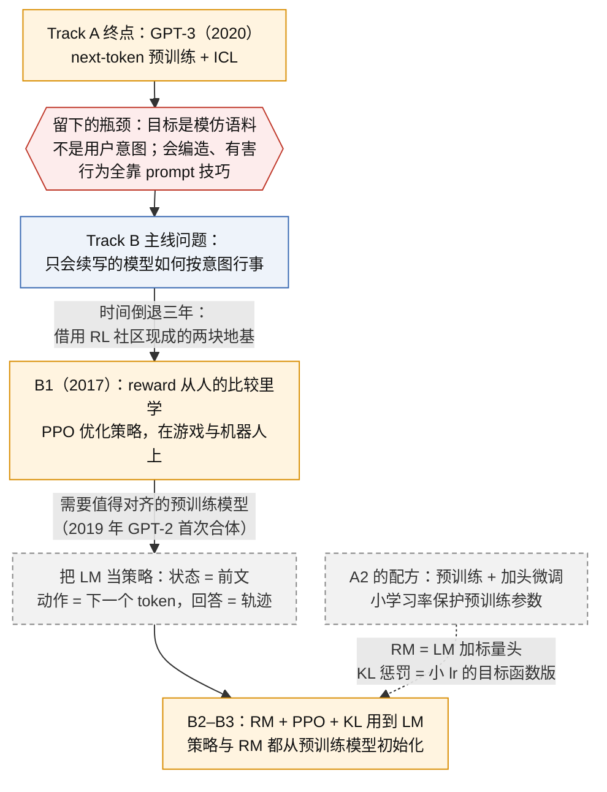

# Track B · Alignment

主线问题：一个只会续写的模型，如何变成按人的意图行事的模型？

## 与前序主线的衔接（2026-10-15，B1 开讲前）

### Track A 的终点留下了什么

[[A5-gpt-3-in-context-learning]] 的结论：一个只用 next-token 交叉熵训练的 175B 模型，把示例写进上下文就能换任务，不改参数。它解决不了的问题恰好是本线的主线问题：**模型的目标是"像语料那样续写"，不是"按用户意图行事"**。具体表现有三条，GPT-3 论文自己在 §5、§6 承认了前两条：输出质量取决于 prompt 怎么写、few-shot 到底是学还是认分不清；会编造、会生成有害内容；在对话或指令格式下常常答非所问。预训练的目标函数里没有任何一项告诉模型"人想要什么"，所以靠继续放大 N 解决不了，要换目标函数。这就是从 A 跳到 B 的原因。

### 对象对应表：Track A 的东西在本线里变成什么

| Track A 的对象 | 在 Track B 里变成什么 | 哪一节用到 |
|---|---|---|
| A1 的目标：最大化 $\sum_i \log P(u_i \mid u_{<i})$，每个数据 token 权重 1 | 策略梯度：最大化 $\mathbb{E}[\hat A_t \log \pi_\theta(a_t \mid s_t)]$。同一个 $\log \pi$ 的梯度，只是权重从 1 换成优势 $\hat A_t$。SFT 就是 $\hat A_t \equiv 1$ 的策略梯度，RL 只是换权重 | B1 §2.2，B3 |
| A1 的 LM head：末位隐状态 → V 维 logits | 策略的动作分布 $\pi(a_t \mid s_t)$：状态是 prompt 加已生成的 token，动作是下一个 token，一条完整回答是一条轨迹 | B1 §2.1 的 π，B2 |
| A2 的 fine-tune：预训练 LM 加任务头 $W_y$，取末位隐状态 | reward model 的做法完全一样：预训练 LM 把 LM head 换成 1 维标量头，取末位；训练信号从标签换成成对比较（A2 的 similarity / comparison 拼法的近亲） | B1 §3.1 公式，B2、B3 |
| A2 的小学习率：保护预训练参数不被覆盖 | B2 的 KL 惩罚：同一目的，从"缩小步长"改成"目标函数里加一项到参考策略的距离"；B1 §10.3 先区分它和 PPO 自己的 KL | B2 |
| A3、A5 的 prompt 与 ICL：不改参数调行为 | RLHF 改参数：把"写 prompt 的技巧"训进权重，InstructGPT 之后 zero-shot 直接可用；三种调行为的手段至此齐全：改权重拟合标签（A2）、改上下文（A5）、改权重拟合学到的 reward（B） | B3 |
| A4 的 scaling：能力随 N 幂律 | 对齐与规模是两条轴：InstructGPT 的 1.3B 对齐模型在人类偏好上胜过 175B GPT-3；代价是 alignment tax | B3 |
| A5 的评测：few-shot 基准分数 | 本线评测：人类偏好胜率、reward model 分数、与参考策略的 KL；指标本身换了，benchmark 分数不再是主证据 | B2、B3 |

### 为什么课程顺序是 A → B，而 B1 比 A5 早三年

B1 的两篇论文是 2017 年的，比 GPT-3（2020）早，当时在机器人与 Atari 上做，和语言模型无关。它们要用到语言模型，得等 Track A 的两个结果：一个值得对齐的预训练模型（2019 年 Ziegler 等用 GPT-2 首次合体），以及 A2 那套"预训练 + 加头微调"的配方（reward model 就是它）。所以因果上 A 是底座，B 是在底座上换目标函数；时间线上 B 的起点早于 A 的终点，课程按因果排，不按时间。Track C 的 RL on CoT 用的是同一套 RLHF 机器，所以 C 排在 B 前半之后。

### 衔接图



## 主线因果图

### 我的版本

学完本线后在 session 里填因果表（第一档），教练转成图写在这里。复测时用下面参考版的骨架做填空（第二档）。

| 上一代 | 下一代 | 上一代的瓶颈 |
|---|---|---|
| | | |

### 教练参考版

> [!example]- 学完并交了因果表之后再展开对照
> ```mermaid
> flowchart LR
>   P[PPO + Human Preferences<br/>2017]:::model -->|"用在语言模型上会 reward hacking 吗？"| LS[Learning to Summarize<br/>RM + PPO + KL, 2020]:::model
>   LS -->|"GPT-3 不听指令"| IG[InstructGPT / ChatGPT<br/>SFT → RM → PPO, 2022]:::model
>   IG -->|"模型超过标注者后怎么监督？"| SO[Scalable Oversight<br/>CriticGPT · PVG · Weak-to-strong]:::human
>   SO -->|"有了推理链，安全训练能否利用它？"| DA[Deliberative Alignment · CoT Monitoring · GPT-Red]:::model
>   classDef model fill:#FFF4E0,stroke:#D98E04,color:#111
>   classDef human fill:#EAF7EE,stroke:#2E8B57,color:#111
> ```

B5 建立在 [[C-reasoning]] 之上，学完 Track C 再回来。

## 概念卡

| # | 卡片 | 状态 | Mastery |
|---|---|---|---|
| B1 | [[B1-ppo-human-preferences-2017]] | canonical（2026-10-15） | 0 |
| B2 | [[B2-rlhf-learning-to-summarize]] | 未写 | 0 |
| B3 | [[B3-instructgpt-chatgpt]] | 未写 | 0 |
| B4 | [[B4-scalable-oversight]] | 未写 | 0 |
| B5 | [[B5-deliberative-alignment-gpt-red]] | 未写 | 0 |

## 图板与图解页

每节的 Artifact 页面（私有链接，需登录 claude.ai），全表见 [[artifacts]]。

| 节点 | 页面 |
|---|---|
| B1 | [PPO 与 Human Preferences 图板](https://claude.ai/artifact/U8pfXG1BpHr83eC6BJyTbg)（本节图板）；[PPO in Pictures](https://claude.ai/artifact/W62d69PXW35bCnih2LQWAN)（ELI5 图解）；[图解 PPO](https://claude.ai/artifact/WvB6r5iggPxUCXeBm4RqbS)（ELI5 图解）；[PPO 基线图板](https://claude.ai/artifact/WLVGDQAYB6fWJuiCTsaHNx)（追问图板）；[PPO × Next-token 训练图板](https://claude.ai/artifact/KcFkoErwZppVLoMdy22Ho3)（追问图板） |
| B2 | 无 |
| B3 | 无 |
| B4 | 无 |
| B5 | 无 |

## 实验

E4 reward model + 策略优化；可选 E8 无害环境自博弈。

## 对照（非 OpenAI）

DPO（B3 对照）。

← [[index]]
