# PPO 与 Learning from Human Preferences（2017）

整条 alignment 主线的两块地基，都是 OpenAI 2017 年的论文：**Deep RL from Human Preferences**（Christiano 等，2017-06，与 DeepMind 合作）证明"没有可编程 reward 的任务，可以从人类对两段行为的成对比较里学出一个 reward model，再用 RL 去优化它"；**PPO**（Schulman 等，2017-07）给出一个一阶、可多轮复用样本、实现简单的策略优化算法，后来成为 OpenAI 的默认 RL 算法。两者在 2017 年还没有合体（偏好论文用的是 TRPO 和 A2C），合体发生在 2019～2020 年的语言模型工作（[[B2-rlhf-learning-to-summarize]]）。

> [!success] Public algorithm
> 偏好论文公开：三进程异步结构；成对比较的数据格式 $(\sigma^1,\sigma^2,\mu)$；Bradley–Terry 式偏好概率与交叉熵损失（式 (1)）；ensemble（3 个预测器、有放回重采样）、$1/e$ 留出验证、$\ell_2$ 正则系数按验证损失 1.1～1.5 倍调、10% 随机作答假设；按 ensemble 方差选 query；MuJoCo 700 条、Atari 5,500 条人类比较的结果；消融（随机 query、无 ensemble、无正则等）。PPO 论文公开：clipped surrogate 目标（式 (7)）、自适应 KL 惩罚变体、合并 value 与熵项的总目标（式 (9)）、Algorithm 1、全部超参、MuJoCo 7 个环境与 Atari 49 个游戏的对比；代码开源在 openai/baselines。

> [!info] Public system behavior
> OpenAI 博客称 PPO 自 2017 年起成为内部默认 RL 算法；博客给出"机械臂假装抓球"的 reward 被钻空子的例子（凭记忆，待核对博客原文）。

> [!question] Inference
> （1）"PPO 后来成为 RLHF 的标准策略优化器"是从 [[B2-rlhf-learning-to-summarize]] 与 [[B3-instructgpt-chatgpt]] 的论文倒推的，2017 年两篇论文互不引用；（2）偏好论文选 TRPO/A2C 而不是 PPO 只因为时间先后（PPO 晚一个月），不代表方法上的偏好。

> [!danger] Unknown
> 偏好论文的人类标注界面与契约工细节只在附录给了说明文字；PPO 在 OpenAI 内部后续版本（如 Dota 2 项目）的改动未公开。两篇论文都不涉及语言模型。

## 1. 承接的瓶颈

与 Track A 的衔接（为什么从 [[A5-gpt-3-in-context-learning]] 跳到这里、A 线的对象在 B 线里变成什么）见 [[B-alignment]] 的「与前序主线的衔接」，本卡不重复。一句话：A 线终点的 GPT-3 目标是模仿语料而不是用户意图，要换目标函数；换目标函数的两块地基是 RL 社区 2017 年的这两篇论文。

在 RL 社区里，上一代是"有明确 reward 的 RL"（Atari 得分、MuJoCo 前进距离）。它留下两个瓶颈：

1. **reward 写不出来。** 要让机器人"后空翻"或"按人类觉得合适的方式开车"，没有人能把目标写成一个函数；手写 reward 常被钻空子。此前的办法要么是人实时打分（TAMER 等），要么从示范里逆推 reward（inverse RL），前者人要盯着每一步，后者要求人能做示范。
2. **策略优化器难用。** 策略梯度每批样本只能更新一步，步长稍大就崩；TRPO 用 KL 约束保证单调改进，但要解带约束的二阶问题（共轭梯度、线搜索），实现复杂，和 dropout、策略/价值网络共享参数这类结构不兼容。

两个瓶颈分别对应两篇论文。

## 2. 核心思想

### 2.1 偏好学习：三个异步进程的闭环

把 reward 从"人写"改成"人比"。人只看两段 1～2 秒的短视频，说哪段更好；reward model $\hat r$ 从这些比较里学出来；策略 $\pi$ 只对 $\hat r$ 做普通 RL。三个进程异步运行：轨迹从 (1) 流向 (2)，比较结果从 (2) 流向 (3)，$\hat r$ 的参数从 (3) 流回 (1)。

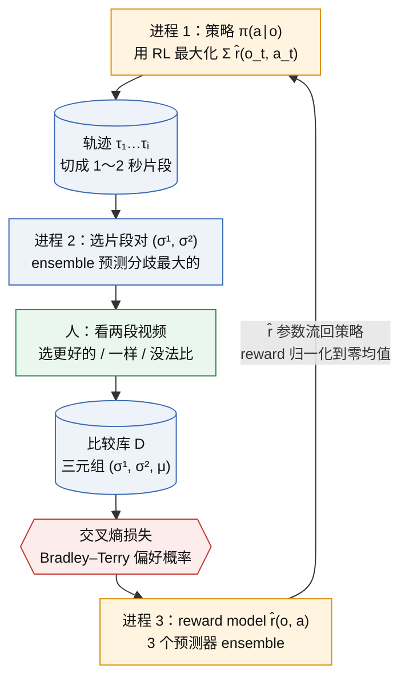

为什么是"比"不是"打分"：reward 的绝对位置本来就不可辨认（整体加一个常数，最优策略不变），人对绝对分数也不稳定；而"哪段更好"对非专家也容易回答。论文把它类比成国际象棋的 Elo：两段片段的预测 reward 之差，估计的是人选前者的概率。

为什么必须在线、异步：策略一变，它产生的轨迹分布就变，$\hat r$ 在没见过的状态上会外推出错，策略会专门去钻这些错（论文 §2.2.4 说选 query 的目的之一就是防止策略"exploit"学到的 reward 的弱点）。所以比较数据要不断从**当前策略**的轨迹里抽，这是整条 RLHF 线"reward hacking"问题的源头，[[B2-rlhf-learning-to-summarize]] 的 KL 惩罚就是为此加的。

### 2.2 PPO：把信赖域变成一个可以直接做 SGD 的目标

记 $r_t(\theta) = \pi_\theta(a_t \mid s_t) / \pi_{\theta_{\text{old}}}(a_t \mid s_t)$，是新旧策略在同一个动作上的概率比。普通策略梯度的替代目标是 $\hat{\mathbb{E}}_t[r_t(\theta)\hat A_t]$，对同一批样本反复优化它会把 $r_t$ 推到很远，策略崩掉。PPO 把它截断：

| 优势符号 | $r_t$ 的位置 | 目标项取值 | 梯度 | 含义 |
|---|---|---|---|---|
| $\hat A_t > 0$（好动作） | $r_t \le 1+\epsilon$ | $r_t \hat A_t$ | 有 | 允许提高概率 |
| $\hat A_t > 0$ | $r_t > 1+\epsilon$ | $(1+\epsilon)\hat A_t$，平 | 0 | 已经提高够了，别再推 |
| $\hat A_t < 0$（坏动作） | $r_t \ge 1-\epsilon$ | $r_t \hat A_t$ | 有 | 允许降低概率 |
| $\hat A_t < 0$ | $r_t < 1-\epsilon$ | $(1-\epsilon)\hat A_t$，平 | 0 | 已经降低够了，别再推 |

取 $\min$ 的作用是只在"改进方向上"截断：$r_t$ 往错误方向走（好动作被降概率、坏动作被升概率）时不截断，梯度仍然把它拉回来。这样整个目标是原目标的一个悲观下界，同一批样本可以做 K 个 epoch 的 minibatch SGD 而不崩。$\epsilon = 0.2$ 是论文选的默认值。

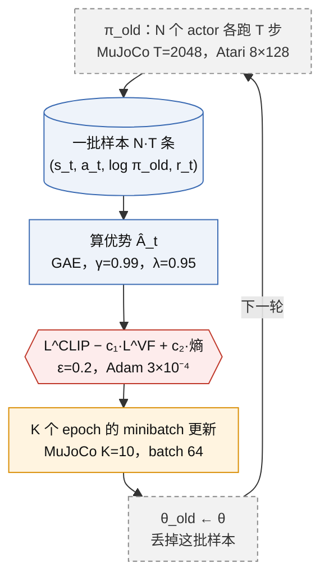

### 2.3 读论文重点：Schulman 怎样从理论下界推出工程近似

> [!tip] 读 PPO 时盯住这条三步链
> PPO 本身没有新定理，它的价值在于把 TRPO 的理论保证一步步换成一阶 SGD 能做的近似，每一步都放松了保证、换来了可实现性。读 PPO §2～§4 时对照下表，看每一步丢掉了什么。

| 步 | 形式 | 保证 | 代价 / 放松了什么 | 出处 |
|---|---|---|---|---|
| 0 理论下界 | $\eta(\tilde\pi) \ge L_\pi(\tilde\pi) - C\, D_{\mathrm{KL}}^{\max}(\pi,\tilde\pi)$，$C = \frac{4\epsilon\gamma}{(1-\gamma)^2}$ | 最大化右边即单调改进（minorize–maximize） | $C$ 极大，步长小到不可用；$D^{\max}$ 要对所有状态取最大 | TRPO 定理 1（非 OpenAI，P-27，凭记忆待核对） |
| 1 TRPO | 最大化 $L_\pi$，约束 $\overline{D}_{\mathrm{KL}} \le \delta$ | 近似保证 | 惩罚换成约束、max 换成平均；要共轭梯度 + 线搜索 | TRPO §4～§6 |
| 2 PPO-KL | $\hat{\mathbb{E}}_t[r_t\hat A_t - \beta\,\mathrm{KL}]$，$\beta$ 自适应 | 无硬保证 | 回到理论里的"惩罚"形式，用自适应 $\beta$ 代替算不出来的 $C$ | PPO §4（P-26） |
| 3 PPO-clip | 式 (7) $L^{\mathrm{CLIP}}$ | 只剩"悲观下界"的直觉 | 不再算 KL，改成逐样本截断 $r_t$；多 epoch 后实际 KL 不受控（§8） | PPO §3（P-26） |

阅读时注意三点：

1. **"下界"这个思想一直保留。** 第 0 步是严格下界，第 3 步的 $\min(\cdot,\mathrm{clip}(\cdot))$ 仍是对 $L^{\mathrm{CPI}}$ 的悲观下界，只是不再对应真实回报 $\eta$ 的证明。这就是 §2.2 表格里"只在改进方向截断"的来源。
2. **PPO §2.2 自己承认理论更支持惩罚而不是约束**，难点只是 $\beta$ 选不好；第 2 步的自适应 $\beta$ 就是对这句话的回答（凭记忆，待核对原文措辞）。
3. **判断"近似是否够好"靠实验而不是证明**：PPO 表 1 拿"无截断无惩罚 / 固定 β / 自适应 β / 不同 ε"做消融，ε=0.2 最好（§7）。这是 Schulman 的典型写法：理论定方向，实验定取舍。后来 RLHF 里对参考模型的 KL 惩罚又回到了第 2 步的形式，见 §10.3。

### 主线因果位置

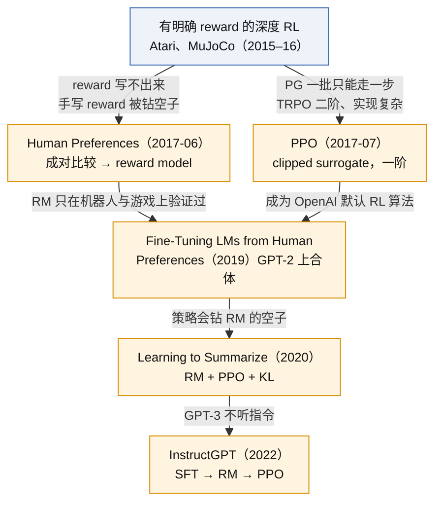

## 3. 目标函数与数据

### 3.1 偏好论文（Christiano 等，式 (1) 与损失）

一段轨迹片段 $\sigma = ((o_0,a_0),\ldots,(o_{k-1},a_{k-1}))$。假设人偏好某段的概率随该段 reward 之和指数增长：

$$
\hat P[\sigma^1 \succ \sigma^2] = \frac{\exp \sum_t \hat r(o^1_t, a^1_t)}{\exp \sum_t \hat r(o^1_t, a^1_t) + \exp \sum_t \hat r(o^2_t, a^2_t)}
$$

$$
\mathcal{L}(\hat r) = -\sum_{(\sigma^1,\sigma^2,\mu)\in\mathcal D} \Big[\mu(1)\log \hat P[\sigma^1 \succ \sigma^2] + \mu(2)\log \hat P[\sigma^2 \succ \sigma^1]\Big]
$$

符号说明：

| 记号 | 含义 | 对应步骤 |
|---|---|---|
| $\hat r(o,a)$ | reward model，输入观测与动作，输出标量 | 进程 3 训练；进程 1 用 |
| $\sigma^1, \sigma^2$ | 两段 1～2 秒的轨迹片段（Atari 25 步） | 进程 2 选出 |
| $\mu$ | 人的判断，$\{1,2\}$ 上的分布：选 1 则 $\mu=(1,0)$；"一样好"则 $(0.5,0.5)$；"没法比"则丢弃 | 人工环节 |
| $\mathcal D$ | 比较三元组库 | 进程 2 → 3 |
| 式 (1) 不含折扣 | 把人当作对片段内何时发生不在意 | 论文脚注 3 |

这就是 Bradley–Terry 模型（1952）：$\hat P[\sigma^1 \succ \sigma^2] = \sigma(\sum \hat r^1 - \sum \hat r^2)$，sigmoid 作用在 reward 之差上。[[B3-instructgpt-chatgpt]] 的 reward model 损失是同一条公式换成文本回答。实际训练加了三处修正：ensemble（每个预测器在 $|\mathcal D|$ 条有放回重采样上训，各自归一化后平均）；$1/e$ 的数据留作验证集，$\ell_2$ 系数调到验证损失在训练损失的 1.1～1.5 倍；把 softmax 改成"10% 概率人随机作答"的混合，因为人的错误率不会随 reward 差距变大而趋于零。

### 3.2 PPO（Schulman 等，式 (7) 与 (9)）

$$
L^{\mathrm{CLIP}}(\theta) = \hat{\mathbb{E}}_t\Big[\min\big(r_t(\theta)\hat A_t,\; \operatorname{clip}(r_t(\theta), 1-\epsilon, 1+\epsilon)\hat A_t\big)\Big]
$$

$$
L^{\mathrm{CLIP+VF+S}}(\theta) = \hat{\mathbb{E}}_t\Big[L^{\mathrm{CLIP}}_t(\theta) - c_1 L^{\mathrm{VF}}_t(\theta) + c_2 S[\pi_\theta](s_t)\Big],\quad L^{\mathrm{VF}}_t = (V_\theta(s_t) - V_t^{\mathrm{targ}})^2
$$

符号说明：

| 记号 | 含义 | 对应步骤 |
|---|---|---|
| $r_t(\theta)$ | 新旧策略概率比 $\pi_\theta(a_t\mid s_t)/\pi_{\theta_{\text{old}}}(a_t\mid s_t)$，采样时 $=1$ | 每个 minibatch 重新算 |
| $\hat A_t$ | 优势估计，用截断 GAE（$\gamma=0.99$，$\lambda=0.95$） | 采样后、更新前算一次 |
| $\epsilon$ | 截断半径，默认 0.2 | 超参 |
| $c_1, c_2$ | value 损失与熵奖励的权重（Atari：1 与 0.01） | 策略与 value 共享网络时才需要 |
| $S[\pi_\theta]$ | 策略熵，鼓励探索 | 总目标里 |

论文还给了另一种变体：自适应 KL 惩罚 $\hat{\mathbb{E}}_t[r_t\hat A_t - \beta\,\mathrm{KL}[\pi_{\theta_{\text{old}}}, \pi_\theta]]$，$\beta$ 按实际 KL 相对目标值 $d_{\text{targ}}$ 是偏小还是偏大对半折或翻倍。实验里 clip 版更好，但 KL 版是后来 RLHF 里 KL 项的形式来源之一，见 §10 的辨析。

### 3.3 数据

偏好论文：人类比较 MuJoCo 每任务 700 条、Atari 每游戏 5,500 条；"合成 oracle"实验用真实 reward 代替人，比较 350 / 700 / 1,400 条等档位。人类反馈只覆盖 agent 与环境交互的不到 1%。PPO：MuJoCo 每环境 100 万步；Atari 每游戏 4,000 万帧。

## 4. 训练循环

偏好论文的三个进程见 §2.1 图。节奏（附录）：预测器大约每 10 个 RL 步处理 1 条标签；只保留最近 3,000 条标签循环训练，让 $\hat r$ 跟着策略当前的分布走；候选片段对抽 10 倍再按 ensemble 方差挑。策略那边 Atari 用 A2C，MuJoCo 用 TRPO，只调了 TRPO 的熵奖励（因为 reward 在变，信赖域会探索不足）；$\hat r$ 的输出归一化到零均值、固定标准差后才给 RL。

PPO 的 Algorithm 1 见 §2.2 图：采样 → 算优势 → 同一批样本 K 个 epoch 的 minibatch 更新 → 同步 $\theta_{\text{old}}$。与 TRPO 的差别只在"用什么防止一步走太远"：TRPO 是硬约束 $\mathrm{KL} \le \delta$ 加二阶求解，PPO 是把约束折进目标用一阶 Adam 做。

## 5. 推理行为

训练完的策略就是普通策略网络，推理时不需要 $\hat r$ 也不需要人。偏好论文展示的"新行为"：Hopper 连续后空翻并站稳（900 条比较，人花不到一小时）；Enduro 里与其他车并排行驶（约 1,300 条比较、400 万帧）。这些目标没有可写的 reward，是本方法独有的产出。

## 6. Scaling 维度

两篇论文都不是 scaling 论文，但各有一个"随什么变好"的量：

| 量 | 偏好论文 | PPO |
|---|---|---|
| 人类标签数 | 350 → 700 → 1,400（合成）单调变好；真人略差于合成，大约等于少 40% 的合成标签 | 不涉及 |
| 环境交互步数 | 固定 | 1M 步（MuJoCo）、40M 帧（Atari）内 PPO 的学习曲线高于 A2C、TRPO 等 |
| 样本复用 | 不涉及 | 同一批样本 K=10 个 epoch；无截断时反复更新会发散（表 1 中无 clip 无惩罚的归一化分数为负，待核对具体数值） |

## 7. 证据

| 主张 | 证据 | 来源 |
|---|---|---|
| 不用真实 reward 也能学会 RL 任务 | 700 条人类比较下 MuJoCo 多数任务接近直接用真实 reward 的 RL；Atari 5,500 条下多数游戏有实质学习、部分追平 | 偏好论文图 2、图 3 |
| 人类反馈成本低 | 反馈覆盖交互的不到 1%；后空翻约一小时人工 | 摘要、§3.2 |
| 真人与合成 oracle 的差距 | 真人略差，相当于少 40% 标签；Ant 任务真人反而更好，因为"站直"的指令起了 reward shaping 作用 | §3.1 |
| ensemble、在线 query、正则有用，方差选 query 不一定 | 消融：随机 query 在某些任务反而更好 | §3.3 图 5 |
| clip 优于 KL 惩罚与无约束 | MuJoCo 7 环境归一化平均分：$\epsilon=0.2$ 最高，无 clip 无惩罚最差（数值待核对） | PPO 表 1 |
| PPO 优于同期一阶方法 | 7 个 MuJoCo 环境几乎全部领先 A2C、CEM、vanilla PG、TRPO；49 个 Atari 按全程均分领先 A2C 与 ACER，按最后 100 局 ACER 更好 | PPO 图 3、表 2 |

## 8. 局限

- 偏好论文只在模拟机器人与 Atari 上验证，片段 1～2 秒，人只看画面；语言任务要到 2019 年才做。
- 学到的 reward 非平稳，策略会钻它的空子，论文靠不停在线采新比较缓解，没有正则项；"机械臂假装抓球"的例子说明 $\hat r$ 学到的是"看起来像"而不是"是"。
- 选 query 的方差准则粗糙，有的任务不如随机。
- PPO 的 clip 不是真正的信赖域：$r_t$ 可以越过 $1\pm\epsilon$（只是梯度为零），多 epoch 后实际 KL 不受保证；论文自己也给出 KL 版本作为替代。
- 两篇都假设可以无限采样环境，语言模型上一次采样就是一次完整生成，成本不同。

## 9. 后续影响

直接影响 [[B2-rlhf-learning-to-summarize]]：2019 年 Ziegler 等把同一套 RM + RL 搬到 GPT-2 上（文本续写与摘要，5,000～60,000 条比较），策略优化器换成 PPO，并新增对初始策略的 KL 惩罚；2020 年 Learning to Summarize 把它做扎实并发现 RM 过优化。[[B3-instructgpt-chatgpt]] 的三阶段里，第二阶段 RM 的损失就是 §3.1 的公式换成"同一 prompt 的两条回答"，第三阶段就是 PPO 加 KL。更远：[[C1-process-supervision-prm]] 的 reward 落点从整段比较变成每一步；[[C2-o1-reasoning-rl]] 的 RL on CoT 是同一个"策略优化 + 学到的或可验证的 reward"框架。

## 10. 与相关方法的区别

### 10.1 reward 从哪来

| 维度 | 手写 reward | 逆强化学习（示范） | 人类偏好（本卡） |
|---|---|---|---|
| 人提供什么 | 一个函数 | 完整示范轨迹 | 两段之间选一个 |
| 对人的要求 | 能写出目标 | 能做到目标 | 能看出好坏 |
| 可表达的目标 | 可编程的 | 人能演示的 | 人能辨认的（后空翻） |
| 失败模式 | 被钻空子 | 示范分布外不可靠 | $\hat r$ 分布外被钻空子，需在线更新 |

### 10.2 策略优化器

| 维度 | vanilla PG | TRPO | PPO-clip | PPO-KL 惩罚 |
|---|---|---|---|---|
| 防止一步过大 | 靠小学习率 | 硬约束 $\mathrm{KL}\le\delta$ | 截断概率比 | 软惩罚 $\beta\,\mathrm{KL}$，$\beta$ 自适应 |
| 求解 | 一阶 | 二阶（共轭梯度 + 线搜索） | 一阶 Adam | 一阶 Adam |
| 每批样本 | 1 步 | 1 步 | K 个 epoch | K 个 epoch |
| 兼容共享网络、dropout | 是 | 否 | 是 | 是 |

### 10.3 两个 KL 不是一回事（为 B2 预埋）

| | PPO 论文里的 KL | RLHF 里的 KL（B2 起） |
|---|---|---|
| 比较对象 | $\pi_\theta$ 与**上一轮**的 $\pi_{\theta_{\text{old}}}$ | $\pi_\theta$ 与**训练开始时**的参考策略 $\pi_{\mathrm{ref}}$（SFT 模型） |
| 目的 | 优化稳定：一次更新别走太远 | 别偏离语言模型本身：防止策略钻 RM 的空子、输出变怪 |
| 生命周期 | 每轮重置 | 全程固定 |
| 在 InstructGPT 里 | 由 clip 承担，不显式出现 | 作为 reward 的一项 $-\beta\log(\pi_\theta/\pi_{\mathrm{ref}})$ |

把这两个混在一起是最常见的误解，B2 的检查题会考。

## 11. 追问与澄清

### 11.1 PPO 用到语言模型上，本质是不是"从机器人跨到 LLM"（2026-10-15 追问）

跨的不是 PPO，是"把语言模型当策略"。PPO 对领域无感，只要求策略能算 $\pi_\theta(a\mid s)$、能采样、能估优势；2019 年 Ziegler 等（OpenAI）把 GPT-2 接上去，算法几乎没改，变的是 MDP 的定义：

| MDP 要素 | 机器人 / Atari（2017） | 语言模型（2019 起） |
|---|---|---|
| 状态 $s_t$ | 观测图像或关节角 | prompt 加已生成前缀 |
| 动作 $a_t$ | 18 个离散键或低维连续力矩 | 词表里一个 token，约 5 万个离散动作 |
| 环境转移 | 物理或游戏引擎，有随机性 | 把 token 接到前缀后，确定性，环境几乎为空 |
| 轨迹 | 一段游戏片段 | 一条完整回答 |
| reward | 每步有分数或 $\hat r$ 逐步给 | 回答结束时 RM 给一个数，中间为零 |
| 策略初始化 | 随机 | 预训练 LM，这是整件事成立的前提 |
| 探索 | 靠熵奖励 | 基本不需要，预训练先验已给出合理分布 |
| 一次 rollout 成本 | 便宜 | 一次完整生成，样本复用（K 个 epoch）更重要 |

"LM 当策略、用序列级指标做 RL"不是 OpenAI 首创：2015 年前后机器翻译与摘要社区已用 REINFORCE 拿 BLEU、ROUGE 当 reward 训过（Ranzato 等 MIXER，非 OpenAI，凭记忆、待核对）。OpenAI 2019 年加的是：reward 从人类比较学出的 RM 而非手写指标，优化器用 PPO 并加 KL 惩罚。合体细节见 [[B2-rlhf-learning-to-summarize]]。

### 11.2 next-token 是逐字的，PPO 学轨迹是否引入了序列级的偏好（2026-10-15 追问）

是，而且要拆成三件事，它们在 RL 里是分开的：

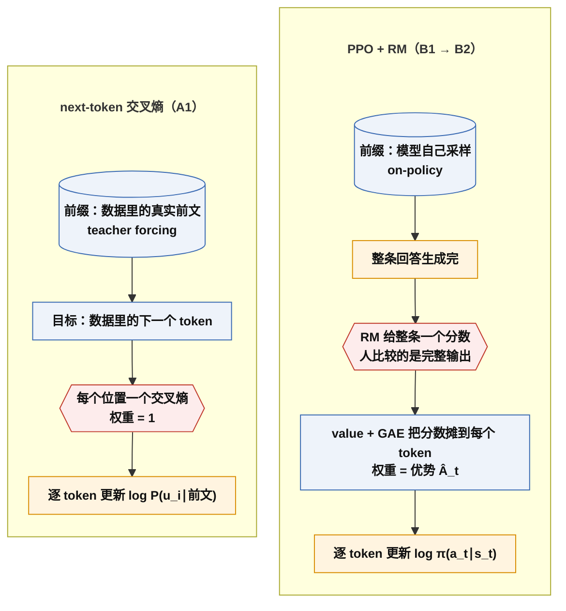

- **目标确实是序列级的。** 人比较两条完整输出，RM 给整条一个分数，"连贯、正确、不冒犯、长度合适"这类单个 token 不具备的性质得以进入目标函数；交叉熵的目标分解到每个位置，只问"数据里下一个字是什么"。
- **梯度仍是逐 token 打的。** 策略梯度 $\sum_t \hat A_t \nabla\log\pi_\theta(a_t\mid s_t)$，每个 token 各自更新自己的 log 概率，权重从 1 换成优势；序列级 reward 经 value function 与 GAE 摊到各 token（信用分配），交叉熵里没有这一步。准确说法：**序列级目标，token 级更新**。
- **前缀来源变了。** 交叉熵永远在数据的真实前缀上训；RL 在模型自己生成的前缀上评分，被评的是它真写出来的那条回答。

两点预埋：[[B2-rlhf-learning-to-summarize]] 的 KL 惩罚把一个 token 级的项（$\log\pi_\theta - \log\pi_{\mathrm{ref}}$，逐 token）加回 reward，RLHF 的总 reward 是"序列级 RM 分数 + token 级 KL"；[[C1-process-supervision-prm]] 把 reward 落点从整条推回每一步，是序列级与 token 级之间的中间粒度。

### 11.3 "比平时高分就多做"，"平时"怎么定义（2026-10-15 追问）

**结论：** "平时"= 基线 $b(s_t)$，PPO 取为价值函数 $V(s_t)$：在当前状态（prompt + 已写出的前缀）下，按当前策略继续写完，**预期**能拿到的总 reward。优势 $\hat A_t$ = 实际拿到的 − $V(s_t)$，正则这个 token 的概率往上推，负则往下压。"平时"是**按状态逐个估**的，不是全局平均分。

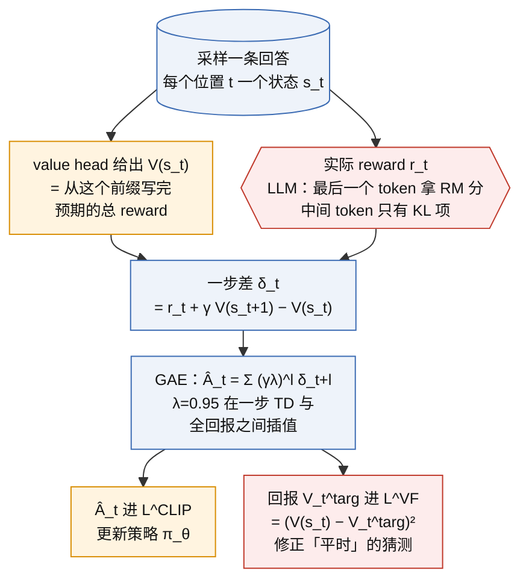

三层展开：

1. **为什么要减一个"平时"。** REINFORCE 的梯度 $\sum_t R\,\nabla\log\pi_\theta(a_t\mid s_t)$ 无偏但方差大：所有动作都拿正分时全被往上推，只是推的幅度不同。减去任何**不依赖动作** $a_t$ 的 $b(s_t)$，梯度期望不变（$\mathbb{E}_{a\sim\pi}[\nabla\log\pi(a\mid s)]=0$），方差变小。所以"平时"可以是任何只看状态、不看动作的量；取 $V(s_t)$ 是最常见的选择。
2. **PPO 里 $V$ 从哪来。** 由一个单独的 value head 或网络学，损失就是 §3.2 式 (9) 里的 $c_1 L^{\mathrm{VF}}_t=(V_\theta(s_t)-V_t^{\mathrm{targ}})^2$，$V_t^{\mathrm{targ}}$ 是采样到的回报。优势不直接用 $R-V$，而用截断 GAE（PPO 论文 §5 式 (10)～(12)）：$\delta_t=r_t+\gamma V(s_{t+1})-V(s_t)$，$\hat A_t=\sum_{l}(\gamma\lambda)^l\delta_{t+l}$。$\lambda=0$ 只信 $V$ 的一步 TD（低方差、高偏差），$\lambda=1$ 只信实际回报（无偏、高方差），PPO 用 0.95。GAE 本身来自 Schulman 等 2016 的非 OpenAI 前置论文。
3. **LLM 的 RLHF 里 $V$ 是什么。** 状态是 prompt + 已生成前缀，$V(s_t)$ 预测"从这里写完，RM 最终会打多少分"（加 KL 项后是总 reward）。InstructGPT 把 value 网络从 RM 初始化（P-21 附录 C.4，凭记忆待核对），因为 RM 已经会给整条打分，只差学会给半条打分。同一个 prompt 下开头写得好的回答 $V$ 高，后面的 token 必须拿更高的分才算"比平时好"，这就是信用分配。

**小狗图里的对应：** "平时"是评论员（critic）的猜测，猜"做到这一步通常能拿几颗零食"；评论员和小狗一起学，猜错了就按 $L^{\mathrm{VF}}$ 修猜测。

**非 OpenAI 对照（本课不展开）：** 后来有的方法不训 $V$，把同一个 prompt 采样多条回答的平均分当"平时"（GRPO，DeepSeek 2024），基线是序列级而非 token 级；到 [[B3-instructgpt-chatgpt]] 或 C 线对比时再入论文台账。

### 11.4 PPO 的网络长什么样，什么是 value head（2026-10-15 追问）

**结论：** "head"指接在网络躯干（trunk / backbone）顶上的一个小输出层。value head 是一层 $d \to 1$ 的线性映射：把躯干对状态 $s_t$ 算出的隐向量 $h_t\in\mathbb{R}^d$ 压成**一个标量** $V(s_t)$，含义是"从这里往后预期还能拿多少回报"，即 §11.3 的"平时"。它只在训练时用（算优势、算 $L^{\mathrm{VF}}$），推理时丢掉。同一躯干上另一个 head 是 policy head：$d \to$ 动作数，softmax 后是 $\pi_\theta(a\mid s_t)$。

PPO 论文和 RLHF 里的两种接法：

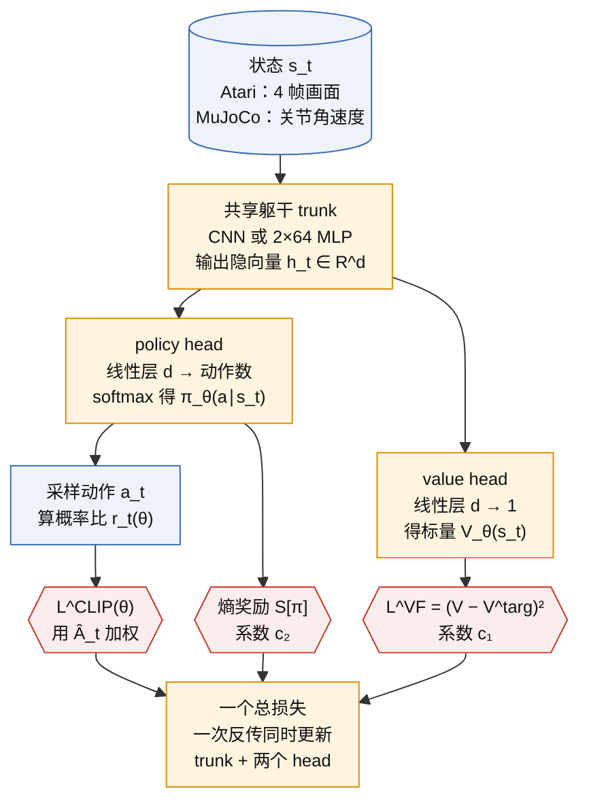

- **PPO 论文（Atari / MuJoCo）：一个躯干两个 head。** 论文 §5 说明当策略与 value 共享参数时，要把 $L^{\mathrm{CLIP}}$、$c_1 L^{\mathrm{VF}}$、$c_2 S$ 合成一个损失一次反传（式 (9)），因为 trunk 的梯度来自两个 head；不共享时 $c_1$ 无意义，value 网络单独用 $L^{\mathrm{VF}}$ 训。Atari 用 [Mnih 2016] 式的 CNN 躯干，MuJoCo 用两层 64 单元 MLP（细节凭记忆）。

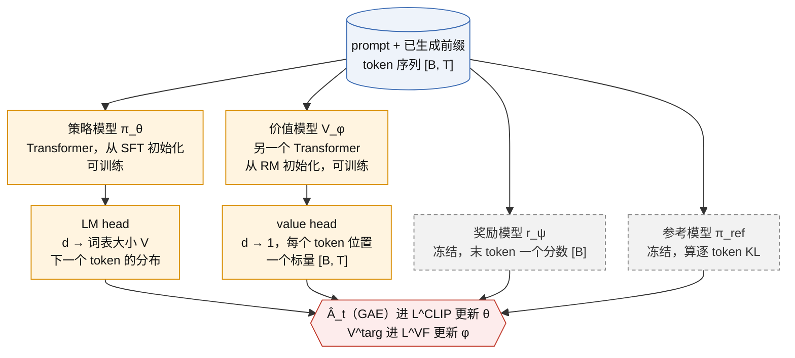

- **RLHF（Ziegler 2019 → InstructGPT 2022）：四个 Transformer，value head 长在单独的价值模型上。** 策略 $\pi_\theta$ 从 SFT 初始化，顶上是原来的 LM head（$d\to$ 词表）；价值模型 $V_\phi$ 是**另一份** Transformer，从奖励模型初始化，顶上接 value head（$d\to 1$），每个 token 位置给一个标量；奖励模型 $r_\psi$ 与参考模型 $\pi_{\mathrm{ref}}$ 冻结。策略与价值不共享躯干，所以式 (9) 的 $c_1$ 在这里退化成"两个模型各自的学习率"。InstructGPT 把价值模型从 RM 初始化这一点凭记忆（附录 C.4），待核对；Ziegler 2019 的具体初始化待 [[B2-rlhf-learning-to-summarize]] 核对。
- **为什么 RM 和 value head 形状一样却不是一回事。** 两者都是 $d\to 1$ 的线性层，但 reward head 只在**末 token** 读一次、给整条一个分、RL 阶段冻结；value head 在**每个 token** 读一次、给每个前缀一个预期、随训练更新。RM 答"这条写完了值多少"，V 答"写到这里，接着写完大概值多少"。

形状记账（LLM 情形）：

| 部件 | 输入 | 参数 | 输出 | 训练它的损失 |
|---|---|---|---|---|
| LM head（policy head） | $h_t\in\mathbb{R}^d$ | $W\in\mathbb{R}^{d\times V}$，常与 embedding 绑定 | logits $[B,T,V]$ | $L^{\mathrm{CLIP}}$ |
| value head | $h'_t\in\mathbb{R}^d$（价值模型的隐向量） | $w\in\mathbb{R}^{d\times 1}$ | $V\ [B,T]$，每 token 一个数 | $L^{\mathrm{VF}}$ |
| reward head | 末 token 的 $h\in\mathbb{R}^d$ | $w\in\mathbb{R}^{d\times 1}$ | $r\ [B]$，整条一个数 | 偏好损失（式 (1)）；RL 阶段冻结 |

非 OpenAI 对照：GRPO 去掉价值模型，只剩策略、RM、参考模型三个网络，"平时"改用同 prompt 多条回答的均值（见 §11.3 末）。

### 11.5 LLM 里 PPO 的整体训练流程，以 InstructGPT 为例（2026-10-16 追问）

**结论：** PPO 不是整条流水线，只是第三步里的优化器。InstructGPT（Ouyang 等 2022，[[B3-instructgpt-chatgpt]] 详讲）的三步：**SFT → 训练奖励模型 → PPO**。前两步都是普通监督学习，只有第三步是 RL；第三步每一轮用模型自己刚生成的回答打分、更新，重复几千轮。

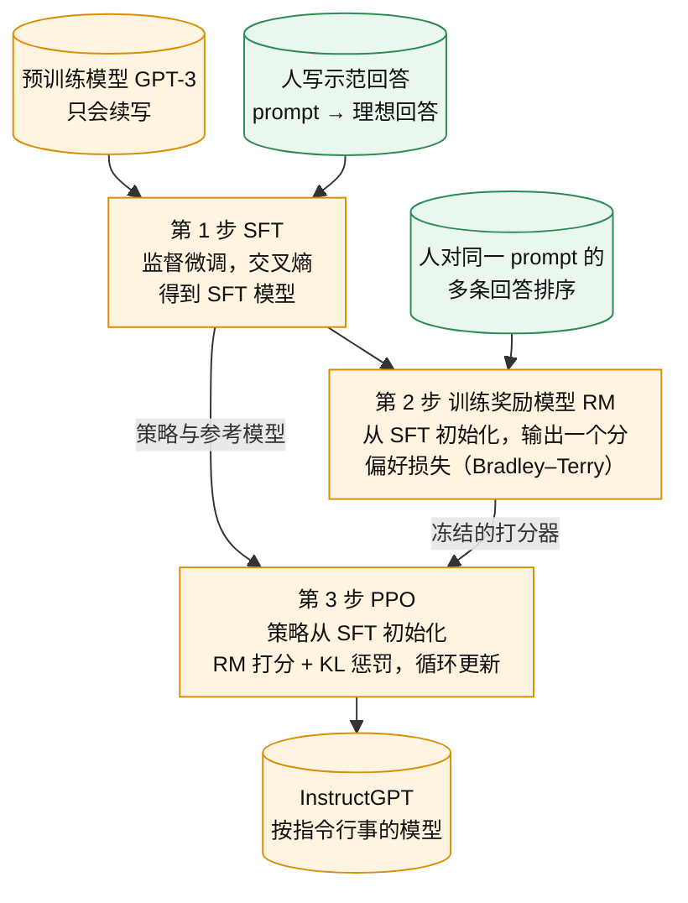

三步各做什么（只讲角色，不讲数字）：

1. **SFT（监督微调）。** 标注员给 prompt 写理想回答，用交叉熵把预训练的 GPT-3 微调成 SFT 模型。它是后两步的起点：RM 从它初始化，PPO 的策略和参考模型也从它初始化。
2. **奖励模型（RM）。** 对同一个 prompt 让模型生成多条回答，标注员排序；RM 从 SFT 初始化、把 LM head 换成 reward head（§11.4），用 Bradley–Terry 式偏好损失（§3.1 式 (1) 的同一形式）学会给一条回答打一个分。训完冻结。
3. **PPO。** 策略从 SFT 初始化，在新的 prompt 上生成回答，RM 打分，减去与参考模型（即 SFT 副本）的逐 token KL 惩罚作为总 reward，价值模型估基线，按 §3.2 的 clipped 目标更新。InstructGPT 还把预训练数据的交叉熵梯度混进来（PPO-ptx），防止 RL 把通用能力冲掉。

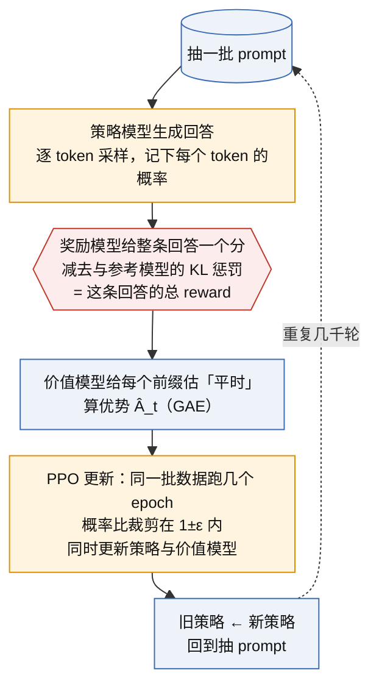

一轮 PPO 循环的六件事：抽一批 prompt → 策略逐 token 采样出回答并记下每个 token 的概率 → RM 给整条回答一个分，减 KL 惩罚 → 价值模型给每个前缀估"平时"、算优势（§11.3）→ 同一批数据跑几个 epoch 的 clipped 更新，同时更新策略和价值模型（§11.4）→ 旧策略换成新策略，回到抽 prompt。

与 B1 两篇论文的对应：Christiano 2017 的三进程闭环（§2.1）里"人比较 → 训 RM → RL"在这里被拆成串行的三步，人类比较只在第 2 步集中做一次而不是异步持续收集；PPO 的 clipped 目标、GAE、value 损失原样搬用，变化只在网络（Transformer 而非 MLP）和 reward（RM 分数 + KL 惩罚）。KL 惩罚的形式与来源在 [[B2-rlhf-learning-to-summarize]] 展开。

### 11.6 逐 token 分别算了 RM 和 value 的什么，怎么合成最终 loss（2026-10-16 追问）

**结论：** 一条 $T$ 个 token 的回答里，**RM 只算一个数**（整条的分，记在最后一个 token 上），**value 算 $T$ 个数**（每个前缀一个 $V(s_t)$），**KL 项算 $T$ 个数**（每个 token 一个 $k_t=\log\pi_\theta-\log\pi_{\mathrm{ref}}$）。三者合成逐 token 的 reward 与优势后，策略项和价值项各在 $T$ 个 token 上取平均，加权相加就是一次反传的 loss。

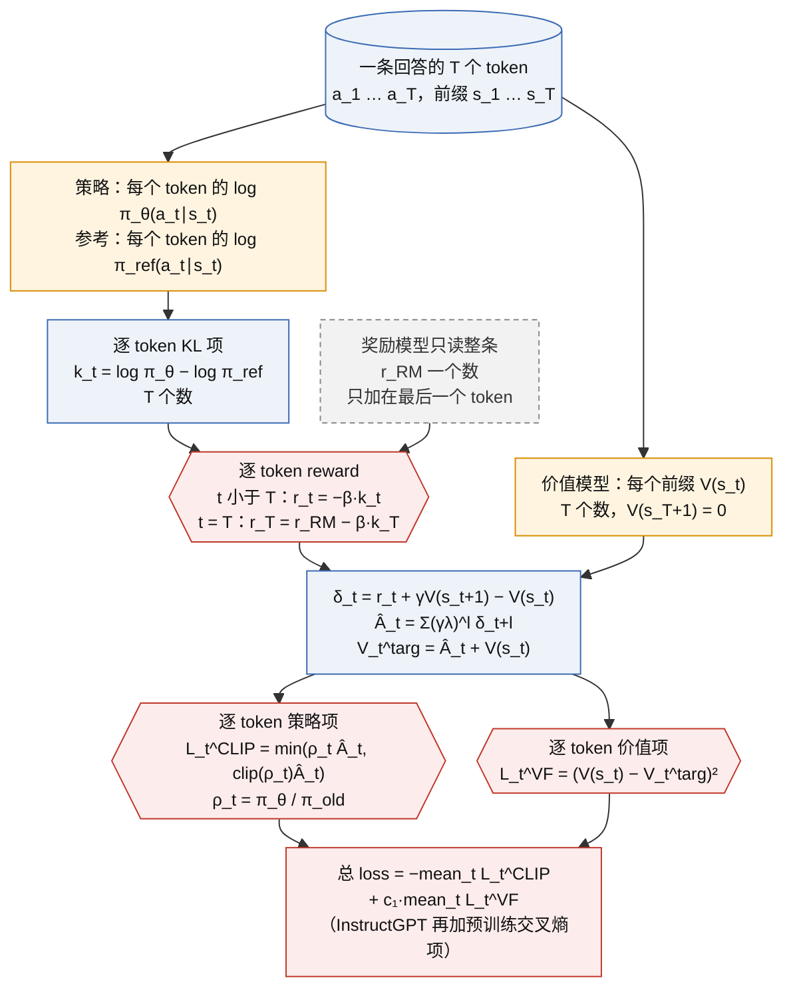

逐 token 的量（RLHF 设定，Ziegler 2019 / InstructGPT 的形式，$\beta$ 是 KL 系数）：

$$
r_t=\begin{cases}-\beta\,k_t, & t<T\\ r_{\mathrm{RM}}-\beta\,k_T, & t=T\end{cases}
\qquad
\delta_t=r_t+\gamma V(s_{t+1})-V(s_t),\quad V(s_{T+1})=0
$$

$$
\hat A_t=\sum_{l\ge 0}(\gamma\lambda)^l\delta_{t+l},\qquad V_t^{\mathrm{targ}}=\hat A_t+V(s_t)
$$

$$
\mathcal L=-\frac1T\sum_t\min\big(\rho_t\hat A_t,\ \mathrm{clip}(\rho_t,1-\epsilon,1+\epsilon)\hat A_t\big)+c_1\frac1T\sum_t\big(V_\phi(s_t)-V_t^{\mathrm{targ}}\big)^2\ (+\ \text{PPO-ptx 项})
$$

| 记号 | 含义 | 谁算、算几个 |
|---|---|---|
| $k_t$ | 当前策略与参考模型在 token $t$ 的 log 概率差 | 策略 + 参考模型，$T$ 个 |
| $r_{\mathrm{RM}}$ | 奖励模型给整条回答的分 | RM，1 个 |
| $r_t$ | 逐 token reward：中间只有 KL 惩罚，末 token 加 RM 分 | 合成，$T$ 个 |
| $V(s_t)$ | 价值模型对前缀 $s_t$ 的预期总 reward | 价值模型，$T$ 个 |
| $\hat A_t$ | 优势，按 §11.3 的 GAE | 合成，$T$ 个 |
| $\rho_t$ | 概率比 $\pi_\theta(a_t\mid s_t)/\pi_{\mathrm{old}}(a_t\mid s_t)$，采样时为 1 | 策略，$T$ 个，每个 minibatch 重算 |

**数值例子（$T=4$）。** 取 $\beta=0.1$、$\gamma=1$、$\lambda=1$（算术简单；PPO 默认 $\lambda=0.95$），第一个 epoch $\rho_t=1$，$c_1=0.5$，RM 给整条 1.5 分：

| 量 | t=1 | t=2 | t=3 | t=4（末） |
|---|---|---|---|---|
| $k_t$ | 0.20 | 0.00 | 0.30 | 0.10 |
| RM 分 | — | — | — | 1.50 |
| $r_t$ | −0.02 | 0.00 | −0.03 | 1.49 |
| $V(s_t)$ | 1.00 | 1.20 | 1.10 | 1.30 |
| 回报 $G_t=\sum_{l\ge t} r_l$ | 1.44 | 1.46 | 1.46 | 1.49 |
| $\hat A_t=G_t-V(s_t)$ | 0.44 | 0.26 | 0.36 | 0.19 |
| $L_t^{\mathrm{CLIP}}=\rho_t\hat A_t$ | 0.44 | 0.26 | 0.36 | 0.19 |
| $L_t^{\mathrm{VF}}=(V(s_t)-G_t)^2$ | 0.194 | 0.068 | 0.130 | 0.036 |

$\mathrm{mean}\,L^{\mathrm{CLIP}}=0.3125$，$\mathrm{mean}\,L^{\mathrm{VF}}=0.1067$，总 loss $=-0.3125+0.5\times0.1067=-0.259$。反传时策略项的梯度经 $\rho_t$ 推高四个 token 的概率（$\hat A_t$ 全正，末 token 推得最轻），价值项把四个 $V$ 往各自的 $G_t$ 拉。

三个容易错的点：

- **RM 不给逐 token 分。** 中间 token 的 reward 只有 KL 惩罚；RM 的分靠 $\gamma$ 折扣和 GAE **从末尾往前传**到每个 token，这就是信用分配。[[C1-process-supervision-prm]] 的 PRM 才是逐步打分。
- **$\rho_t=1$ 时 clip 不起作用但梯度仍在。** 第一个 epoch 新旧策略相同，$\min$ 两项相等，梯度是 $\hat A_t\nabla\log\pi_\theta$；从第二个 epoch 起 $\rho_t$ 偏离 1，超出 $1\pm\epsilon$ 且方向"有利"的 token 梯度被截成 0。
- **取平均的分母。** 实现上常按 batch 内全部 token 取平均而不是每条回答各自平均，长回答因此权重更大；这是实现细节，论文未规定。

### 11.7 PPO 属不属于 OpenAI 引用前十的论文（2026-10-16 追问）

**结论：** 属于，而且在前三。按 Semantic Scholar 的引用数（2026-10-16 经 API 批量查询 44 篇 OpenAI 代表作，不是官方榜单，OpenAI 没有发布过论文排名），PPO 以约 3.2 万次引用排第 3，只低于 GPT-3 和 CLIP；它是前十里唯一一篇纯 RL 算法论文，也是 2017 年的论文里引用最高的。

| 名次 | 论文 | 年份 | 引用（Semantic Scholar） | 课程节点 |
|---|---|---|---|---|
| 1 | Language Models are Few-Shot Learners（GPT-3） | 2020 | 64,759 | A5 |
| 2 | CLIP | 2021 | 57,824 | S1 |
| 3 | **Proximal Policy Optimization Algorithms** | 2017 | 32,249 | B1 |
| 4 | Language Models are Unsupervised Multitask Learners（GPT-2） | 2019 | 30,706 | A3 |
| 5 | GPT-4 Technical Report | 2023 | 27,748 | A4、F |
| 6 | InstructGPT | 2022 | 25,020 | B3 |
| 7 | Improving Language Understanding by Generative Pre-Training（GPT-1） | 2018 | 15,472 | A1、A2 |
| 8 | Diffusion Models Beat GANs on Image Synthesis | 2021 | 13,363 | S1 |
| 9 | Evaluating Large Language Models Trained on Code（Codex） | 2021 | 12,190 | D1 |
| 10 | Training Verifiers to Solve Math Word Problems（GSM8K） | 2021 | 11,433 | C1 |
| 11 | Improved Techniques for Training GANs | 2016 | 10,762 | — |
| 12 | DALL-E 2 | 2022 | 9,538 | S1 |
| 13 | Scaling Laws for Neural Language Models | 2020 | 9,332 | A4 |
| 14 | Whisper | 2022 | 9,043 | S2 |
| 16 | Deep RL from Human Preferences（本卡另一篇） | 2017 | 6,184 | B1 |

三点限定：

- **口径。** Semantic Scholar 的计数普遍低于 Google Scholar（后者 PPO 约 2～3 万以上，未核）；名次在两个口径下大体一致，但具体数字不要跨口径比较。样本是手工列的 44 篇，没有穷举，但 3.2 万以上的 OpenAI 论文不太可能漏。
- **为什么 PPO 引用这么高。** 不是因为它在 LLM 里的用法，而是 2017～2022 年它是 RL 社区的默认基线算法（openai/baselines 与 Stable-Baselines 实现），机器人、游戏、推荐、控制领域的论文凡用 RL 几乎都引它；RLHF 的兴起（§11.5）只是在 2022 年后又加了一波。
- **课程里的位置。** 前十里课程已学或将学的有 8 篇（GPT-1/2/3、PPO、InstructGPT、GPT-4 TR、Codex、GSM8K），B1 两篇论文一篇第 3、一篇第 16；TRPO（8,427）与 GAE（5,056）是 Berkeley 时期的非 OpenAI 论文，不在表内排名。

### 11.8 Rollout 与 PPO 更新怎么交替，概率比 $\rho_t$ 的本质作用（2026-10-16 追问）

**结论：** 一轮 = 一段 rollout（冻结快照 $\pi_{\mathrm{old}}$，只前向采样 $N$ 条、不反传）+ $K$ 个 epoch 的 update（不再采样，反复用这一批数据做 minibatch 梯度步）。两段严格交替，这就是 PPO 论文的 Algorithm 1。概率比 $\rho_t=\pi_\theta(a_t\mid s_t)/\pi_{\mathrm{old}}(a_t\mid s_t)$ 的本质是**重要性采样权重**：样本是 $\pi_{\mathrm{old}}$ 采的，$\pi_\theta$ 每走一步样本就"过期"，$\rho_t$ 把过期样本重新称重，使得在旧样本上算的期望仍是新策略目标的一阶近似；clip 则把称重限幅，防止近似失效。

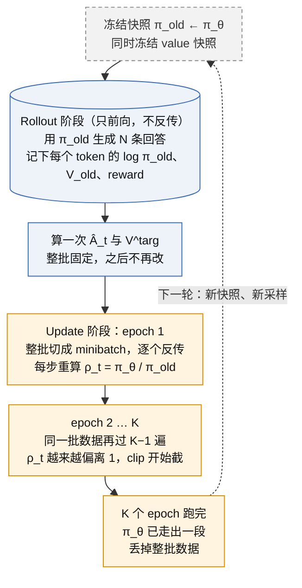

**为什么要交替、而不是边采边更。** 策略梯度是 on-policy 的：梯度公式里的期望必须在**当前**策略下取。最朴素的做法是采一批、更新一步、全扔掉，样本利用率极低（每条回答只贡献一次梯度）。PPO 的折中是把同一批样本用 $K$ 次（MuJoCo $K=10$，LLM 常 1～4），代价是从第二步起样本已不是当前策略的，必须有 $\rho_t$ 来修正。rollout 阶段还顺手记下 $\log\pi_{\mathrm{old}}$、$V_{\mathrm{old}}$ 与 reward，优势 $\hat A_t$ 在 update 开始前算一次、整批固定。

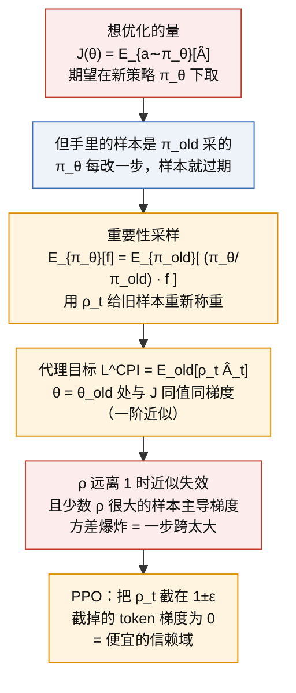

**$\rho_t$ 的三层作用，从本质到实现：**

1. **数学上：换测度。** 想优化 $J(\theta)=\mathbb E_{a\sim\pi_\theta}[\hat A]$，手里只有 $a\sim\pi_{\mathrm{old}}$ 的样本。重要性采样恒等式 $\mathbb E_{\pi_\theta}[f]=\mathbb E_{\pi_{\mathrm{old}}}[\tfrac{\pi_\theta}{\pi_{\mathrm{old}}}f]$ 给出代理目标 $L^{\mathrm{CPI}}=\hat{\mathbb E}_t[\rho_t\hat A_t]$（PPO 论文式 (6)，CPI 指 conservative policy iteration）。在 $\theta=\theta_{\mathrm{old}}$ 处它与 $J$ 同值、同梯度：$\nabla_\theta\rho_t|_{\theta_{\mathrm{old}}}=\nabla_\theta\log\pi_\theta(a_t\mid s_t)$，所以第一步就是普通策略梯度。
2. **数值上：它是过期程度的读数。** $\rho_t$ 离 1 越远，一阶近似越不可信，并且少数 $\rho_t$ 很大的样本会主导整批梯度，方差爆炸。这正是 §2.2 讲的"一步跨太大"在样本层面的表现。TRPO 用 KL 约束整体限制这件事；PPO 直接把 $\rho_t$ 截在 $[1-\epsilon,1+\epsilon]$，被截的 token 梯度为 0（式 (7)）。
3. **实现上：它把"信赖域"变成逐 token 的开关。** 每个 minibatch 重算 $\rho_t$；$K$ 个 epoch 里 $\rho_t$ 从 1 逐渐漂移，越来越多的 token 被 clip 关掉梯度，更新自动减速；下一轮 rollout 换快照，$\rho_t$ 重置为 1。clip 只拦"朝有利方向走过头"：$\hat A_t>0$ 且 $\rho_t<1-\epsilon$、或 $\hat A_t<0$ 且 $\rho_t>1+\epsilon$ 时 $\min$ 取未截项，梯度照常（悲观下界）。

示意：$\epsilon=0.2$、$\hat A_t>0$ 的某个 token，epoch 1 时 $\rho_t=1.00$ 梯度照常；epoch 2 时 1.12 照常；epoch 3 时 1.27 被截到 1.2，梯度 0。另一个 $\hat A_t<0$ 的 token 在 epoch 3 掉到 0.70，被截到 0.8，梯度 0。

**和 LLM 的关系。** rollout 在 LLM 里就是生成，占一轮大部分时间（逐 token 解码）；update 是几次前向加反传。$K$ 常取 1～4，且 $\rho_t$ 的统计（均值、被 clip 的比例 clip-fraction、近似 KL）是训练健康度的常用监控指标：clip-fraction 很高说明策略一轮内走得太远。[[B2-rlhf-learning-to-summarize]] 的 KL 惩罚管的是 $\pi_\theta$ 与 $\pi_{\mathrm{ref}}$（SFT）的距离，跨越所有轮；$\rho_t$ 的 clip 管的是 $\pi_\theta$ 与 $\pi_{\mathrm{old}}$（上一次快照）的距离，只在一轮之内，见 §10.3。

### 11.9 PPO 与 next-token 预测怎么配合：几个模型、每个 token 记什么、前向几次更新几次（2026-10-16 追问）

**结论：** PPO 没有换掉 next-token 预测。策略的"动作"就是 LM head 的下一个 token softmax，PPO 只是把 SFT 里每个 token 权重为 1 的 $\log\pi_\theta(a_t\mid s_t)$ 换成权重为优势 $\hat A_t$、再乘概率比 $\rho_t$ 的版本。整页图见 [PPO × Next-token 训练图板](https://claude.ai/artifact/KcFkoErwZppVLoMdy22Ho3)，下面只留结论与一张入卡图。

**配合点有三处。** 第一，动作分布本身：rollout 时策略逐 token 采样，用的就是预训练同一个 softmax；第二，初始化：策略、参考模型都从 SFT（交叉熵训出来的）复制；第三，正则项：InstructGPT 的 PPO-ptx 把预训练交叉熵按系数加回 PPO 目标（Ouyang 等 2022 §3.5）。

**第 3 步里有 4 个模型，2 个在更新。** 策略 $\pi_\theta$（SFT 初始化，LM head，训练）、参考 $\pi_{\mathrm{ref}}$（SFT 副本，冻结，只提供 $\log\pi_{\mathrm{ref}}$ 算 KL）、奖励 RM（第 2 步训好，标量 head 取末 token，冻结）、价值 $V_\phi$（InstructGPT 附录 C.4 写从 RM 初始化，每个位置一个标量，训练）。"$\pi_{\mathrm{old}}$"不是第五个模型，它是 rollout 开始那一刻 $\pi_\theta$ 的数值快照，以一列 $\log\pi_{\mathrm{old}}$ 存在缓冲区里。

**每个回答 token 记 4 个数、算 4 个数、更新时再算 2 个。** 记：$a_t$、$\log\pi_{\mathrm{old}}(a_t\mid s_t)$、$\log\pi_{\mathrm{ref}}(a_t\mid s_t)$、$V_{\mathrm{old}}(s_t)$，外加整条序列一个 $r_{\mathrm{RM}}$。算（rollout 结束时一次）：$r_t=-\beta(\log\pi_{\mathrm{old}}-\log\pi_{\mathrm{ref}})+[t=T]\,r_{\mathrm{RM}}$、$\delta_t=r_t+V_{\mathrm{old}}(s_{t+1})-V_{\mathrm{old}}(s_t)$、$\hat A_t=\delta_t+\gamma\lambda\hat A_{t+1}$、$R_t=\hat A_t+V_{\mathrm{old}}(s_t)$。更新时每个 minibatch 重算：$\log\pi_\theta(a_t\mid s_t)$ 与 $\rho_t=\exp(\log\pi_\theta-\log\pi_{\mathrm{old}})$。记 $\log\pi_{\mathrm{old}}$ 是为了做 $\rho_t$ 的分母，记 $\log\pi_{\mathrm{ref}}$ 是为了 KL，记 $V_{\mathrm{old}}$ 是为了基线与 value clipping，$r_{\mathrm{RM}}$ 只在末 token 是因为 RM 只给整条打分。prompt 的 token 用 mask 从所有求和里去掉。图板第 05 块有 $T=4$ 的数值表（$\beta=0.1,\gamma=1,\lambda=0.95,\epsilon=0.2$，示意值）。

**前向与更新次数（以 InstructGPT 附录 C.4 的 batch 512、minibatch 64 计，凭记忆转述，待核对）。** 一个 batch：策略自回归生成一次（$T$ 步解码）、$\pi_{\mathrm{ref}}$ 与 RM 与 $V_{\mathrm{old}}$ 各前向一次（无梯度）；然后 $K$ 个 epoch × 8 个 minibatch = $8K$ 次 optimizer step，每次策略与价值各一次前向加反向（PPO-ptx 再加一个预训练 minibatch 的前向反向）。$K$ 论文未明说。整个训练 256k episode ÷ 512 = 500 轮 rollout、$4000K$ 次更新。与预训练的区别：那里每条数据只用一次，这里每条自采回答用 $K$ 次，所以才需要 $\rho_t$ 与 clip（§11.8）。

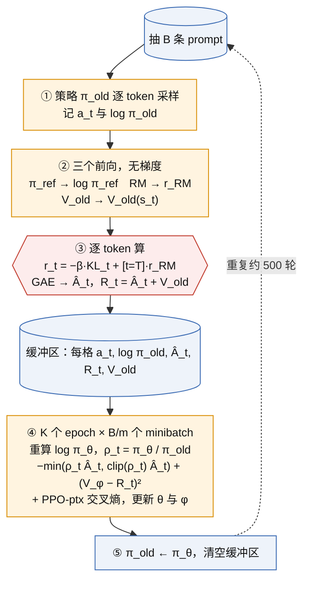

公开边界：clipped surrogate、GAE、多 epoch 复用是 PPO 论文公开算法；三步流水线、KL 惩罚、PPO-ptx 是 InstructGPT 论文 §3.5 公开；batch / minibatch / episode 数与价值模型初始化是附录 C.4 的系统披露；"逐 token 记哪几列"是开源 RLHF 实现（trlx、TRL、OpenRLHF）的通行做法，论文未逐项列出，属推断；$K$、生成与更新的并行与显存布局未知。InstructGPT 全貌在 [[B3-instructgpt-chatgpt]]。


### 11.10 价值模型怎么进 loss；是不是每个 token 一个分、衰减拟合最终分、越靠前权重越高（2026-10-16 追问）

**结论：** 价值模型走两条路进 loss，只有一条有梯度；每个位置的目标不是"衰减后的最终分"而是"从这个位置往后实际拿到的回报"；loss 里各位置等权，末尾信号往前传时按 $\lambda$ 衰减，所以前面的 token 分到的末尾信号更少，不是更多。图见 [PPO × Next-token 训练图板](https://claude.ai/artifact/KcFkoErwZppVLoMdy22Ho3) 第 06b 块。

**两条路。** 路一：rollout 时的 $V_{\mathrm{old}}(s_t)$ 当基线，$\hat A_t$ 由 $\delta_t = r_t + \gamma V_{\mathrm{old}}(s_{t+1}) - V_{\mathrm{old}}(s_t)$ 递推而来，进策略 loss $-\min(\rho_t\hat A_t,\ \mathrm{clip}(\rho_t)\hat A_t)$ 时 $\hat A_t$ 是常数（`detach`），梯度不回流价值模型。路二：update 时重算 $V_\phi(s_t)$，与账本上的目标 $R_t = \hat A_t + V_{\mathrm{old}}(s_t)$ 做平方误差 $L^{VF}_t = (V_\phi(s_t) - R_t)^2$（PPO 论文式 (9) 的 $L^{VF}$），对回答位置做 mask 后等权平均。InstructGPT 的价值模型是单独一份（从 RM 初始化，附录 C.4），两个 loss 各改各的参数；PPO 原论文共享主干时按 $c_1$ 加权相加（§11.4）。开源实现还常加 value clipping：把 $V_\phi$ 限制在 $V_{\mathrm{old}} \pm \epsilon$ 内取更悲观的一边，这是 baselines 代码里的做法，论文未写。

**目标是什么。** $R_t$ 在 $\lambda = 1$ 时就是从 $t$ 往后的实际回报 $\sum_{k \ge t} \gamma^{k-t} r_k$。RLHF 里 $\gamma = 1$，奖励只有末尾一个 $r_{\mathrm{RM}}$ 加逐 token 的小额 KL 罚，所以每个位置的目标约等于"最终分减去之后的 KL 罚"，各位置几乎同一个数。$\lambda < 1$ 时 $R_t$ 变成实际回报与 bootstrap 估值 $V_{\mathrm{old}}(s_{t+1})$ 的几何混合，$\lambda$ 调的是"信实际结果多一点还是信估值多一点"（§11.3 的 λ 两端对照），不是按位置给权重。位置之间真正不同的是估值本身：前缀越长价值模型越有把握，所以靠前位置的 $|\hat A_t|$ 往往更大，这是估值不准造成的，不是加权。

**衰减的方向。** $\hat A_t = \sum_{l \ge 0} (\gamma\lambda)^l \delta_{t+l}$：末尾最大的那个 $\delta_T$（实际分减末尾估值的"惊喜"）传到位置 $t$ 时乘 $(\gamma\lambda)^{T-t}$，离末尾越远份额越小。因此"越靠前权重越高"反了：价值 loss 各位置等权，优势里末尾信号往前是递减的，靠前的 token 更多靠价值模型自己的 $\delta$ 顶上。

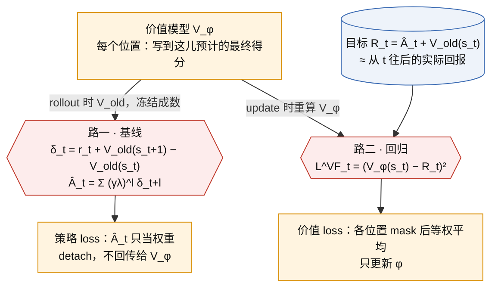

**补充：用 $\gamma$ 单独看"目标"（2026-10-17 追问）。** 位置 $t$ 的目标是 $G_t = \sum_{k \ge t} \gamma^{\,k-t} r_k$。RLHF 的 $r_k$ 只有末尾一个大分 $r_{\mathrm{RM}}$，其余是小额 KL 罚，所以 $G_t \approx \gamma^{\,T-t} r_{\mathrm{RM}} - (\text{之后的 KL 罚})$。末尾分传到位置 $t$ 时剩 $\gamma^{\,T-t}$ 份：

| 距末尾 | 0 步 | 1 步 | 2 步 | 3 步 | 5 步 |
|---|---|---|---|---|---|
| $\gamma = 1$（RLHF） | 100% | 100% | 100% | 100% | 100% |
| $\gamma = 0.9$ | 100% | 90% | 81% | 73% | 59% |
| $\gamma = 0.7$ | 100% | 70% | 49% | 34% | 17% |

"每个 token 一个分数"对：每个位置一个估值去拟合 $G_t$。"衰减拟合最终分"是 $\gamma < 1$ 的图景，RLHF 取 $\gamma = 1$，各位置目标几乎同一个数。"越靠前权重越高"在 $\gamma < 1$ 时恰好相反，$\gamma = 1$ 时不多不少。图板 06b 块有 $\gamma$ 与整条分双滑块的交互图，四行账加递推表，数值自洽（2026-10-17 追问后重做）。示意值：$T = 6$，$\beta = 0.05$，对数比 $\log\frac{\pi_{\mathrm{old}}}{\pi_{\mathrm{ref}}}$ 取 +1.0、−0.4、+0.2、−0.6、+0.8、+0.4，偏离罚 $= -\beta \times$ 对数比 $=$ −0.05、+0.02、−0.01、+0.03、−0.04、−0.02，末词加整条的分 +0.6（归一化后"比示范好 0.6 分"，约 65% 把握胜过示范）得 $r_6 = +0.58$。$\gamma = 1$ 时从后往前：

| t | 6 | 5 | 4 | 3 | 2 | 1 |
|---|---|---|---|---|---|---|
| $r_t$ | +0.58 | −0.04 | +0.03 | −0.01 | +0.02 | −0.05 |
| $G_t = r_t + \gamma G_{t+1}$ | 0.58 | 0.54 | 0.57 | 0.56 | 0.58 | 0.53 |

六个位置的目标都在 0.53～0.58 之间，差的只是几笔偏离罚；$\gamma = 0.9$ 时同一列变成 0.58、0.48、0.46、0.40、0.38、0.29，这才是"越靠前越小"。$\lambda$ 不在这张图里，它管的是把 $G_t$ 与 bootstrap 估值 $V(s_{t+1})$ 怎么混。

公开边界：$L^{VF}$、GAE 的递推与 $\lambda$ 的含义是 PPO 论文与 GAE 论文的公开算法；价值模型单独一份、从 RM 初始化是 InstructGPT 附录 C.4 的系统披露（凭记忆，待核对）；value clipping 与 mask 等权平均是开源实现的通行做法，属推断。


### 11.11 "每步奖励" $r_t$ 是什么，怎么算出来的（2026-10-17 追问）

**结论：** 奖励模型只给整条回答一个分，不给每个 token 打分。PPO 与 GAE 需要逐步的 $r_t$，于是按下式拼出来：

$$
r_t = -\beta\big[\log \pi_{\mathrm{old}}(a_t \mid s_t) - \log \pi_{\mathrm{ref}}(a_t \mid s_t)\big] + \mathbb 1[t = T]\, r_{\mathrm{RM}}(x, y)
$$

| 记号 | 含义 | 来源 |
|---|---|---|
| `log π_old(a_t|s_t)` | 生成时策略给所采样 token 的对数概率 | rollout 时记下（§11.9） |
| `log π_ref(a_t|s_t)` | 参考模型（SFT 副本）给同一 token 的对数概率 | rollout 末参考模型前向一次 |
| `β` | KL 罚系数，很小 | InstructGPT 附录 C.4（凭记忆） |
| `r_RM(x, y)` | 奖励模型对整条回答的分 | 只加在最后一个 token |

**怎么理解。** 中间每个 token 的奖励只有一笔"偏离罚"：策略比参考更偏爱这个 token，对数比为正，奖励为负；更不偏爱则为正。最后一个 token 再加上整条的分。把所有 token 的偏离罚加起来，$\sum_t [\log\pi_{\mathrm{old}} - \log\pi_{\mathrm{ref}}] = \log \frac{\pi_{\mathrm{old}}(y \mid x)}{\pi_{\mathrm{ref}}(y \mid x)}$，正是 InstructGPT 目标函数（式 (2)）里的序列级 KL 罚项的单样本估计，所以按 token 摊开不是近似，是把一个和拆成逐项；这个形式来自 [[B2-rlhf-learning-to-summarize]]。图板 06b 块"每步奖励 r 是怎么来的"一图是它的数据流；滑块图里"每步奖励"一行即示意的偏离罚，末词再加整条的分（示意默认 +0.6）。

**为什么逐词有正有负、合计偏负（2026-10-17 追问）。** 每个 token 的项 $-\beta[\log\pi_{\mathrm{old}}(a_t\mid s_t) - \log\pi_{\mathrm{ref}}(a_t\mid s_t)]$ 的符号只取决于策略对这个采样到的 token 是比参考更偏爱（为负，罚）还是更不偏爱（为正，奖）。训练刚开始 $\pi_{\mathrm{old}} = \pi_{\mathrm{ref}}$，全为 0；几轮后策略学出新习惯，更爱的词与不太爱但仍采到的词在一条回答里都会出现，所以逐词正负混杂。合计偏负是因为 token 按 $\pi_{\mathrm{old}}$ 自己的概率采样，更爱的词出现更多：$\mathbb E_{a\sim\pi_{\mathrm{old}}}[\log\pi_{\mathrm{old}} - \log\pi_{\mathrm{ref}}] = \mathrm{KL}(\pi_{\mathrm{old}}\,\|\,\pi_{\mathrm{ref}}) \ge 0$。逐词正负是单样本估计的噪声，起约束作用的是合计。图板示意值取 −0.05、+0.02、−0.01、+0.03、−0.04、−0.02，合计 −0.07。有些开源实现改用逐词恒非负的估计量（常称 k3），罚永远不为正；用哪种估计量论文未写。

**整条的分 $r_{\mathrm{RM}}$ 典型长什么样（2026-10-17 追问）。** 图板示意的默认值取 +0.6，是归一化后常见范围内的一个数，不是什么特殊值。奖励模型用成对比较的 Bradley–Terry 损失训练（§3.1 式 (1) 的同一形式），损失只依赖两条回答的分差，对整体平移不变，所以原始标量的绝对位置是任意的，可能整批偏在 −3 附近也可能偏在 +5 附近。InstructGPT 的处理是加一个偏置做归一化，让标注员示范回答的平均分为 0，再进 RL（§3.5 / 附录，凭记忆待核对）；归一化后一批回答的分围着 0 散开，正负都有。分数的单位是偏好的对数几率：分差 1 对应 $\sigma(1) \approx 73\%$ 的偏好概率，分差 2 约 88%，分差 3 约 95%，所以 ±1 量级的值常见，几十以上不会出现。分数的正负不等于奖惩：优势 $= $ 从该位置往后的实际回报 $-$ 基线，一条得 −0.5 分的回答在基线为 −1.2 时仍是"比平时好"。与偏离罚的尺度对比：$\beta$ 很小，但一条几百 token 的回答把偏离罚加总后可与分差同量级，$\beta$ 就是按这个平衡来选的。

**不是什么。** 奖励模型逐步打分的做法是过程奖励模型（PRM），属 Track C（[[C1-process-vs-outcome-supervision]]），InstructGPT 没有用。单样本对数比是 KL 的无偏估计但方差大，开源实现有的换用其他估计量（如 k3），这是实现层面的选择，论文未写。


### 11.12 衰减系数 $\gamma$ 的物理意义，在平衡当前与未来的什么（2026-10-17 追问）

**结论：** $\gamma^k$ 是"一笔 $k$ 步之后才到的奖励，现在这一步认领多少"。它平衡的是当前一步立刻到手的 $r_t$（RLHF 里是这个 token 的偏离罚）与之后所有奖励的总和（RLHF 里几乎就是末尾的 $r_{\mathrm{RM}}$）。$\gamma$ 越小越短视，$\gamma = 1$ 一视同仁。

经典 RL 里取 $\gamma < 1$ 的三个理由，到一条回答的 RLHF 上都不成立：

| 理由 | 含义 | 在 RLHF 里 |
|---|---|---|
| 时间偏好 | 早到的奖励更值钱，类似利率 | 整条的分是给整条回答的，首尾 token 责任相同 |
| 无限视野求和收敛 | 等价于每步 $1-\gamma$ 的终止概率，有效视野约 $1/(1-\gamma)$ | 回答有限长，到 EOS 必结束 |
| 降方差 | 远处奖励难归因，打折少吃噪声，代价是短视 | $\gamma<1$ 会让开头 token 几乎看不到 $r_{\mathrm{RM}}$，只剩偏离罚可学 |

所以 InstructGPT 取 $\gamma = 1$（附录 C.4，凭记忆），§11.10 里"各位置目标几乎相同"是这个选择的直接结果。 图板 06b 块"γ 的物理意义"一组图（当前 vs 未来的认领比例、三个经典理由在 RLHF 里为何不成立、γ 与 λ 的分工）即本节。

**$\gamma$ 是 RL 的通用参数还是 PPO 特有（2026-10-17 追问）。** 通用，且比"常用超参"更基本：它是 MDP 五元组 $(\mathcal S,\mathcal A,P,R,\gamma)$ 的一员，定义优化目标 $G_t=\sum_k\gamma^k r_{t+k}$。因此它出现在所有以回报为目标的算法里：Bellman 方程 $V(s)=\mathbb E[r+\gamma V(s')]$（价值迭代、TD、Q-learning、DQN）、TD 误差 $\delta_t=r_t+\gamma V(s_{t+1})-V(s_t)$（actor-critic、A2C、PPO）、多步回报与 GAE 的权重 $(\gamma\lambda)^k$。控制与游戏任务常取 0.99（PPO 论文 MuJoCo 与 Atari 均为 0.99，§4），有效视野约 $1/(1-\gamma)$ 步。RLHF 取 $\gamma=1$ 是有限长 episode、末尾奖励下的特例，TRL、OpenRLHF 等开源实现默认也是 1。三层定位：$\gamma$ 属于问题（目标是什么），$\lambda$ 属于估计方法（怎么估），$\epsilon$ 与学习率属于优化器（怎么走）。

**学习者的概括（2026-10-17）：$\gamma=1$ 为最终结果负责、视野广；$\gamma\ll1$ 只为当前步负责、视野近。** 正确。补三点：(1) 两端之间是连续衰减，$\gamma=0.9$ 时 10 步外的奖励仍算 $0.9^{10}\approx35\%$，"负责"按距离打折而非开关；(2) 视野广的代价是方差，一步的功过要从之后一长串噪声里分离，经典 RL 取 0.99 而非 1 是在"看得远"与"学得稳"之间让步，RLHF 能取 1 是因为 episode 短且只有末尾一个有意义的奖励；(3) $\gamma=1$ 时各 token 的目标几乎相同，"哪个 token 功劳大"不再由 $\gamma$ 区分，而由基线 $V(s_t)$ 区分，接回 §11.10。

**与 $\lambda$ 的分工。** $\gamma$ 定义目标 $G_t = \sum_k \gamma^k r_{t+k}$ 里未来算多少；$\lambda$ 定义怎么估这个目标：$\lambda = 1$ 全信实际回报（无偏、高方差），$\lambda = 0$ 全信 $V(s_{t+1})$ 的 bootstrap（有偏、低方差），见 §11.3。InstructGPT 的组合 $\gamma = 1$、$\lambda = 0.95$：目标上不打折，估计上稍借价值模型降噪。一句话：$\gamma$ 决定远处的分算不算数，$\lambda$ 决定远处的分信谁报的。


### 11.13 LM head 具体是什么组件（2026-10-21 追问）

答案写在 [[A1-transformer-decoder-next-token]] §11.14：一个 $d\times V$ 的线性矩阵，logit 是隐状态与词向量的点积；本卡用到它的两处是把它的输出分布当策略 $\pi(a_t\mid s_t)$（§11.1），以及把它换成 $d\times 1$ 标量头当 reward model（§3.1）。

### 11.14 GAE 是哪篇论文（2026-10-22 追问）

**High-Dimensional Continuous Control Using Generalized Advantage Estimation**，Schulman、Moritz、Levine、Jordan、Abbeel，UC Berkeley，arXiv 1506.02438（2015-06），ICLR 2016 发表。**非 OpenAI**（R-11、P-30），作者团队与 TRPO 相同，比 OpenAI 成立早半年。

- **解决什么**：策略梯度要用优势 $\hat A_t$ 给动作打分。用整条轨迹的蒙特卡洛回报无偏但方差大；只用一步 TD 残差 $\delta_t = r_t + \gamma V(s_{t+1}) - V(s_t)$ 方差小但偏差随 $V$ 的误差走。GAE 用 $\hat A_t = \sum_l (\gamma\lambda)^l \delta_{t+l}$ 在两者之间连续插值：$\lambda=0$ 退化为一步 TD，$\lambda=1$ 退化为蒙特卡洛（§11.3、§11.10）。
- **与 TRPO 的分工**：同一批作者，TRPO 管"一步走多远"（§2.3 的第 0～1 步），GAE 管"往哪走的信号多准"；论文实验就是 TRPO + GAE 跑 MuJoCo 运动控制。
- **进入 OpenAI 的路径**：PPO 论文 §5 直接采用截断 GAE（式 (11)(12)），默认 $\gamma=0.99$、$\lambda=0.95$（§3.2）；之后 InstructGPT 等 RLHF 实现沿用 PPO，也就沿用了 GAE。
- **按课程规则**：只能用来解释通用机制；OpenAI 后续系统里 GAE 的具体设定未公开。

### 11.15 理解 GAE 要先懂哪些算法，它们什么关系（2026-10-22 追问）

GAE 是两条线的汇合点：**价值估计线**（蒙特卡洛 → TD → n-step → TD(λ)）回答"回报怎么估、偏差和方差怎么取舍"，**策略梯度线**（REINFORCE → 基线 → 优势 → actor-critic）回答"用什么信号给动作打分"。GAE 把前一条线的 λ 加权，搬到后一条线的优势估计上。以下前置全部是**非 OpenAI** 的通用强化学习知识（教材 Sutton & Barto《Reinforcement Learning: An Introduction》第 5～7、12、13 章覆盖其中大部分，章号凭记忆）。

```mermaid
%%{init: {"flowchart": {"nodeSpacing": 24, "rankSpacing": 22, "padding": 10}, "themeVariables": {"fontSize": "13px"}}}%%
flowchart TB
  M["⓪ 期望、方差、无偏估计<br/>几何级数"]:::data
  MDP["① MDP：回报 Gₜ、折扣 γ"]:::data
  V["② 价值函数 V、Q<br/>Bellman 方程"]:::model
  PG["⑦ 策略梯度定理<br/>REINFORCE"]:::model
  MC["③ 蒙特卡洛回报<br/>无偏、方差大"]:::data
  TD["④ TD(0)：残差 δₜ<br/>方差小、随 V 有偏"]:::data
  BL["⑧ 基线 b(s)<br/>减方差、不改期望"]:::model
  NS["⑤ n-step 回报<br/>前 n 步真奖励 + V 收尾"]:::data
  ADV["⑨ 优势 A = Q − V"]:::model
  LAM["⑥ TD(λ)：λ-return<br/>对所有 n-step 指数加权"]:::data
  AC["⑩ Actor-critic<br/>学一个 Vᵩ 当基线"]:::model
  GAE["GAE：Âₜ = Σ (γλ)ˡ δₜ₊ₗ"]:::loss
  PPO["TRPO + GAE（2015）<br/>PPO 截断 GAE（2017）→ RLHF"]:::frozen
  M --> MDP
  MDP -->|"定义要估的量"| V
  MDP -->|"对期望回报求梯度"| PG
  V -->|"直接采样"| MC
  V -->|"自举一步"| TD
  PG -->|"梯度方差太大"| BL
  MC -->|"一端"| NS
  TD -->|"另一端"| NS
  BL -->|"基线取 V(s)"| ADV
  V --> ADV
  NS -->|"不想手选 n"| LAM
  ADV -->|"用网络估 V"| AC
  LAM -->|"λ 加权搬到<br/>优势估计上"| GAE
  AC -->|"V 等于真值时<br/>E[δₜ] = A"| GAE
  GAE --> PPO
  classDef data  fill:#EEF3FA,stroke:#3B6BB3,color:#111
  classDef model fill:#FFF4E0,stroke:#D98E04,color:#111
  classDef frozen fill:#F2F2F2,stroke:#888,color:#333,stroke-dasharray:4 3
  classDef loss  fill:#FDECEC,stroke:#C0392B,color:#111
  classDef human fill:#EAF7EE,stroke:#2E8B57,color:#111
```

| 编号 | 前置 | 一句话 | 和 GAE 的关系 | 出处 |
|---|---|---|---|---|
| ⓪ | 期望、方差、无偏估计、几何级数 | 估计量好坏的两把尺子 | GAE 的全部论证就是偏差—方差权衡；$\sum(\gamma\lambda)^l$ 是几何级数 | 数学基础 |
| ① | MDP、回报 $G_t=\sum_k \gamma^k r_{t+k}$ | 定义"要最大化什么" | $\gamma$ 来自这里；GAE 论文把 $\gamma$ 也解释为降方差的偏差来源 | 教材第 3 章 |
| ② | $V^\pi(s)$、$Q^\pi(s,a)$、Bellman 方程 | 从某状态 / 某动作出发的期望回报 | $\delta_t$ 就是 Bellman 方程的残差 | 教材第 3～4 章 |
| ③ | 蒙特卡洛回报 | 用整条轨迹的实际回报估价值 | $\lambda=1$ 的一端：无偏、方差大 | 教材第 5 章 |
| ④ | TD(0) 与 $\delta_t = r_t+\gamma V(s_{t+1})-V(s_t)$ | 只看一步真奖励，剩下交给 $V$ | $\lambda=0$ 的一端：方差小、$V$ 不准就有偏；GAE 的基本砖块 | Sutton 1988（P-31） |
| ⑤ | n-step 回报 | 前 n 步用真奖励，第 n 步用 $V$ 收尾 | GAE 论文里的 $k$ 步优势 $\hat A^{(k)}_t=\sum_{l<k}\gamma^l\delta_{t+l}$ 就是 n-step 优势 | 教材第 7 章 |
| ⑥ | TD(λ) / λ-return | 对所有 n-step 回报按 $(1-\lambda)\lambda^{n-1}$ 加权平均 | GAE = 对所有 $\hat A^{(k)}_t$ 做同样的指数加权，化简后得到 $\sum(\gamma\lambda)^l\delta_{t+l}$ | Sutton 1988（P-31） |
| ⑦ | 策略梯度定理、REINFORCE | $\nabla J = \mathbb{E}[\nabla\log\pi(a\mid s)\cdot \Psi_t]$，$\Psi_t$ 可取回报 | GAE 要替换的就是 $\Psi_t$；GAE 论文 §2 列出了 $\Psi_t$ 的六种取法 | Williams 1992（P-32）；Sutton 等 2000（P-33） |
| ⑧ | 基线 $b(s)$ | 从 $\Psi_t$ 里减去只依赖状态的量，期望不变、方差变小 | 本卡 §11.3 已讲；常用基线取 $V(s)$ | Williams 1992（P-32） |
| ⑨ | 优势 $A=Q-V$ | 这个动作比该状态下的平均好多少 | GAE 估的就是它；关键恒等式：$V=V^\pi$ 时 $\mathbb{E}[\delta_t\mid s_t,a_t]=A^\pi(s_t,a_t)$ | GAE 论文 §2～§3（P-30） |
| ⑩ | Actor-critic | 策略网络（actor）+ 价值网络 $V_\phi$（critic） | GAE 需要一个学出来的 $V_\phi$；GAE 论文还用信赖域方法拟合 $V_\phi$ | 教材第 13 章 |

#### 逐个图解（2026-10-22 追问：多用图、少文字）

图板 V-29 里每个前置一张图，下面是同一份 mermaid 源码；柱状图在卡里改成数值表。

**⓪ 偏差与方差**：瞄偏了是偏差，手抖是方差。几何级数 $\sum_l x^l = 1/(1-x)$；$\gamma\lambda=0.94$ 时总权重约 17，半衰期约 11 步。

| $l$ | 0 | 2 | 5 | 10 | 20 |
|---|---|---|---|---|---|
| $0.94^l$ | 1 | 0.88 | 0.74 | 0.54 | 0.29 |
| $0.5^l$ | 1 | 0.25 | 0.03 | 0.001 | 0 |

**① MDP 与折扣回报**：$G_t=\sum_k\gamma^k r_{t+k}$，有效视野约 $1/(1-\gamma)$（$\gamma=0.99$ 约 100 步，$0.9$ 约 10 步）。

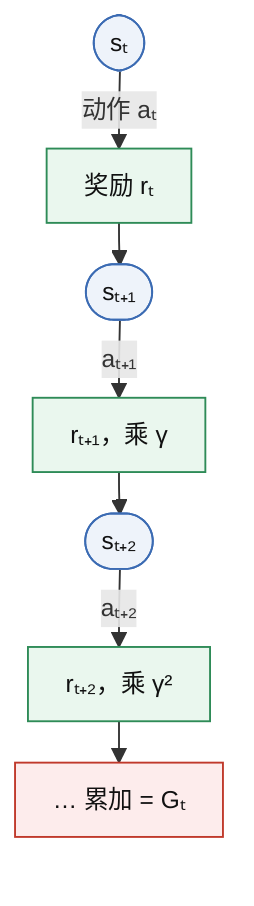

**② 价值函数与 Bellman 方程**：$V(s)=\mathbb{E}[r+\gamma V(s')]$，两边的差就是 ④ 的 $\delta$。

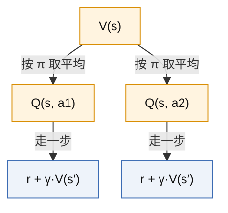

**③ 蒙特卡洛 vs ④ TD(0)**：等到结束全加起来，或只走一步剩下交给 $V$ 猜。

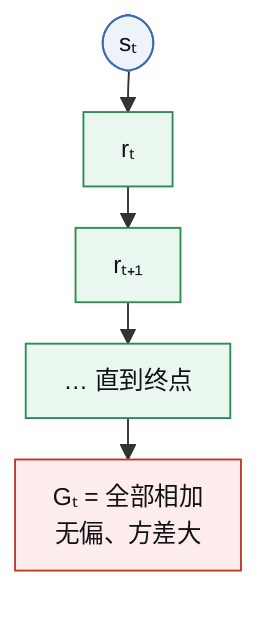
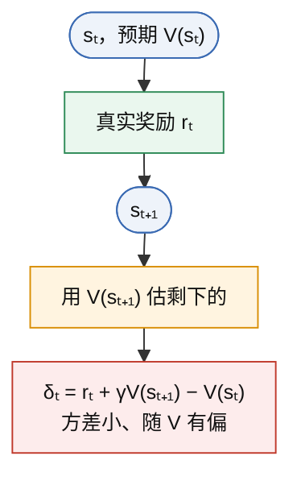

| | ③ 蒙特卡洛 | ④ TD(0) |
|---|---|---|
| 目标 | 整条轨迹的真实回报 | $r_t+\gamma V(s_{t+1})$ |
| 例子（$\gamma=1$，奖励 1, 0, 0, 5，$V(s_1)=3.5$） | $G_0=6$ | $1+3.5=4.5$ |
| 偏差 / 方差 | 无偏 / 大 | $V$ 不准就有偏 / 小 |
| 在 GAE 里 | $\lambda=1$ | $\lambda=0$ |

**⑤ n-step 回报**：前 n 步真奖励（方差），第 n 步用 $V$ 收尾（偏差）。

| n | 组成 |
|---|---|
| 1 | $r_t$ ＋ $V$ |
| 2 | $r_t$ $r_{t+1}$ ＋ $V$ |
| 3 | $r_t$ $r_{t+1}$ $r_{t+2}$ ＋ $V$ |
| ∞ | 全部真实奖励直到终点（= MC） |

**⑥ TD(λ)**：所有 n 一起要，权重 $(1-\lambda)\lambda^{n-1}$。

| n | 1 | 2 | 3 | 4 | 8 |
|---|---|---|---|---|---|
| $\lambda=0.5$ | 0.50 | 0.25 | 0.13 | 0.06 | 0.004 |
| $\lambda=0.9$ | 0.10 | 0.09 | 0.08 | 0.07 | 0.05 |

**⑦ 策略梯度**：打分高的动作提高概率；⑧～⑩ 和 GAE 都在换更好的打分 $\Psi_t$。

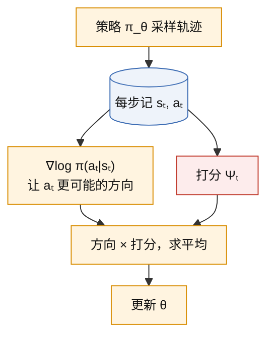

**⑧ 基线**：回报 10, 11, 9, 12 全为正，全部被推高；减去基线 10.5 后为 −0.5, +0.5, −1.5, +1.5，有升有降。

**⑨ 优势**：三个动作 $Q=7,5,3$，均匀策略下 $V=5$，$A=+2,0,-2$。$V=V^\pi$ 时 $\mathbb{E}[\delta_t]=A$。

**⑩ Actor-critic**：critic 学 $V_\phi$，给 actor 算 $\hat A_t$。

```mermaid
%%{init: {"flowchart": {"nodeSpacing": 24, "rankSpacing": 22, "padding": 10}, "themeVariables": {"fontSize": "13px"}}}%%
flowchart TB
  ENV["环境"]:::human --> TR[("轨迹 s, a, r")]:::data
  TR --> CR["critic Vᵩ"]:::frozen
  CR --> DL["算 δₜ，再算 Âₜ"]:::loss
  DL --> AC["actor π_θ<br/>按 Âₜ 更新"]:::model
  TR --> FIT["回归回报目标"]:::loss
  FIT --> CR
  AC --> ENV
  classDef data  fill:#EEF3FA,stroke:#3B6BB3,color:#111
  classDef model fill:#FFF4E0,stroke:#D98E04,color:#111
  classDef frozen fill:#F2F2F2,stroke:#888,color:#333,stroke-dasharray:4 3
  classDef loss  fill:#FDECEC,stroke:#C0392B,color:#111
  classDef human fill:#EAF7EE,stroke:#2E8B57,color:#111
```

**GAE 汇合**：相加时中间的 $V$ 两两抵消（telescoping）。

$$
\hat A^{(2)}_t=\delta_t+\gamma\delta_{t+1} = -V(s_t)+r_t+\gamma r_{t+1}+\gamma^2V(s_{t+2}),\qquad
\hat A^{(k)}_t=\sum_{l<k}\gamma^l\delta_{t+l}
$$

对所有 $k$ 按 $(1-\lambda)\lambda^{k-1}$ 加权，得 $\hat A_t^{\mathrm{GAE}}=\sum_l(\gamma\lambda)^l\delta_{t+l}$。图板里有 λ 滑块，可以看权重随 λ 怎么变。

**学习顺序建议**：按编号 ⓪→⑩，其中 ③④⑤⑥ 是一条线、⑦⑧⑨⑩ 是另一条线，两条可以交替读；读完后回到 GAE 论文 §3，自己从 $\hat A^{(k)}_t$ 推出 $\sum(\gamma\lambda)^l\delta_{t+l}$，推得出来就算掌握。

**和课程的连接**：GAE 本身不是 OpenAI 的工作；它进入 OpenAI 的路径是 PPO 论文 §5 的截断 GAE（$\gamma=0.99$、$\lambda=0.95$，§3.2），再随 PPO 进入 [[B2-rlhf-learning-to-summarize]] 与 [[B3-instructgpt-chatgpt]]。A2C/A3C（Mnih 等，2016）与 GAE 同期，用的是固定 n-step 优势，不是前置。

### 11.16 $\gamma\lambda$ 是什么意思（2026-10-22 追问）

就是两个数相乘，$0.99\times0.95=0.9405$，作为 GAE 里**每往后一步的衰减系数**：$\delta_{t+l}$ 的权重是 $(\gamma\lambda)^l=\gamma^l\cdot\lambda^l$。两个因子来源不同、管的事不同（三层定位见 §11.12）：

| 因子 | 属于 | 为什么乘在 $\delta_{t+l}$ 上 | 调大的后果 |
|---|---|---|---|
| $\gamma^l$ | 问题本身：目标 $G_t=\sum\gamma^k r_{t+k}$ | $\delta_{t+l}$ 发生在 $l$ 步之后，按目标本来就要打 $\gamma^l$ 折 | 更看重远期；若真实目标不打折，$\gamma<1$ 本身就是一种偏差 |
| $\lambda^l$ | 估计方法：TD(λ) 加权（§11.15 ⑥） | 越远的 $\delta$ 越多地依赖真实奖励而不是 $V$，$\lambda$ 决定信多少 | 更信真实奖励：偏差小、方差大；$V$ 准时 $\lambda$ 不引入偏差 |

- 合起来：$\gamma\lambda$ 越接近 1，远处的 $\delta$ 分到的权重越多；半衰期 $\ln 0.5/\ln(\gamma\lambda)$，0.9405 约 11 步。
- 两端：$\lambda=0$ 时 $\gamma\lambda=0$，只剩 $\delta_t$（TD(0)，$\gamma$ 仍在 $\delta_t$ 内部）；$\lambda=1$ 时只剩 $\gamma^l$，等于折扣回报减 $V$（蒙特卡洛）。
- 递推写法 $\hat A_t=\delta_t+\gamma\lambda\,\hat A_{t+1}$（§11.9）：$\gamma\lambda$ 就是"下一步的优势传回来要打的折扣"。
- RLHF 常取 $\gamma=1$，此时 $\gamma\lambda=\lambda$，衰减全部来自估计方法（§11.12）。

### 11.17 $\gamma\lambda$ 是哪篇论文引入的（2026-10-23 追问）

分三层，出处不同：

| 层 | 内容 | 出处 | 核验 |
|---|---|---|---|
| $\lambda$ | 对多步预测按 $\lambda$ 指数加权，即 TD(λ) | Sutton 1988（P-31），原文是不打折的预测问题 | 凭记忆 |
| $\gamma\lambda$ 作为每步衰减 | 带折扣的 TD(λ)：资格迹每步乘 $\gamma\lambda$ | 强化学习教材与 1989 年前后的 Q(λ) 工作；**最早出处未确定** | 凭记忆 |
| $\sum(\gamma\lambda)^l\delta_{t+l}$ 用作策略梯度的优势 | 本卡所说的 GAE 公式 | 公式最早见 **Kimura & Kobayashi 1998**（ICML，在线 actor-critic + 资格迹，P-34）与 Wawrzyński 2009（P-35）；**命名为 GAE 并给出偏差—方差分析、用于批量信赖域方法**的是 Schulman 等 2015/2016（P-30） | GAE 论文贡献列表自述"该公式已在先前工作中提出，我们的分析是新的"（搜索命中，2026-10-23） |

结论：说"GAE 引入了 $\gamma\lambda$"不准确。$\gamma\lambda$ 这个组合来自带折扣的 TD(λ)；把它用在优势估计上的公式 1998 年已有；Schulman 等的贡献是名字、分析和在大规模批量策略优化里的用法，PPO 再把它带进 OpenAI（§11.14）。

### 11.18 图板里"像 MC""像 TD"指什么，$(\gamma\lambda)^l$ 是不是乱码（2026-10-23 追问）

- **MC** = 蒙特卡洛（Monte Carlo）回报，§11.15 ③：等轨迹结束，把真实奖励全加起来。**TD** = 时序差分（Temporal Difference），§11.15 ④：只走一步，剩下用 $V$ 的估计补。⓪ 的两个靶子是类比：MC 每次估计都用真实奖励，平均正中靶心（无偏）但散（方差大）；TD 靠 $V$ 猜，很集中（方差小），但 $V$ 不准时整团偏离靶心（有偏）。
- **$(\gamma\lambda)^l$ 不是乱码**，是"$\gamma\lambda$ 的 $l$ 次方"，$l$ 是往后第几步；图板原先用纯文本写成 `^l`。例：$\gamma\lambda=0.94$ 时 $l=0,1,2,10$ 的权重是 $1,\ 0.94,\ 0.88,\ 0.54$。
- 图板 V-29 第 3 版已改：⓪ 的标签写全"像 ③ 蒙特卡洛""像 ④ TD"并加一行解释；全页指数改成上标（$\gamma\lambda$ 的 $l$ 次方写作 (γλ)ˡ），下标改成 ₜ₊ₗ 之类。本节 §11.15 的 mermaid 源码同步改了记号。

### 11.19 只有终局一个输赢或打分时，每一步的 $r_t$ 怎么算（2026-10-23 追问）

**结论：** 中间各步 $r_t=0$，最后一步 $r_T=R$（赢 +1、输 −1，或一个分数）。奖励本身不做任何分摊，"哪一步该记功"交给价值函数 $V$ 和 GAE：$\delta_t=r_t+\gamma V(s_{t+1})-V(s_t)$ 在中间步退化为 $\gamma V(s_{t+1})-V(s_t)$，即**这一步让局面估值涨了多少**。

```mermaid
%%{init: {"flowchart": {"nodeSpacing": 24, "rankSpacing": 22, "padding": 10}, "themeVariables": {"fontSize": "13px"}}}%%
flowchart TB
  S0(["s₀"]):::data -->|"r = 0"| S1(["s₁"]):::data
  S1 -->|"r = 0"| S2(["s₂"]):::data
  S2 -->|"r = 0"| S3(["s₃"]):::data
  S3 -->|"r = 终局分 R"| E["结束"]:::loss
  E --> G["γ=1 时每一步的回报都是 R<br/>分不出哪一步好"]:::frozen
  G --> F["δₜ = 这一步让 V 涨了多少<br/>把功劳分给改变局面的那一步"]:::model
  classDef data  fill:#EEF3FA,stroke:#3B6BB3,color:#111
  classDef model fill:#FFF4E0,stroke:#D98E04,color:#111
  classDef frozen fill:#F2F2F2,stroke:#888,color:#333,stroke-dasharray:4 3
  classDef loss  fill:#FDECEC,stroke:#C0392B,color:#111
  classDef human fill:#EAF7EE,stroke:#2E8B57,color:#111
```

例子：$\gamma=1$，赢了 $R=1$；$V$ 是 critic 估的胜率，第 1 步之后从 0.5 跳到 0.8（数值为示意）。

| 步 t | `r_t` | `V(s_t)` | `δ_t` | λ=0 | λ=0.95 | λ=1（MC） |
|---|---|---|---|---|---|---|
| 0 | 0 | 0.5 | 0 | 0 | 0.46 | 0.5 |
| 1 关键一手 | 0 | 0.5 | +0.3 | 0.3 | 0.48 | 0.5 |
| 2 | 0 | 0.8 | 0 | 0 | 0.19 | 0.2 |
| 3 终局 | 1 | 0.8 | +0.2 | 0.2 | 0.2 | 0.2 |

（$V(s_4)=0$ 为终止状态；λ=0.95 列按递推 $\hat A_t=\delta_t+\gamma\lambda\hat A_{t+1}$ 从后往前算。）

- **只用 MC（λ=1）**：每一步的优势都是 $R-V(s_t)$，赢局里所有动作一起被推高、输局里一起被压低，只能靠大量对局平均出哪些动作真正有用，方差大。这就是稀疏奖励的**信用分配**问题。
- **TD（λ=0）**：功劳落在让胜率跳起来的第 1 步；前提是 $V$ 估得准，$V$ 不准时功劳会记错（偏差）。
- **λ=0.95**：在两者之间，终局信号按 $(\gamma\lambda)^l$ 往前传，同时保留 $V$ 跳变处的局部信号。
- **RLHF 就是这种情形**：奖励模型只给整条回答一个分，放在最后一个 token；另外每个 token 加一笔 KL 偏离罚，见 §11.11。
- **另外两条路（不在本节展开）**：给中间步设计额外奖励（reward shaping；用势函数差的形式可不改变最优策略，Ng 等 1999，非 OpenAI，凭记忆）；或者训练一个逐步打分的过程奖励模型（PRM），属 Track C，见 [[C1-process-vs-outcome-supervision]]。
- 图板 V-29 第 5 版"附"一节是本节的图与表。

### 11.20 序列很长时，PPO 怎么保证"有效视野"够远（2026-10-23 追问）

**结论：PPO 本身不保证。** clip 只限制每次更新走多远，和视野无关。视野由三样东西决定：$\gamma$（目标打不打折）、$\lambda$（末尾信号直接往前传多远）、价值模型 $V$（传不到的地方靠它补）。

先分清两种"视野"：

| | 看得见多少前文 | 功劳能往前传多远 |
|---|---|---|
| 由谁决定 | Transformer 上下文窗口（[[A1-transformer-decoder-next-token]]） | $\gamma$、$\lambda$、$V$ |
| 预训练 next-token | 不涉及传功劳：每个位置都有自己的监督信号 | 不涉及 |
| RL 阶段长序列 | 窗口够长就全看得见 | 末尾分逐 token 打折，要靠 $V$ 补 |

**$\gamma$ 不是瓶颈。** RLHF 常取 $\gamma=1$（§11.12），目标本身不打折，有效视野 $1/(1-\gamma)$ 为无穷。

**$\lambda$ 才是。** $\gamma=1$ 时末尾分传到前面第 $l$ 个 token 的份额是 $\lambda^l$：

| 离末尾 $l$ | 10 | 14 | 50 | 100 | 500 |
|---|---|---|---|---|---|
| $0.95^l$ | 0.60 | 0.49 | 0.077 | 0.006 | $7\times10^{-12}$ |

半衰期约 13.5 个 token。几百 token 之前的位置几乎收不到末尾分的直传，只能靠 $\delta_t=V(s_{t+1})-V(s_t)$：$V(s_t)$ 本身就在预测"从这个前缀出发最终能得几分"，所以 $V$ 的变化携带了远处的信息。这就把"视野"转成了"$V$ 估得准不准"。

```mermaid
%%{init: {"flowchart": {"nodeSpacing": 24, "rankSpacing": 22, "padding": 10}, "themeVariables": {"fontSize": "13px"}}}%%
flowchart TB
  R["末尾 token：r_T = 奖励模型分"]:::loss
  P1["路一：直接往前传<br/>每过一个 token 乘 γλ"]:::data
  P2["路二：经价值模型 V<br/>V(sₜ) 直接预测最终分"]:::model
  F1["γ=1、λ=0.95<br/>100 个 token 后只剩 0.6%"]:::frozen
  F2["δₜ = V(sₜ₊₁) − V(sₜ)<br/>前段 token 靠 V 的变化拿信号"]:::model
  RISK["V 在长序列上估不准<br/>前段优势有偏"]:::loss
  FIX["补救：critic 用 λ=1、预训练 V<br/>或去掉 critic"]:::human
  R --> P1 --> F1
  R --> P2 --> F2 --> RISK --> FIX
  classDef data  fill:#EEF3FA,stroke:#3B6BB3,color:#111
  classDef model fill:#FFF4E0,stroke:#D98E04,color:#111
  classDef frozen fill:#F2F2F2,stroke:#888,color:#333,stroke-dasharray:4 3
  classDef loss  fill:#FDECEC,stroke:#C0392B,color:#111
  classDef human fill:#EAF7EE,stroke:#2E8B57,color:#111
```

**$V$ 的目标同样会衰减。** PPO 的价值目标 $V^{\mathrm{targ}}_t=\hat A_t+V_{\mathrm{old}}(s_t)$ 是 λ-return，也按 $\lambda^l$ 衰减；末尾分要经过多轮更新、靠自举一段段往前挪。$V$ 从 RM 或 SFT 初始化时起点有偏，长序列上更难校准。

| 做法 | 末尾信号怎么到前面 | 代价 | 出处 |
|---|---|---|---|
| $\gamma=1$，$\lambda=0.95$ | 直传十几个 token，再往前靠 $V$ 的变化 | $V$ 不准则前段优势有偏 | PPO 默认 λ（§3.2）；RLHF 的 γ（§11.12） |
| $\lambda=1$ | 不打折：每个 token 的优势都是 $R-V(s_t)$ | 方差大（§11.19 MC 列） | GAE 的 MC 一端 |
| 解耦 GAE + 预训练 $V$ | critic 用 $\lambda=1$ 学无衰减目标，actor 仍用较小 λ | 多一个超参 | VC-PPO（Yuan 等，ByteDance，2025，P-38，非 OpenAI；具体 λ 值据二手综述，待核对原文） |
| 去掉 critic | 整条回答一个优势，所有 token 共用 | 没有逐 token 的功劳区分 | GRPO（DeepSeekMath，2024，P-37，非 OpenAI；本卡 §11.3 已提及） |

> [!danger] Unknown
> OpenAI 在 o1 及之后的长推理模型上用什么 RL 算法、$\lambda$ 取多少、有没有价值模型，都没有公开。上表只说明公开的通用做法，不能用来推断 OpenAI 的实现。InstructGPT 具体的 $\gamma$、$\lambda$ 取值本卡尚未核对。

图板 V-29 第 6 版"附 2"是本节的图与表。

## 最小示例或实验

本节不挂实验。E4（[[B2-rlhf-learning-to-summarize]] 启动）会用一个小型预训练 LM 实现 §3.1 的 reward model 损失与一轮简化的策略优化，观察 KL 与 reward 的权衡。本卡可以先做一个纸面练习：给两段片段的 reward 之和 3.0 与 1.0，按式 (1) 算 $\hat P[\sigma^1 \succ \sigma^2] = e^3/(e^3+e^1) = \sigma(2) \approx 0.88$；人若选了 $\sigma^2$，损失为 $-\log(1-0.88) \approx 2.1$。

## 常见误解

- "RLHF 是 2020 年或 2022 年才有的"：reward model 与 RL 的闭环 2017 年已完整，2020 年的新东西是用在语言模型上并加 KL。
- "PPO 是 RLHF 专用算法"：PPO 是通用策略优化器，2017 年在机器人和游戏上提出；偏好论文当年用的是 TRPO 和 A2C。
- "clip 保证了 KL 不超过某个值"：不保证，只是越界后梯度为零。
- "reward model 预测的是绝对好坏"：它只在**差值**上有意义，位置任意，所以才要归一化。
- "KL 惩罚是 PPO 的一部分"：PPO 的 KL 版本比较的是上一轮策略，RLHF 的 KL 比较的是参考策略，对象和目的都不同（§10.3）。

## 我曾经答错的地方

每条四要素，评分当场写入（规则见 AGENTS.md「错题记录」）：

### 2026-09-13 · PPO、reward model、RLHF 的定义（诊断）
- 题目：诊断第 3 项，PPO、reward model、RLHF 分别是什么。
- 我的答案（记录为摘要，原话未存）：不知。
- 错在哪：术语未识别。
- 正确答案：reward model 从成对比较学 reward（§3.1）；PPO 是截断概率比的一阶策略优化器（§3.2）；RLHF 是两者的闭环（§2.1）。

## 图板与图解页

本卡相关的 Artifact 页面，全表见 [[artifacts]]（私有链接，需登录 claude.ai）。

- [PPO 与 Human Preferences 图板](https://claude.ai/artifact/U8pfXG1BpHr83eC6BJyTbg)（本节图板，2026-10-15）：三进程闭环、PPO 训练循环、clip 四种情况、两个 KL、时序图。对应 全卡（9 张，3 张入卡；衔接图入 MOC）。
- [PPO in Pictures](https://claude.ai/artifact/W62d69PXW35bCnih2LQWAN)（ELI5 图解（英文），2026-10-15）：小狗学把戏六张图：treat、advantage、cliff、fence、loop、RLHF。对应 §2.2。
- [图解 PPO](https://claude.ai/artifact/WvB6r5iggPxUCXeBm4RqbS)（ELI5 图解（中文），2026-10-15）：上一页的中文版，术语括注英文。对应 §2.2。
- [PPO 基线图板](https://claude.ai/artifact/WLVGDQAYB6fWJuiCTsaHNx)（追问图板，2026-10-15）：基线 V(s) 与 GAE 的数据流，λ 两端对照表；图 2、图 3 为 PPO 论文与 RLHF 两种网络结构（value head）；图 4、图 5 为 InstructGPT 三步流程与一轮 PPO 循环；图 6 为逐 token 的 RM / KL / value 量怎么合成总 loss，附 T=4 数值例子；图 7、图 8 为 rollout 与 update 的交替、概率比 ρ_t 的重要性采样本质与 clip。对应 §11.3～§11.8。
- [PPO × Next-token 训练图板](https://claude.ai/artifact/KcFkoErwZppVLoMdy22Ho3)（追问图板，2026-10-16，少公式版）：InstructGPT 第 3 步的实体与数据流（少公式版）：三步定位、4 模型 + 3 种数据 + 旧策略快照的实体卡、同一词表头的 SFT / PPO 两种来源、rollout → 账本 → update 的数据流转大图、「一个 token 的一生」时序图、账本每列的生产者与消费者血缘图、新旧概率对比为何必要、四模型泳道、六节点压缩图、公开边界四格；06b 块为价值模型的两条路、各位置目标与估值、带 γ 滑块的各位置目标交互图、整条的分典型长什么样（归一化与分差单位表）、γ 的物理意义（当前 vs 未来、三个经典理由、γ 与 λ 分工）、每步奖励 r_t 的来路图与正负号来源（均 2026-10-17 加）、末尾信号向前衰减十张图。公式与 T=4 数值例子留在本卡。对应 §11.9～§11.12。
- [GAE 前置地图](https://claude.ai/artifact/FCmUPh7gBr9XTDHH6c7W2U)（追问图板，2026-10-22）：理解 GAE 的十个前置，两条线的依赖图与关系表（非 OpenAI）。对应 §11.15（含逐个图解与 λ 滑块）。

## 掌握证据

mastery 0（2026-10-15 讲解完成，检查题待答）。升 1 需识别题 correctness ≥ 2；升 2 需机制题 mechanism ≥ 3 且 correctness ≥ 3：能说清三进程闭环为何必须在线、clip 的四种情况与 min 的作用。

## 待验证内容

- OpenAI 博客 B-1、B-2 页面未打开（403），"机械臂假装抓球"的例子待在用户浏览器中核对；
- PPO 表 1 的归一化分数小数值待核对（HTML 版不可用，PDF 未能抽取文本）。

← [[B-alignment]]
